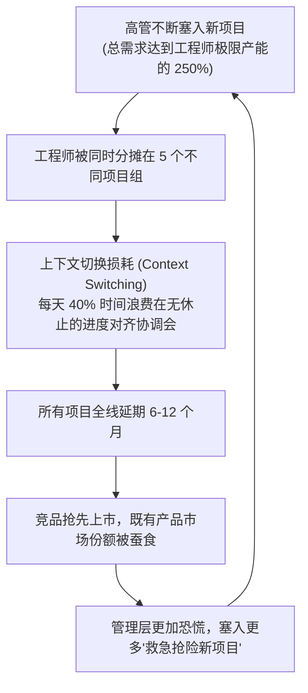

# Lec 20 研发项目组合管理与资源平衡 (Aggregate Project Planning: Le Petit Chef)

> MIT 15.350 · Managing Technological Innovation · 模块四：创新价值榨取：期权、组合与平台

## TL;DR

- 企业研发瘫痪的最普遍原因不是资金不足，而是陷入“项目过度承诺综合征（Overcommitment）”。
- 惠尔赖特与克拉克（Wheelwright & Clark）的总量项目规划模型（Aggregate Project Plan, APP）是平衡研发产能的黄金标尺。
- 法国家电经典案例 Le Petit Chef 展现了研发管线严重超载 250% 导致所有项目集体延期的惨烈灾难。
- 研发高管的核心职责不是批准新项目，而是依据工程师人时产能硬约束，勇敢行使关停否决权。

## 研发管线的“高速公路塞车定律”

在许多高科技企业中，CEO 和市场总监总是有源源不断的新创意，每个项目在汇报时都声称“拥有数千万潜在营收”。于是高管层将所有项目全部立项塞入研发管道，其后果就如同将超出通行能力 3 倍的车辆塞上高速公路——**所有车道彻底瘫痪，没有一辆车能准时到达终点**：

::: definition 总量项目计划 (Aggregate Project Plan, APP)
一种系统化匹配企业研发人力资源供给（Available Engineering Hours）与各类别研发项目总需求（Project Demands）的宏观平衡框架。它强制企业对各类项目的资源配比划定红线，坚决不超载立项。
:::

## 经典实操案例：Le Petit Chef 的研发大塞车

课堂研讨了法国知名高档高端厨房家电制造商 **Le Petit Chef** 的真实危机：
- **危机现象**：公司新任命的技术副总裁 Gagne 发现，研发部门士气极度低落，过去 3 年内所有关键换代电磁炉和智能料理机全线延期，财务报表严重恶化；
- **产能严密核算（Capacity Calculation）**：
  - 研发部拥有 25 名高级工程师，扣除休假与日常支持，全年可用研发工时为 40,000 人时；
  - 汇总高管层目前正在推进的 14 个立项项目，实际所需工时高达 **98,500 人时**（产能超载率达 246%）；
- **残酷的断舍离决策**：Gagne 必须在董事会年度预算会上承受各事业部老总的愤怒质问，大刀阔斧关停 8 个平庸的改进型项目，将全部精英力量集中投向 2 个旗舰平台级项目与 4 个高确定性衍生项目，一举让研发速度提升了 200%。

::: insight
“对平庸项目的每一次拒绝，都是对伟大产品的一张赞成票。”研发项目组合管理的真谛，是用**工程工时的物理硬约束**击碎管理层贪婪的无限幻想。
:::

::: pitfall
在资源测算时轻信“工程师可以每周工作 80 小时”的过度加班假设。长期的恶性加班只会换来核心代码架构的百密一疏、测试 Bug 几何级暴增以及核心技术骨干成批跳槽。
:::
