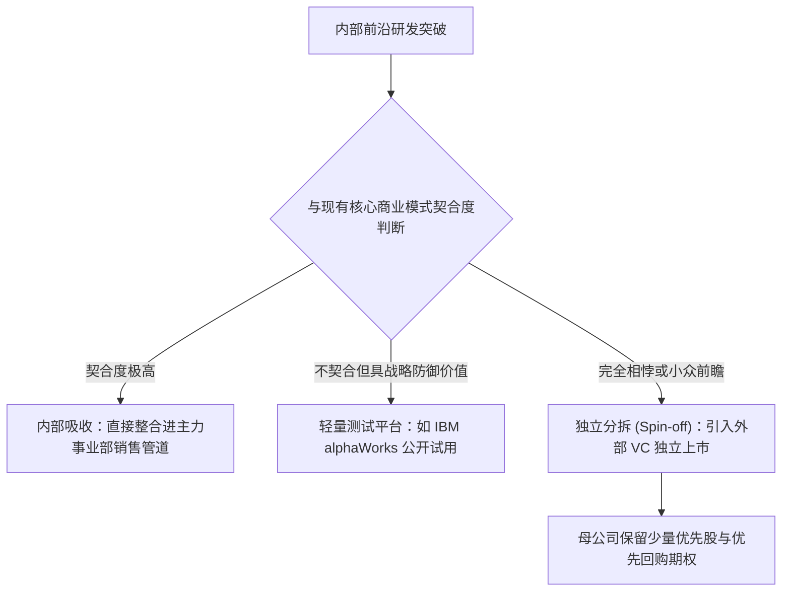

# Lec 22 企业风险投资与内部孵化分拆 (Corporate Venturing and Spinouts: IBM alphaWorks and Xerox Inxight)

> MIT 15.350 · Managing Technological Innovation · 模块五：创新自我更新：驾驭颠覆

## TL;DR

- 当内部孵化出的前沿技术与公司现有核心业务模式冲突时，分拆为独立衍生企业（Spin-off）是最优解脱。
- 企业风险投资（Corporate Venture Capital, CVC）必须明确战略目标（获取技术窗口）与财务回报的权重。
- IBM alphaWorks 平台开创了向全球开发者提前公开实验室前瞻代码并快速收集市场反馈的轻量孵化模型。
- 施乐 Inxight 分拆案例揭示：母公司股权控制过多与过度干涉会彻底扼杀分拆实体的创业狼性。

## 企业内部创新的三大归宿

当大公司内部孕育出一项极具前景、但与其现有最赚钱产品线产生竞争或商业模式不匹配的技术构想时，管理层通常有三种处置方式：

::: definition 企业衍生分拆公司 (Corporate Spin-off)
母公司将内部特定的技术专利、核心研发团队与初始资产打包剥离，设立具有完全独立法人资格的新公司，引入外部专业风险投资机构进行市场化治理与股权稀释激励。
:::

## 经典对立案例复盘：IBM alphaWorks vs. 施乐 Inxight

课堂深入研讨了跨国巨头在技术分拆与孵化上的成败对比：

### 1. IBM alphaWorks 的轻量敏捷创新
- 针对实验室每天产出的上百项 Java、XML 前沿中间件，IBM 设立了 **alphaWorks 极客社区**；
- 研发人员只需将代码打包上传，全球数十万外部开发者免费下载试用 90 天，在论坛提交实测反馈；
- IBM 根据下载热度与用户评价，将真正受欢迎的成熟代码直接打包转入 Websphere 核心商业套件，用极低成本完成了早期市场验证。

### 2. 施乐 Inxight 的分拆教训
- 施乐帕克研究中心开发出了革命性的超双曲树数据可视化分析系统 **Inxight**；
- 施乐高管为了“保护股东利益”，在分拆时坚持保留 80% 以上的绝对控股权，并派遣大量施乐官僚进驻董事会；
- 外部顶级硅谷 VC 由于无法获得足够股权激励与管理主导权，拒绝注资支持；Inxight 创始人由于缺乏市场化期权激励，最终核心研发骨干大批流失，项目失去生机。

::: insight
母公司决定分拆一项技术时，必须拥有**放手的胸襟与勇气**。如果母公司像对待亲生部门一样对分拆实体指手画脚，甚至强制要求其采购母公司昂贵的内部 IT 和差旅服务，分拆实体将同时承受大企业的官僚重负与初创企业的生存绝境，必死无疑。
:::

::: pitfall
在分拆协议中设立针对母公司的“恶性竞业限制”。很多母公司法务出于自私，强制要求分拆公司“永远不得进入母公司可能涉足的任何软件领域”，这直接堵死了初创企业未来根据市场反馈进行战略转型（Pivot）的所有生路。
:::
