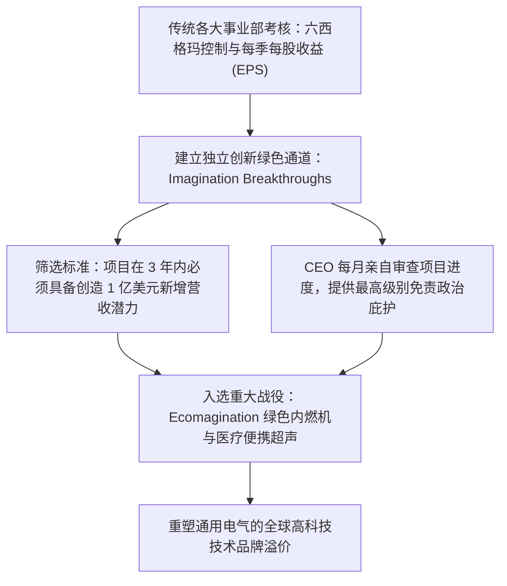

# Lec 23 内部变革与企业再造实战 (Internal Venturing: GE Imagination Breakthroughs)

> MIT 15.350 · Managing Technological Innovation · 模块五：创新自我更新：驾驭颠覆

## TL;DR

- 通用电气（GE）前 CEO 杰夫·伊梅尔特（Jeffrey Immelt）发起了著名的“想象力突破（Imagination Breakthroughs）”计划。
- 该机制强制各大传统业务单元每年必须提交能创造 1 亿美元以上新增营收的突破性创新构想。
- 经典案例混合动力机车（Hybrid Locomotive）：在传统重型柴油机车部门内部推进绿色电池混合动力的政治博弈。
- 内部变革能够成功的先决条件是最高掌舵人提供直接的政治庇护与跨越经济周期的耐心研发资本。

## 巨型工业航母的转型试验：GE 的想象力突破机制

通用电气在杰克·韦尔奇（Jack Welch）时代以严苛的六西格玛（Six Sigma）质量管理与短线财务控制闻名，但到了 21 世纪初，过度注重削减成本导致 GE 的前瞻创新能力严重退化。

新任 CEO 杰夫·伊梅尔特启动了激进的 **“想象力突破（Imagination Breakthroughs, IB）”** 计划，试图从庞大官僚体系内部重燃创业火焰：

::: definition 想象力突破项目 (Imagination Breakthrough, IB)
GE 内部的一套高阶战略孵化标签。一旦某个前沿项目被评定为 IB，它将获得母公司专属风险资金支持，其短期利润指标免受传统财务审计考核，项目负责人享有直通 CEO 办公室的特权。
:::

## 经典实操战役：绿色混合动力重型机车的内部博弈

课堂深入解构了 GE 交通运输事业部（Transportation Division）内部的惊天内战：
- **内燃机铁军的傲慢**：GE 掌握全美 70% 货运重型柴油机车市场，老牌机械工程师极其鄙视电池驱动，认为“只有重油柴油机才能拉动上万吨重的百节长列车穿越落基山脉”；
- **法规倒逼与绿色前瞻**：环保总局（EPA）排放新规日益严厉，且铁路公司对燃油成本极其敏感。创新团队提出利用超级电池回收列车制动下坡时的巨大动能，在平地释放动力，节油 15%；
- **伊梅尔特的拍板注资**：在传统事业部高管试图掐死这一耗资巨大的项目时，伊梅尔特将其列入 IB 核心项目，亲自下拨数亿美元研发专款，最终打造成全球首款通过 EPA Tier 4 认证的 Evolution 绿色机车，彻底垄断了全美下一代货运机车市场。

::: insight
在成熟巨头内部推行突破性创新，**没有 CEO 的肉身护航，项目必死无疑**。传统业务部门有成千上万种合规理由（预算不足、安全风险、客户投诉）在暗中掐死任何可能威胁自身地位的新业务。唯有最高统帅亲自将创新列为最高意志，才能强行劈开官僚部门墙。
:::

::: pitfall
把“想象力突破”变成了形式主义的 PPT 申报大赛。各大事业部为了完成集团强制下达的指标，把原本日常的微小改版包装上时髦概念充数，最终导致整个变革计划流于形式。
:::
