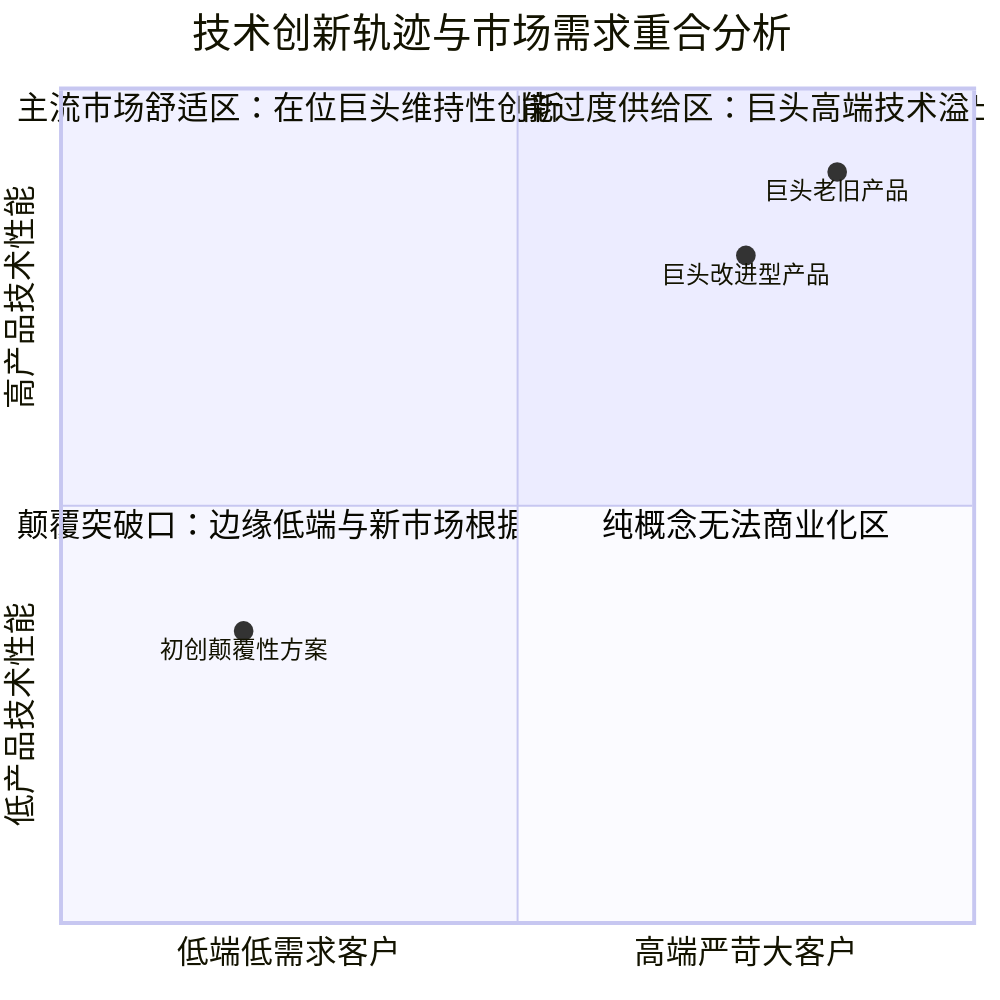

# Lec 3 颠覆性创新与市场竞争格局 (Competitive Implications of Disruption: Clayton Christensen Model)

> MIT 15.350 · Managing Technological Innovation · 模块一：技术创新的动力学基础与市场演进

## TL;DR

- 克莱顿·克里斯坦森（Clayton Christensen）区分了维持性创新（Sustaining）与颠覆性创新（Disruptive）。
- 颠覆性技术初期在主流性能指标上显著落后于既有产品，但在简易性、便携性或低价格上具备压倒性优势。
- 硬盘驱动器（HDD）与微型钢厂历史案例表明，在位企业恰恰是因为“倾听了最赚钱老客户的意见”才走向灭亡。
- 初创企业必须在主流巨头不屑一顾的低端市场或新市场建立根据地，再沿改进轨迹实现自下而上的逆袭。

## 克氏颠覆性创新模型的几何解构

大众媒体常常滥用“颠覆（Disruption）”一词，将其等同于任何高科技突破。克里斯坦森给出了严格的学术界定：



::: definition 颠覆性创新 (Disruptive Innovation)
并非提供更高端的技术，而是引入一种在主流市场评估标准下初期性能明显较差，但具备**更便宜、更简单、更小巧、更易用**特征的产品，首先在低端消费者或非主流消费者中生根发芽，随后以超越市场需求提升斜率的速度持续进化，最终吞噬整个主流市场的动态过程。
:::

## 经典行业实证：硬盘驱动器（HDD）产业的大屠杀

硬盘产业为颠覆性创新理论提供了最严密的量化实证证据。在计算机发展史上，从 14 英寸到 8 英寸、再到 5.25 英寸、3.5 英寸和 2.5 英寸，每一次物理尺寸的缩小都不是由重大基础科学发现驱动的，而是由下游应用场景的重构所催生。每一代新架构出现时，其容量和单位存储成本在老一代客户眼中都是不可接受的玩具。

正是由于在位行业巨头拥有最健全的财务管理、最严密的市场调研和最优秀的客户沟通流程，它们才会严格按照最赚钱的大客户的意见，将所有资源倾斜到老架构的性能微调上。这种完全符合教科书级“优秀管理”的行为，反而构成了最致命的组织盲区。当新兴进入者在新兴市场中通过快速迭代使新架构的性能突破主流门槛时，在位巨头已经在技术、渠道和供应链上被不可逆转地锁定在即将沉没的旧大陆上。

克里斯坦森在《创新者的窘境》中对 1970–1990 年代全球计算机硬盘驱动器行业进行了详尽的实证解构：

```text
[硬盘行业的代际颠覆血泪史]
1. 14 英寸驱动器 (统治大型主机市场):
   - 巨头 Control Data 牢牢掌控 IBM 等大型机客户，单盘容量极大但体积笨重。
2. 8 英寸驱动器诞生:
   - 容量仅为 14 英寸的三分之一，单位兆字节成本高昂，大型机客户断然拒绝采购；
   - 创业公司转而卖给新兴的“小型机（Minicomputer, 如 DEC）”厂商；
   - 8 英寸技术性能快速进化，几年内达到大型机容量门槛，14 英寸巨头全军覆没。
3. 5.25 英寸驱动器诞生:
   - 8 英寸巨头再次重蹈覆辙，认为其容量太小；新创企业卖给初生的个人台式电脑（PC）；
   - 5.25 英寸再次反噬并埋葬了 8 英寸巨头。
4. 3.5 英寸驱动器诞生:
   - 5.25 英寸厂商再次嘲笑其容量太小；Conner Peripherals 锁定便携笔记本电脑，最终称霸全行业。
```

## 为什么优秀管理反而是致命毒药？

在位巨头之所以被颠覆，不是因为管理层愚蠢懈怠，而是因为管理层**做出了教科书般理性的管理决策**：
1. **老客户的利润绑架**：最赚钱的华尔街金融大客户要求更稳定、容量更大的高端产品，并为此支付 50% 丰厚毛利；颠覆性产品毛利仅 15%，理性的资源配置机制必然将研发预算砍向高端项目。
2. **小市场无法解决大公司的增长渴望**：一家年营收 100 亿美元的在位巨头，每年必须创造 10 亿美元新增业务才能满足股市 10% 增长预期；而初生的颠覆性市场首年容量可能仅有区区 1000 万美元，在大公司财报中微不足道。

::: insight
颠覆性创新的本质是**价值网（Value Network）的错位迁移**。初创企业想要战胜巨头，绝对不要在巨头的主场与对方比拼其深耕数十年的传统性能指标；必须在巨头“看不懂、看不起、赚不到钱”的非主流边缘地带悄然筑巢。
:::

::: pitfall
在低端颠覆初期直接向在位巨头的主流核心客户发起正面强攻。巨头在主流战场拥有无比深厚的供应链控制力和财务现金储备，正面硬碰硬只会招致灭顶之灾。
:::
