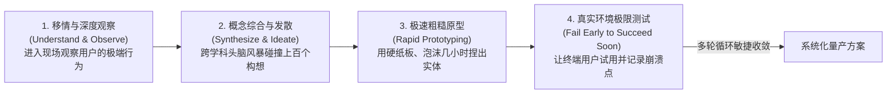

# Lec 4 系统化创新流程与设计思维 (Systematizing Innovation: IDEO Design Process and Brainstorming)

> MIT 15.350 · Managing Technological Innovation · 模块二：创新探索：实验、迭代与领先用户

## TL;DR

- 创新不是不可捉摸的天才灵感，而是可以通过严密的组织机制与流程设计系统化复现的工业体系。
- 知名设计机构 IDEO 开创的设计思维涵盖移情观察、跨界发散、粗糙原型与现场快速验证。
- 头脑风暴（Brainstorming）必须恪守七大严格纪律，严禁在发散期引入批判性评判。
- BIG 玩具发明系统案例表明，机制化的创意提炼管道能帮助组织打破“创新荒漠”困局。

## 创新能否被系统化制造？IDEO 的方法论革命

传统企业往往把新产品开发的希望寄托在少数明星首席科学家或孤僻设计师身上。全球顶尖设计创新咨询公司 IDEO 彻底打破了这一神话，证明**创新是一种可以通过组织流程系统化生产的流水线**：



::: definition 设计思维 (Design Thinking)
一种以人为本、由同理心驱动的解决复杂问题的系统化框架。它整合了用户的真实需求（Desirability）、技术实现的可行性（Feasibility）以及商业模式的可持续性（Viability）三大要素。
:::

## 头脑风暴（Brainstorming）的七大刚性铁律

创意的产生从来不是偶发的神秘灵感，而是可以通过严密的规则约束与心理安全场域构建来批量激发的工程活动。许多传统企业召开的所谓研讨会之所以效率低下，根本原因在于参会者在提出想法的同时暗含着对自身专业形象的担忧，以及对他人批评的本能戒备。这种自我审查机制使得大多数人只敢提出最平庸、最安全、最毫无突破的保守建议。

IDEO 创立的头脑风暴法通过一系列非对称的行为规范，人为将“创意发散（Divergence）”与“理性收敛（Convergence）”严格分离在不同的时空节点。在发散阶段彻底剥离批评与审查，甚至将荒诞不经视为最具价值的刺激源，正是为了打破常规逻辑思考的重力场，诱发跨学科团队在潜意识层面的隐喻联想与概念重组。

IDEO 办公区墙上镌刻的七大风暴原则，是确保创意发散效率的宪法：

```text
[IDEO 头脑风暴七大纪律]
1. 延迟评判 (Defer Judgment): 发散期间绝对严禁说"这行不通"、"预算不够"或"领导不会同意"
2. 追求数量 (Go for Quantity): 1 小时内目标产生 100 个以上构想，数量是质量的母体
3. 鼓励奇思妙想 (Encourage Wild Ideas): 最荒谬的想法往往孕育着颠覆性突破的萌芽
4. 建立在他人构想之上 (Build on the Ideas of Others): 运用"是的，而且..."(Yes, and...)顺藤摸瓜
5. 保持焦点 (Stay Focused on the Topic): 设定清晰具体的挑战题目，严防漫无边际的闲聊跑题
6. 一次一人发言 (One Conversation at a Time): 保持对分享者的倾听与尊重，杜绝分头窃窃私语
7. 视觉化表达 (Be Visual): 大量使用白板彩笔与便签纸，画出粗糙草图比纯口述生动十倍
```

## 经典实战案例：BIG 玩具公司的创意机器

课堂剖析了波士顿创新集团（Boston Innovation Group, BIG）的玩具系统化发明模型：
- **行业困境**：美泰（Mattel）、孩之宝（Hasbro）等大型跨国玩具巨头年年抱怨“行业遭遇创新枯竭”，依赖老旧 IP 苟延残喘；
- **BIG 的系统化反击**：建立了一套工业化的发明流水线，从全国招募跨界极客、魔术师、木匠与程序员，每周设立结构化的概念评审阶段门径，每年稳定向巨头输出数十款畅销全球的爆款玩具授权。

::: insight
“如果不能在一小时内用硬纸板和透明胶带捏出一个粗糙的原型，你就还没有真正想清楚这个产品。”实物原型能够打破团队内部关于抽象语义的无休止争论，让工程师和市场人员围在桌子前对着具体实物寻找答案。
:::

::: pitfall
在头脑风暴的第一分钟就由资深权威领导定下基调。当高级副总裁率先发表观点后，房间内的所有下属都会不自觉地沿着领导的思维框架迎合，头脑风暴瞬间退化为无意义的点头大会。
:::
