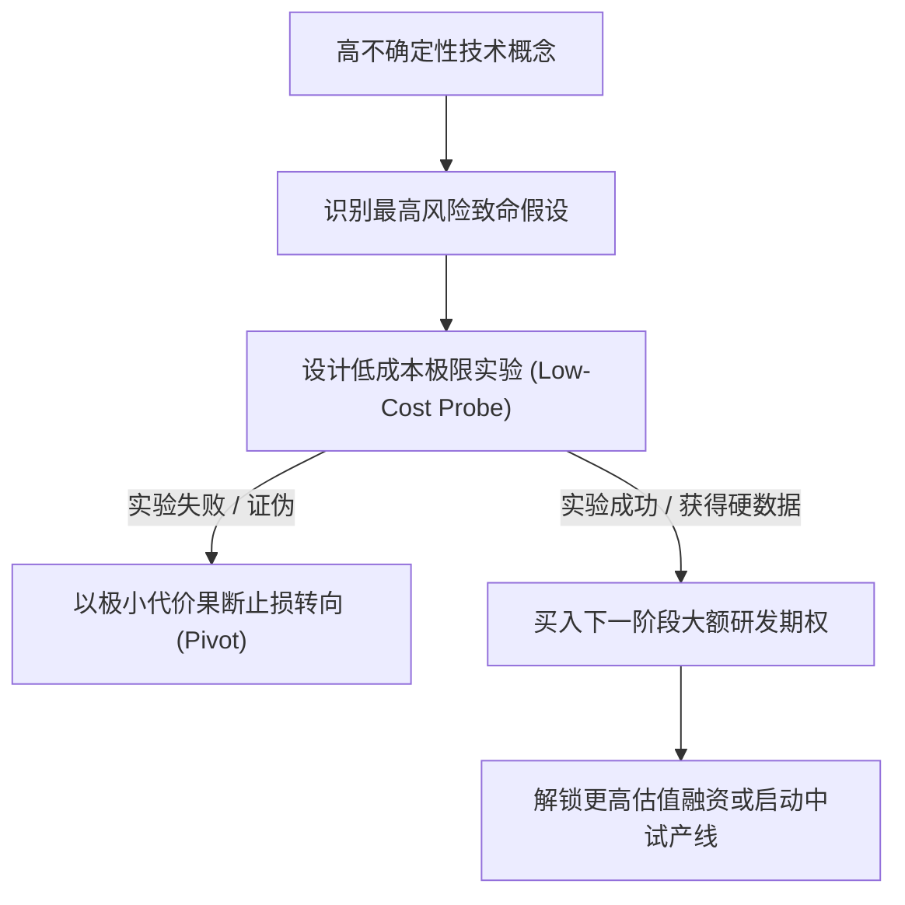

# Lec 5 实验策略与风险边界界定 (Scoping Technology and Experimentation: Advanced Inhalation Research)

> MIT 15.350 · Managing Technological Innovation · 模块二：创新探索：实验、迭代与领先用户

## TL;DR

- 创新研发不是赌徒式的全盘押注，而是一连串精心设计的“买入信息以消除不确定性”的实验期权。
- 实验策略的核心是：用最低的资金与时间成本，优先证伪那些最具破坏力的技术与商业假设。
- 经典案例 Advanced Inhalation Research (AIR) 展现了生物医药企业如何通过模块化实验分阶段锁定大额融资。
- 区分探索性实验（Exploratory）与确认性实验（Confirmatory），避免过早陷入高成本精密验证。

## 研发管理中的“实验经济学”模型

在面对颠覆性前沿技术时，管理层最大的困惑是：在未来结果高度未知的状态下，如何分配宝贵的研发资金？Fiona Murray 指出，现代研发管理将每一次实验视为一次金融期权投资：

::: definition 实验效率 (Experimentation Efficiency)
每次研发实验所产生的信息价值（消减的不确定性方差 $\Delta \sigma^2$）除以该实验消耗的综合资源（资金 $C$ 与时间 $T$）：
$$	ext{Efficiency} = rac{\Delta 	ext{Uncertainty}}{C 	imes T}$$
顶尖的技术管理者永远追求在单位时间和资金下，最大限度地榨干技术风险。
:::

## 经典实战案例剖析：AIR 气溶胶吸入给药的实验战役

MIT 孵化的高科技生物医药初创企业 **Advanced Inhalation Research (AIR)** 提供了一堂经典的实验战略大师课：

### 1. 核心技术构想
麻省理工教授 Robert Langer 与 David Edwards 发现，采用大颗粒、低密度的“多孔大颗粒（Large Porous Particles）”微球，能够克服人体肺部巨噬细胞的吞噬，将蛋白质药物（如胰岛素）高效送入深肺毛细血管吸收，从而有望终结糖尿病患者每日注射胰岛素的痛苦。

### 2. 实验优先级的严密编排
创始人并未一开始就耗费数千万美元直接启动昂贵的 FDA 三期人体临床试验，而是精巧设计了四级实验漏斗：
- **实验一（物理特性验证，花费 $10,000）**：在实验室证明多孔微球在喷雾干燥器中不会粘连结块；
- **实验二（体外空气动力学测试，花费 $50,000）**：在玻璃撞击器上验证微球能否随气流深入最狭窄的气道；
- **实验三（动物体内药代动力学，花费 $200,000）**：在大鼠与灵长类动物模型中，测定血液中胰岛素浓度的平稳释放曲线；
- **商业化套现**：仅用不到 18 个月和数百万美元完成上述关键实验验证后，AIR 以 4.3 亿美元的惊人估值被跨国制药巨头 Alkermes 现金并购。

::: insight
优秀的实验设计必须具有**不对称性**——如果实验失败，损失的仅仅是几万块钱的试剂费；但如果实验成功，所带来的确定性将直接让公司的估值和战略期权倍增十倍。
:::

::: pitfall
在缺乏明确假设的情况下盲目展开“实验”。很多研发团队为了逃避严肃的逻辑思考，习惯于漫无目的地在实验室更换配方打样，把毫无假说指导的“玩泥巴”误当成科学探索。
:::
