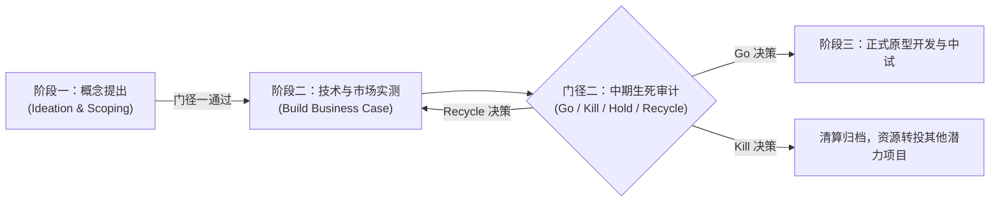

# Lec 6 创新项目中期实战评审 (Innovation Project Workshop: Midterm Review and Milestones)

> MIT 15.350 · Managing Technological Innovation · 模块二：创新探索：实验、迭代与领先用户

## TL;DR

- 中期实战评审是研发项目跨越阶段门径（Stage-Gate）的强制性治理节点。
- 评审委员会从技术可行性、市场引力、知识产权排查与单位经济模型四大维度进行无情审计。
- 设立杀手级指标（Killer Metrics），当关键实验数据证伪核心假设时，坚决终止项目释放资源。
- 跨学科学生团队在真实工业界导师面前展示技术路线图，完成方案的自我纠偏与重构。

## 阶段门径（Stage-Gate）流程在中期的严密把关

在创新的前沿探索中，最危险的组织倾向是让所有项目在惯性中无限期拖延。15.350 课程在中期设立了强制性的门径评审（Gate 2 Review）：

::: definition 门径评审四维裁决机制 (Gate Decisions)
- **Go (继续推进)**：所有关键里程碑指标完全达标，批准进入下一阶段大额预算分配；
- **Kill (终止清算)**：核心技术原理在物理或经济上被判定不可行，立刻终止项目，对技术沉淀进行归档，人员重组；
- **Hold (暂缓搁置)**：方向具备潜力，但当前外部市场或互补供应链尚不成熟，降低预算进入休眠等待窗口；
- **Recycle (返工重构)**：假设逻辑存在盲区，退回上一阶段补充针对性一手调研。
:::

## 中期项目审计的标准记分卡

学生团队必须在评审席前提交一份详尽的量化审计报告，接受教授与产业投资人的穿透式盘问：

| 审计维度 | 权重 | 核心质询焦点与达标底线 |
| :--- | :--- | :--- |
| **技术边界硬度 (Technical Feasibility)** | 30% | 是否在真实工业环境下跑通了最小功能原型？还是仅仅依赖理想模型仿真？ |
| **真实痛点迫切度 (Customer Pain Severity)** | 25% | 团队是否亲自访谈了至少 15 家行业客户？客户是否表达了明确的付费意愿？ |
| **专利自由实施检索 (FTO & IP Defensibility)** | 25% | 是否进行了全行业专利侵权排查（Freedom to Operate）？核心构想是否触碰巨头现有专利墙？ |
| **研发资源与跑道匹配 (Resource & Timeline)** | 20% | 团队目前的技能构成能否在预定预算与周期内完成原型？关键外部外协风险是否可控？ |

::: insight
一个成熟的研发组织，其标志**不是看它批准了多少项目，而是看它能否在门径评审中理性、冷静地杀死那些平庸或注定失败的项目**。杀死一个没有前途的坏项目，等于为公司挽救了数百万美元的宝贵资金，并释放了最优秀工程师去攻坚更有希望的主航道。
:::

::: pitfall
在评审中采用“折衷妥协政治”。高管们因为顾及发起人面子而勉强给出“附条件通过”，导致一个在底层就存在致命缺陷的项目继续苟延残喘，最终耗费数倍代价在量产前夕灾难性溃败。
:::
