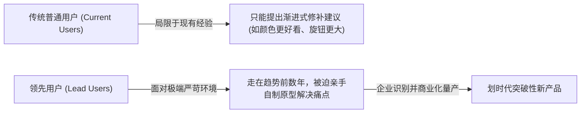

# Lec 8 领先用户调研与市场实验 (Experimenting with Markets: Lead User Innovation at 3M)

> MIT 15.350 · Managing Technological Innovation · 模块二：创新探索：实验、迭代与领先用户

## TL;DR

- 传统市场调研（焦点小组、问卷）只能捕捉主流用户对现有方案的微小改良，无法产生突破性创新。
- 领先用户（Lead Users）处于市场重大趋势的最前沿，在现有市场方案出现数月或数年前就体验到了极端需求。
- 3M 医疗外科手术事业部通过领先用户方法论，成功研发出具备抗菌透气功能的革命性手术敷料。
- 突破性创新的源头往往来自其他极端行业（如兽医战地救护、特种竞技运动），而非本行业内部。

## 传统市场调研的失灵与领先用户理论

麻省理工学院教授埃里克·冯·希佩尔（Eric von Hippel）在开创性研究中指出，传统以制造企业为中心（Manufacturer-Centric）的市场调研工具在颠覆性创新面前全面失效：

::: definition 领先用户 (Lead Users) 的两大核心判定标准
1. **处于重大市场趋势的最前沿**：他们在普通大众感知到该需求的数月甚至数年前，就已经遭受到了极端剧烈的痛点折磨；
2. **拥有强烈的自发解决意愿**：由于市场上根本买不到现成方案，他们往往利用手头材料自己拼凑、改装出了可用的初代原型。
:::

## 经典行业案例：3M 医疗外科事业部的领先用户破局

课堂深入研讨了全球公认的“创新温床” **3M 公司** 医疗外科部门的真实转型战役：

### 1. 危机与挑战
1990 年代，3M 传统医用胶带与消毒敷料陷入同质化价格战，利润率暴跌。部门高管意识到，靠传统的医院护士问卷调查无法产生突破性产品。

### 2. 跨行业猎寻领先用户（Lead User Search）
3M 团队并未停留在普通三甲医院的外科手术室，而是将搜索雷达投向了全社会面临“极端创口无菌要求与剧烈组织牵拉”的特种边缘场景：
- **兽医战地手术**：兽医需要在泥泞、充满细菌的农场或野外给剧烈挣扎的烈马做开腹手术，现有医用敷料一碰就脱落；
- **好莱坞特技特效化妆**：特效演员要在暴雨、强光和剧烈流汗下保持硅胶假皮紧密贴合且不发生过敏感染。

### 3. 突破性成果孵化
通过与战地兽医和特技团队的深度访谈，3M 提炼出了独特的透气水胶体与长效抑菌聚合物技术，研发出革命性的防感染手术保护膜，使得术后感染率骤降 75%，开辟了数十亿美元的全新蓝海市场。

::: insight
寻找领先用户的精髓在于**跨越行业边界的类比思考（Analogous Market Thinking）**。如果你要设计一款下一代高可靠性的汽车制动防抱死系统，不要去问普通家用轿车车主，而应该去拜访每天在极端高温、颠簸降落的军用战斗机着舰飞行员。
:::

::: pitfall
把“高频重度用户”误当成“领先用户”。一个每天使用两小时现有软件的重度老用户，往往是既有操作习惯的最顽固死守者；真正的领先用户是那些因为现有软件功能严重受限，自己在旁边写脚本插件外挂打补丁的极客。
:::
