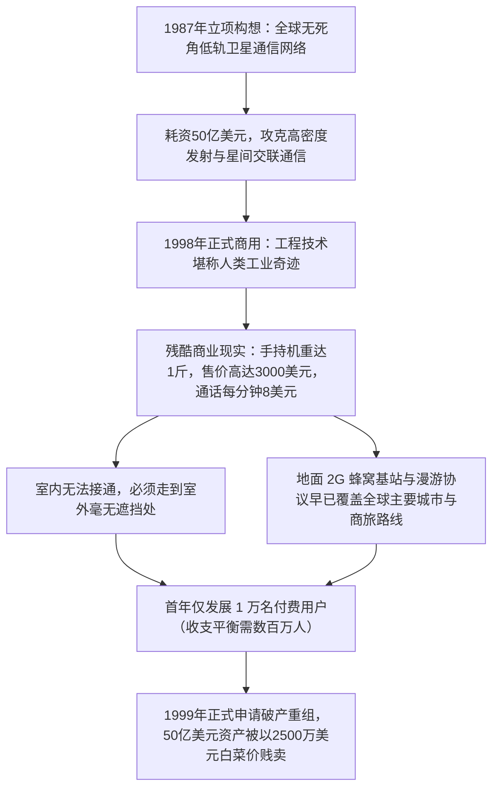

# Lec 9 世纪创新滑铁卢案例反思 (Capstone Failure Analysis: The $5B Iridium Satellite Disaster)

> MIT 15.350 · Managing Technological Innovation · 模块二：创新探索：实验、迭代与领先用户

## TL;DR

- 摩托罗拉铱星系统（Iridium）耗资 50 亿美元发射 66 颗低轨卫星，堪称人类历史上最壮丽的工程奇迹与最惨烈的商业滑铁卢。
- 铱星的悲剧根源于“技术指标的傲慢”：工程上无懈可击，却在商业上彻底脱离了消费者的真实需求与定价承受力。
- 地面蜂窝通信网络（GSM/CDMA）与国际漫游协议的超预期高速覆盖，在铱星漫长的 12 年研发周期中悄然完成了降维超越。
- 沉没成本谬误与跨国巨型联盟的官僚刚性，使得项目在多次出现明确商业死亡信号后依然无法紧急制动。

## 铱星项目（Iridium）：工程神话如何沦为商业废墟？

1987 年，摩托罗拉工程师构想了一个雄心勃勃的全球通信计划：通过在低地球轨道部署 66 颗具备星间激光链路的卫星，实现“无论在撒哈拉沙漠深处还是太平洋中央，都能手持一部手机通达全球”。

::: definition 技术傲慢驱动型失败 (Technology-Push Hubris)
当一家具备超强工程实力的巨头企业被自身的技术浪漫主义所催眠，将所有资源倾注于攻克前所未有的工程技术难题，却对外部替代技术演进、产品便携性、室内穿透力及用户对价格的敏感度视而不见时，所必然导致的灭顶之灾。
:::

## 导致铱星崩盘的四大深层死因

Fiona Murray 在本讲带领全班进行了深入的尸检复盘：

1. **研发周期与外部技术环境的严重脱节**：
   - 铱星研发周期长达 12 年（1987–1999）。在立项时，全球地面移动基站极少；但当卫星升空时，全球电信运营商已联手织就了无缝覆盖各大都市与机场的 GSM 蜂窝漫游网络，普通人根本不需要卫星通信。
2. **不可调和的用户体验缺陷**：
   - 卫星高频信号无法穿透水泥墙壁。商务精英在豪华酒店房间、机场贵宾室或出租车内根本无法使用，必须跑到大楼空旷天台上拉出长长的天线，体验极其滑稽与痛苦。
3. **沉没成本与财团治理绑架**：
   - 铱星引入了来自日本、沙特、欧洲等全球数十家电信财团和政府主权基金。复杂的跨国财团治理机制使得任何试图缩减规模、调整产品形态的理性声音都会被“誓死捍卫国家信誉”的高管政治所碾压。

::: insight
“没有人在乎你的卫星飞得有多高，大家只在乎手机能不能放进口袋、在卧室里能不能打通电话。”技术创新的价值**永远存在于终端用户的体验闭环中，绝不存在于卫星的机械图纸里**。
:::

::: pitfall
在研发项目漫长的推进过程中拒绝进行“外部技术基准重置（Dynamic Baseline Review）”。每隔半年，团队必须重新审视外部竞争替代方案的演进速度；如果外部低成本技术的进步斜率已经超越了你的方案，必须立刻按下止损红灯。
:::
