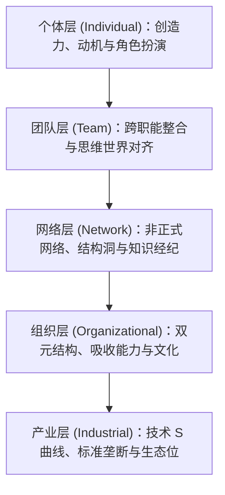

# Lec 1 创新管理导论与全球化组织知识共享 (Introduction to Managing Innovation & Global Knowledge Sharing)

> MIT Sloan School of Management · 15.351 Managing the Innovation Process · Prof. Jonathon Cummings

## TL;DR

- 创新不是单点灵感迸发，而是跨越个体、团队、组织与产业五层维度的知识生产与扩散网络。
- 全球化分布式工作群组面临“专业隔阂”与“地理时区分散”的双重认知负荷。
- 研发项目不仅生产物理原型或代码，更在此过程中沉淀可复用的组织吸收能力与隐性知识。
- 跨国技术升级必须在局部客户适配与底层公共平台架构之间建立动态解耦与复用机制。

## 创新的多层次分析模型 / Five Levels of Innovation Analysis

现代创新管理研究表明，单凭技术天才或偶然机遇无法解释企业的持续突破。麻省理工学院斯隆管理学院教授 Jonathon Cummings 在 15.351 课程中确立了“五层分析框架”（Five Levels of Analysis），为解构复杂的技术创新过程提供了严谨的透镜：

| 分析维度 | 核心研究问题 | 关键机制与代表理论 | 典型挑战与失效模式 |
| :--- | :--- | :--- | :--- |
| **个体维度 (Individual)** | 创新者的内在心理动力与角色分工是什么？ | 创造力三元模型（Amabile）、技术创新五大关键角色（Roberts） | 外在奖金挤出内在动机、专业技术人员职业倦怠 |
| **团队维度 (Team)** | 多学科团队如何跨越认知壁垒实现协同交付？ | 重量级项目团队（Clark & Wheelwright）、思维世界隔阂（Dougherty） | 部门深井（Silos）、沟通漏斗失真、职能部门自利防御 |
| **网络维度 (Network)** | 信息与信任如何在正式与非正式关系网中流动？ | 结构洞理论（Burt）、非正式网络图谱（Krackhardt）、弱连带优势 | 信息茧房、关键人员离职导致的结构性网络断裂 |
| **组织维度 (Organizational)** | 企业如何平衡既有业务运营与前沿技术探索？ | 吸收能力（Cohen & Levinthal）、双元组织模型（O'Reilly & Tushman） | 核心刚性（Core Rigidities）、短期财务考核抹杀探索 |
| **产业维度 (Industrial)** | 外部技术演进与行业标准如何重塑竞争格局？ | 颠覆性创新与技术 S 曲线（Christensen）、标准战争与锁定效应 | 路径依赖（Path Dependence）、未能识别非共识技术范式 |

创新的复杂性恰恰在于，这五层并非相互隔离，而是存在高频的交互与传导。例如，个体工程师的技术洞察能否被采纳，取决于其在非正式网络中的中介中心性；而整个团队的原型试错成果，又受制于母体组织的资源分配机制与外部行业技术轨道的成熟度。

## 全球化研发工作群组实证 / Work Groups and Knowledge Sharing

在全球化竞争格局下，跨国跨区域的技术协作已经从可选项转变为生存必需。然而，地理分散带来的并不只有低成本劳动力，更伴随着严重的认知损耗与沟通障碍。

::: example 跨国研发协作实录：无线网络升级与 DSP 芯片协同
在 Cummings 教授对全球电信设备巨头的实证追踪中，两类典型的分布式协作展现了截然不同的知识共享特征：
1. **无线网络基础设施升级项目（Wireless Network Upgrade）**：
   - **团队构成**：由中国两个城市的 10 名工程师（涵盖项目管理、质量保证与系统工程）组成。
   - **协作模式**：团队成员频繁从异地营销部门调取现网运营数据，组织多轮跨职能客户会议，针对一线电信运营商的复杂机房环境展开定制重构。由于处于相同时区且共享工程语言，团队在隐性知识传递上的摩擦成本相对较低。
2. **数字信号处理器芯片开发（DSP Chip Development）**：
   - **团队构成**：跨越美国、以色列和新加坡三个大洲的 9 名专家，涵盖 EDA 计算机辅助设计、底层驱动应用以及半导体硅片工程。
   - **协作模式**：团队不得不借用母公司其他业务群组的历史代码与模块化图纸，克服 12 小时的昼夜颠倒时差，通过标准接口协议与详尽的代码注释实现接力开发。最终，团队将研发成果撰写成内部专利与技术论文，在全公司技术大会上公开分享。
:::

上述案例清晰地展现了现代知识工作的双重属性：**既是高度专业化的技术分工，又是高度不确定的社会化沟通过程**。

::: definition 隐性知识与粘性信息 (Tacit Knowledge & Sticky Information)
- **隐性知识 (Tacit Knowledge)**：难以用言语、公式或规范图纸直接表达的实操经验、工程直觉与系统手感。此类知识通常只能通过师徒带教、联合调试与深度共同体（Community of Practice）进行低速迁移。
- **粘性信息 (Sticky Information)**：信息在转让、解释与被受让方消化吸收过程中所产生的高昂转移成本。由于各分支机构所处的技术环境与客户语境差异，信息往往紧紧依附在原始产生点，强行远距离传输会导致严重的语义失真。
:::

## 全球团队设立的动因与隐藏代价

企业组建跨地域研发群组的初衷往往非常清晰，但在现实执行中却常常遭遇意料之外的阻力：

企业管理者往往基于人力单价与纸面工时来评估外包与异地研发的收益，却忽略了“沟通协调税（Coordination Tax）”。当系统架构不够清晰、模块边界存在大量未定义的耦合时，异地团队之间的返工与相互推诿会迅速吞噬掉人力成本节省的每一分利润。

::: insight 组织架构与技术架构的镜像法则 (Conway's Law)
康威定律指出：“设计系统的组织，其产生的设计等同于组织内部沟通结构的复制。”在全球分布式研发中，如果团队之间的沟通存在断裂与时差，其开发出的软件或硬件系统必然在模块边界处出现大量的兼容性故障与逻辑冗余。卓越的研发管理不是强求异地团队 24 小时在线开会，而是通过精准的**产品架构模块化**（Modular Architecture），在物理层与逻辑层彻底解耦，赋予属地团队闭环试错的自主权。
:::

::: pitfall 远程协作中的“沉默假设”陷阱
分布式团队成员在跨时空沟通时，往往容易将对方的“未回复”或“沉默”解释为赞同、冷漠或不称职，而忽略了时区延迟、语言自信心匮乏或本地紧急排产等客观现实。这种归因偏差极易摧毁脆弱的组织信任，导致各据点演变为防御性的信息孤岛。
:::

## 我的理解与实践洞察 / Personal Insight

从技术开发走向组织协同，任何创新项目最容易低估的都是跨领域的认知摩擦与制度惯性。在实践中，卓越的技术领袖不仅是精通参数指标的极客，更是深谙人际网络与组织动线的系统架构师。

::: insight 破除体制引力的核心法则
与其指望通过行政命令强迫不同职能部门步调一致，不如在底层建立透明的物理共享物（如可运行的粗糙手板原型、清晰的 API 契约与共担的业务损益 P&L）。用真实的物理反馈与利益一致性，替代虚妄的口头协调，这是跨越组织深井的唯一通途。
:::

## 思考题与实战研讨

1. 结合你所在的工程或业务团队，尝试从 Cummings 教授的“五层分析框架”中，挑选一个当前最严重的瓶颈维度进行因果诊断。
2. 为什么在高度模块化的成熟产品线上，异地外包开发往往能够顺利推进；而在探索突破性技术时，企业依然倾向于将顶尖专家集中在同一屋檐下办公？
3. 如果一个跨国项目必须跨越 8 个小时以上的时区差，项目主管应该建立怎样的技术协议与沟通机制，才能避免信息传递中的“滚雪球式误差”？
