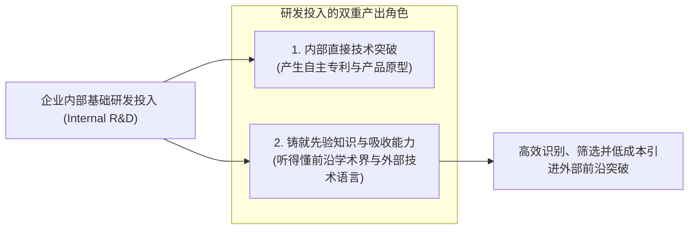
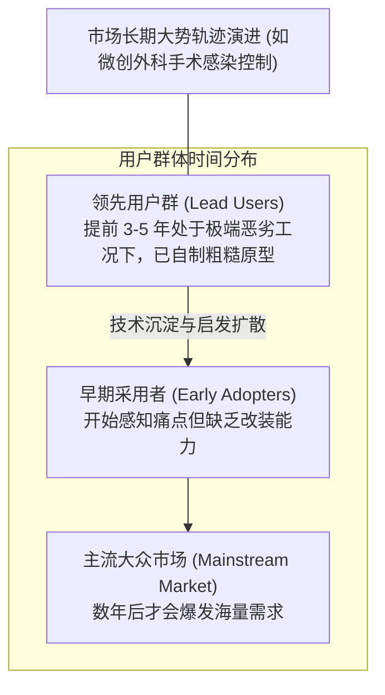

# Lec 10 组织学习与吸收能力：3M 创新体系与领先用户方法 (Organizational Learning & Absorptive Capacity: 3M)

> MIT Sloan School of Management · 15.351 Managing the Innovation Process · Prof. Jonathon Cummings

## TL;DR

- 科恩与莱文索尔（Cohen & Levinthal）吸收能力理论指出：企业基础研发的核心价值是具备“听懂与吸收外部技术”的能力。
- 埃里克·冯·希佩尔（von Hippel）领先用户（Lead Users）方法能够提前数年识别处于市场前沿的突破性需求原型。
- 3M 医疗外科事业部实证对比证明：领先用户项目产生的新产品销售额是传统市场调研项目的整整 8 倍。
- 泰尔与奥利科夫斯基（Tyre & Orlikowski）机遇窗口理论表明：组织技术适应与改良只在新设备上线的极短突发窗口期内发生。

## 吸收能力假说：企业基础研发的双重角色 / Absorptive Capacity

在传统财务管理者眼中，企业自建高成本的基础研发实验室（R&D）往往显得极其低效：很多科学家花费数年探索的成果最终并没有直接转化为当年销售的产品。既然外部大学和初创公司每天都在发布大量新技术，企业为什么不直接等到别人发明出来后“拿来主义”直接购买授权？

宾夕法尼亚大学沃顿商学院教授韦斯利·科恩（Wesley Cohen）与丹尼尔·莱文索尔（Daniel Levinthal）在 1990 年发表于《Administrative Science Quarterly》的里程碑论文中，给出了颠覆性的回答——**企业吸收能力（Absorptive Capacity）**。

::: definition 吸收能力 (Absorptive Capacity)
吸收能力是指企业**识别外部全新有价值信息、消化同化该信息、并将其创造性地应用于商业终局的能力**。科恩与莱文索尔证明：**吸收能力绝非凭空产生的天赋，而是企业内部既有先验知识（Prior Related Knowledge）的直接副产品**。
:::

### 为什么“纯买办主义”在硬科技领域必死无疑？

科恩与莱文索尔指出，如果一家公司长期砍掉自己的底层技术预研团队，它的技术吸收能力就会彻底退化：
1. **认知盲区与信息不对称**：当外部大学或初创公司研发出一项革命性的固态电池材料或新型半导体构架时，缺乏自研底蕴的企业高管甚至根本看不懂相关论文中的测试图表，无法评估其真伪与可行性，极易沦为骗子项目的买单者；
2. **知识积累的路径依赖（Path Dependence）**：学习是一个日积月累的复利过程。如果你在某一技术轨道起步阶段缺席了前五年，未来即使砸下十倍的资金，也无法在一夜之间跨越底层的工程认知断层。

## 埃里克·冯·希佩尔与领先用户方法论 / Lead User Methodology

麻省理工学院斯隆管理学院著名教授埃里克·冯·希佩尔（Eric von Hippel）在 1988 年的经典著作《创新的源泉》（*The Sources of Innovation*）中，彻底颠覆了“企业研发人员闭门发明、消费者被动买单”的传统制造商主导范式。

::: definition 领先用户 (Lead Users)
领先用户具备两大核心特征：
1. **需求前瞻性**：他们当前所面临的苛刻需求与痛点，处于未来大众市场在数月甚至数年后才会普遍显现的发展趋势的最前端；
2. **强烈的自我解决方案诉求**：因为市场上没有任何现成商业产品能够满足其极端工况，而且解决这一痛点能给他们带来巨大的实际收益，他们往往在企业介入之前，就已经在自己的车库或工作台上动手制造出了粗糙但能跑通的**物理改良原型**。
:::

## 3M 医疗外科事业部的领先用户实战奇迹

哈佛商学院案例《3M 公司的创新：医疗外科事业部的领先用户项目》（*Innovation at 3M Corp.*），是管理学史上最为详实的对比实证研究。

::: example 3M 领先用户项目 vs 传统市场调研项目的残酷决战
- **业务背景**：1990 年代末，3M 医疗外科事业部（Medical-Surgical Markets Division）深陷增长乏力泥潭。该部门生产医院手术室使用的无菌手术洞巾（Surgical Drapes）。传统产品只是阻隔病人体液渗透的普通织物，市场充斥着低价同质化竞争。
- **实验设计**：事业部同时启动了两套平行的研发路线：
  - **传统路线**：依赖传统市场调研（焦点访谈、问卷调查、拜访现有医院采购科主任）；
  - **领先用户路线**：由丽塔·赫斯菲尔德（Rita Shor）领导的跨职能团队，专门搜寻处于“极端感染风险边缘”的领先用户。
- **寻找极端环境下的领先用户**：
  团队没有去拜访明尼阿波利斯环境优良的大型三甲医院，而是将触角延伸到了两个极端领域：
  1. **发展中国家的野战医疗帐篷**：在没有空调、苍蝇横飞、甚至缺乏抗生素的极度恶劣环境下，野战军医是如何防止战伤感染的？
  2. **兽医大型动物手术**：在一身泥泞、重达半吨的母牛身上进行剖腹产手术时，兽医面临的无菌挑战比人类手术室严苛十倍！
- **惊人发现与产品突破**：
  团队在这些极端领先用户手中，发现了他们为了防止细菌在伤口边缘滋生而自行研制的“抗微生物固定薄膜”粗糙原型。3M 工程师将这一洞见与自身的粘性化学核心能力结合，发明了具备持续缓释碘伏杀菌功能的革命性手术切口薄膜（Ioban）。
- **实证财务结果震撼全公司**：
  - **传统调研团队产出**：提出了微调包装、增加防滑条等 3 个渐进式改良方案，预计五年累计销售额仅为可怜的 560 万美元；
  - **领先用户团队产出**：打造出全套抗感染手术防护全新产品线，上市五年内累计销售额突破 **1.46 亿美元（整整是传统路线的 26 倍！）**，且平均毛利率高达 65% 以上。
:::

| 维度 | 传统市场调研机制 (Focus Groups) | 冯·希佩尔领先用户方法 (Lead Users) |
| :--- | :--- | :--- |
| **调研对象** | 普通大众消费者或主流医院既有客户 | 处于极端前沿工况的专家、异端极客与跨界专家 |
| **获取的信息形态** | 对现有产品的抱怨与缺乏想象力的微小改良意见 | 解决重大痛点的可运行工程原型与非共识认知 |
| **产出产品定位** | 渐进式产品线延伸（往往引发内部同质化自相残杀） | 突破性平台级新物种，开辟全新的百亿美元蓝海 |

## 泰尔与奥利科夫斯基：技术改进的“机遇窗口”理论

麻省理工学院学者玛丽·泰尔（Mary Tyre）与万达·奥利科夫斯基（Wanda Orlikowski）在 1993 年的研究《利用组织中技术改进的机遇》中，揭示了生产车间在消化吸收新技术时的离散节拍。

::: theorem 机遇窗口假说 (Windows of Opportunity for Technical Improvement)
组织对一项新生产设备或软件系统的适应性学习与重大工艺改良，**并不是随着时间推移平滑渐进发生的，而是高度集中在系统刚安装上线的最初几周乃至几天内的“短暂机遇窗口”之中**。一旦这个窗口关闭，由于生产排产压力与员工行为习惯的固化，组织会迅速陷入技术锁死状态。
:::

管理者的核心启示在于：**在新系统上线的第一周，必须派驻最高水平的跨职能研发与工艺专家现场驻场，利用一线员工认知尚未固化的黄金窗口，倾听现场反馈并实施激进重构**。错过这个极其短暂的窗口期，任何后续的技术补救都将面临巨大的组织惯性阻力。

## 我的理解与实践洞察 / Personal Insight

从技术开发走向组织协同，任何创新项目最容易低估的都是跨领域的认知摩擦与制度惯性。在实践中，卓越的技术领袖不仅是精通参数指标的极客，更是深谙人际网络与组织动线的系统架构师。

::: insight 破除体制引力的核心法则
与其指望通过行政命令强迫不同职能部门步调一致，不如在底层建立透明的物理共享物（如可运行的粗糙手板原型、清晰的 API 契约与共担的业务损益 P&L）。用真实的物理反馈与利益一致性，替代虚妄的口头协调，这是跨越组织深井的唯一通途。
:::

## 思考题与实战研讨

1. 很多大型企业在遭遇财务危机时，最喜欢采取的缩减开支手段就是削减甚至完全解散前瞻性基础研究院。结合科恩与莱文索尔的“吸收能力”理论，解释这种行为为什么无异于“为了节省电费而拔掉全家的火警警报器”？
2. 如果你的硬件初创公司正在研发一款面向下一代城市极限越野场景的电动山地车，根据埃里克·冯·希佩尔的理论，你应该去哪里寻找真正的“领先用户”？你会从哪些非典型场景（如滑雪特技、军警突击车）中寻找灵感？
3. 为什么传统的市场调研问卷（例如问用户“你希望下一代手机拥有什么功能”）往往只能得到“电池更大、拍照更清晰、价格更便宜”等平庸回答，而永远问不出真正的颠覆性创新？
