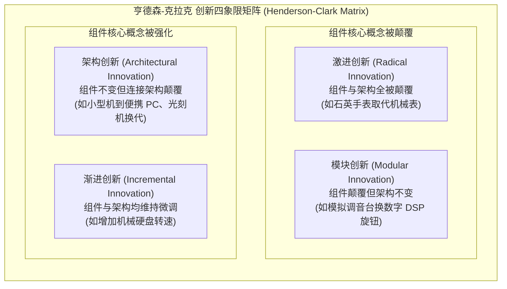
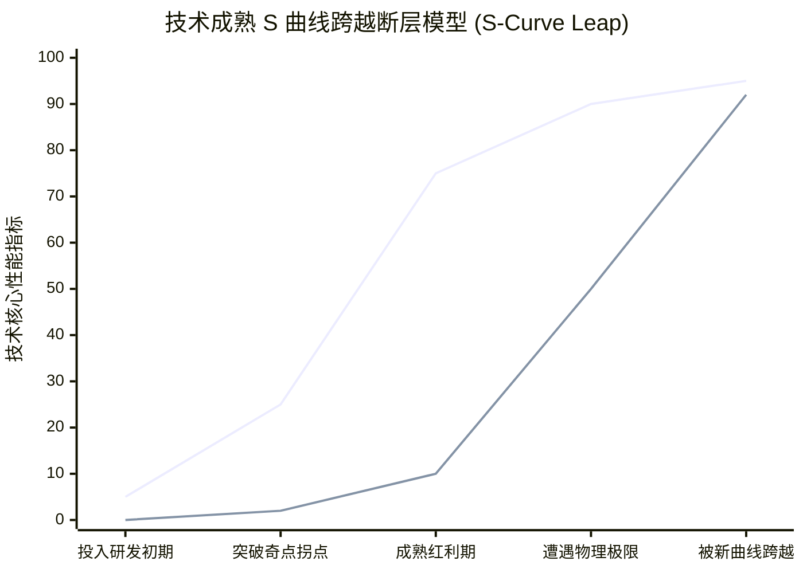

# Lec 11 市场范式剧变、架构创新与技术 S 曲线：孟山都生物技术转型 (Market Changes, Architectural Innovation & S-Curves: Monsanto)

> MIT Sloan School of Management · 15.351 Managing the Innovation Process · Prof. Jonathon Cummings

## TL;DR

- 丽贝卡·亨德森（Henderson & Clark）创新四象限划分：渐进、模块、架构与激进创新；其中架构创新最易引发巨头倾覆。
- 架构创新改变了组件之间的连接与接口关系，而这恰恰与大企业长期固化的组织沟通结构相冲突。
- 理查德·福斯特（Richard Foster）技术 S 曲线揭示了技术性能极限与跨越技术轨道断层的“进攻者优势”。
- 孟山都（Monsanto）从传统重资产商品化学农药巨头向农业基因组学帝国的悲壮转型，是应对范式转移的教科书范例。

## 亨德森与克拉克的创新四象限理论 / Architectural Innovation

传统管理学界长期习惯于将创新二元对立地划分为“渐进式创新（Incremental）”与“激进式创新（Radical）”。然而，麻省理工学院斯隆管理学院教授丽贝卡·亨德森（Rebecca Henderson）与哈佛商学院金·克拉克（Kim Clark）在 1990 年发表于《Administrative Science Quarterly》的里程碑论文中指出：**这种二分法掩盖了导致成熟企业大量倒闭的最危险杀手——架构创新（Architectural Innovation）**。

::: definition 架构创新 (Architectural Innovation)
产品是由多个底层**核心组件（Core Components）**按照特定的**架构关系（Architecture / Linkages）**耦合而成的系统。
- **架构创新**是指：**构成产品的底层核心组件技术本身并没有发生本质改变，但组件之间的连接架构、接口协议与相互作用关系发生了根本性重组**。
:::

### 为什么架构创新是大企业的隐形绞肉机？

亨德森与克拉克对半导体光刻机（Photolithographic Alignment）产业从接触式、接近式、扫描投影到分步重复投影（Stepper）四代霸主更迭（Cobilt、Canon、Perkin-Elmer 到 Nikon）的实证研究表明：
1. **组织沟通渠道与技术架构的同构性**：在一家成熟企业中，组织内部的部门划分是完全按照现有成熟产品的技术架构来设计的（例如镜头部、激光光源部、工件台对准部、传动部）。日常的工程报告和沟通习惯完全固化在这一架构之上；
2. **架构知识的隐性化（Embedded Architectural Knowledge）**：随着时间推移，工程师们已经将组件之间的物理耦合关系内化为理所当然的常识，甚至没有人在图纸上特别强调这些接口约定；
3. **毁灭性的认知误判**：当竞争对手推出架构创新产品时，大企业的高层技术委员会用显微镜拆解后，往往会轻蔑地得出结论：“这根本没有任何技术含量，他们用的每个电阻、芯片和马达都是我们用烂了的成熟料号！”大企业试图在不改变自身组织结构的前提下，强行在旧架构上打补丁，最终在复杂的系统热胀冷缩与电磁串扰中遭遇彻底失败。

## 技术 S 曲线与攻击者的优势 / The Technology S-Curve

麦肯锡资深董事理查德·福斯特（Richard Foster）在 1986 年出版的经典之作《创新：攻击者的优势》（*Innovation: The Attacker's Advantage*）中，系统阐述了**技术性能 S 曲线（Technology S-Curve）**规律。

### 技术轨道切换的三大残酷法则

1. **边际效益递减与物理天花板**：任何技术轨道在经历初期的缓慢爬坡与中期的指数级爆发后，必然会逼近其底层材料科学与热力学物理极限。在成熟期后期，企业即使再追加数十亿美元的研发资金，性能提升也微乎其微；
2. **非连续性断层与“进攻者优势”**：当下下一代全新的颠覆性技术轨道（第二条 S 曲线）萌芽时，其性能在初期往往远低于第一条成熟曲线。初创“进攻者”由于没有历史包袱，全力在新曲线上冲刺；而老牌巨头由于深陷既有客户的沉没成本与超高毛利，根本无法下定决心跳向看似幼稚的新曲线；
3. **跨越曲线的巨大死亡谷**：当新技术的性能在某一天跨越旧技术的物理天花板时，老技术会在极短的时间内发生雪崩式崩溃，留给巨头转型的时间往往只有几个季度。

## 孟山都（Monsanto）农业生物技术的世纪大豪赌

哈佛商学院经典案例《孟山都公司：生物技术时代的来临》（Monsanto Co.: The Coming of Age of Biotechnology），展示了一家传统老牌化工巨头如何跨越技术 S 曲线断层、实现惊心动魄的脱胎换骨。

::: example 孟山都从大宗化学品向生命科学帝国的悲壮转型
- **面临的绝境**：在 1970 年代末，孟山都虽然是全美盈利最丰厚的大宗化学品公司之一（以工业塑料、人造纤维和广谱除草剂农达 Roundup 闻名），但当时的 CEO 理查德·马奥尼（Richard Mahoney）与研发总监霍华德·施奈德曼（Howard Schneiderman）敏锐地察觉到：**基于石油裂解的大宗化学工业已经逼近 S 曲线的顶峰，未来将沦为残酷的产能过剩与价格战泥潭**。
- **敢于下注非共识第二曲线**：1981 年，当全美商界对重组 DNA 技术尚处于懵懂状态时，孟山都管理层力排众议，做出了企业史上最具魄力的战略决策——**在毫无任何商业化先例的情况下，直接将每年研发预算的 20% 以上（累计数十亿美元）坚决砸向农业基因工程**。
- **重构组织知识架构**：孟山都砸下重金在密苏里州 Chesterfield 建造了世界顶尖的生命科学研究院，聘请了全球最卓越的植物分子生物学与基因测序科学家。化学工程师与植物生物学家坐在了一起，历经 15 年的冷板凳与上万次基因编辑田间试验，终于攻克了让大豆、玉米和棉花自身具备抗草甘膦特性的“抗农达作物（Roundup Ready Crops）”。
- **商业重塑与战略阵痛**：
  - 1996 年，孟山都的抗草甘膦转基因大豆与抗虫棉正式实现商业化种植，在全美与南美洲引发了农业生产力的指数级革命；
  - 为了彻底甩掉旧范式的包袱，孟山都以绝大的魄力将为公司贡献了上百年利润的传统大宗化学品与塑料资产彻底剥离分拆，全盘转型为纯粹的农业生命科学巨头；
  - **伴随而来的伦理与监管风暴**：孟山都在欧洲遭遇了激进环保组织与反转基因运动的空前围剿，这也向所有技术管理者揭示了跨越 S 曲线所必须面临的宏观社会学洗礼。
:::

| 战略维度 | 传统大宗化工范式（第一条 S 曲线） | 农业基因组学生命科学（第二条 S 曲线） |
| :--- | :--- | :--- |
| **底层核心技术** | 石油裂解催化、有机化学合成、大罐连续流 | 重组 DNA、基因枪转染、生物信息学测序 |
| **资产与组织特征** | 重资产化工厂、追求产能稼动率与低成本运输 | 高壁垒生物专利知识产权、极端跨学科研发网络 |
| **商业变现模式** | 按吨位销售桶装化工制剂，毛利随周期剧烈波动 | 通过专利种子的技术特许使用费（Tech Fee）获取超额溢价 |

::: pitfall “技术至上”背后的社会伦理与监管断层
孟山都在生物技术 S 曲线上的工程跃迁无可挑剔，但其战略决策中最大的败笔在于**严重低估了社会公众对“改变自然基因”的心理恐惧与伦理抵抗**。技术管理者不仅要看懂实验室里的微观数据，更要对宏观层面的社会监管、伦理偏好与公众沟通保持极度敬畏。忽视社会系统的反作用力，即使最强大的技术也可能在市场准入大门前被彻底封杀。
:::

## 我的理解与实践洞察 / Personal Insight

从技术开发走向组织协同，任何创新项目最容易低估的都是跨领域的认知摩擦与制度惯性。在实践中，卓越的技术领袖不仅是精通参数指标的极客，更是深谙人际网络与组织动线的系统架构师。

::: insight 破除体制引力的核心法则
与其指望通过行政命令强迫不同职能部门步调一致，不如在底层建立透明的物理共享物（如可运行的粗糙手板原型、清晰的 API 契约与共担的业务损益 P&L）。用真实的物理反馈与利益一致性，替代虚妄的口头协调，这是跨越组织深井的唯一通途。
:::

## 思考题与实战研讨

1. 结合丽贝卡·亨德森的架构创新理论，很多智能硬件创业公司试图在现有的成熟智能音箱架构上“顺便装一个高清摄像头”，为什么这种看似微小的改动会引发包括机身散热、防震颤、隐私加密甚至麦克风降噪算法的系统性崩溃？
2. 在很多传统燃油车巨头内部，研发体系是严格按发动机、变速箱、排气系统等机械模块切分的。当汽车全面转向“软件定义汽车（SDV）”与中央集中式电子电气架构时，为什么原有的组织架构会成为新架构落地的巨大阻力？
3. 审视你当前所在的行业，目前的主流技术是否已经逼近了 S 曲线的顶峰？是否有某种尚处于实验室萌芽期、在主流客户看来“粗糙甚至不靠谱”的新技术可能在未来 5 年内跨越断层？
