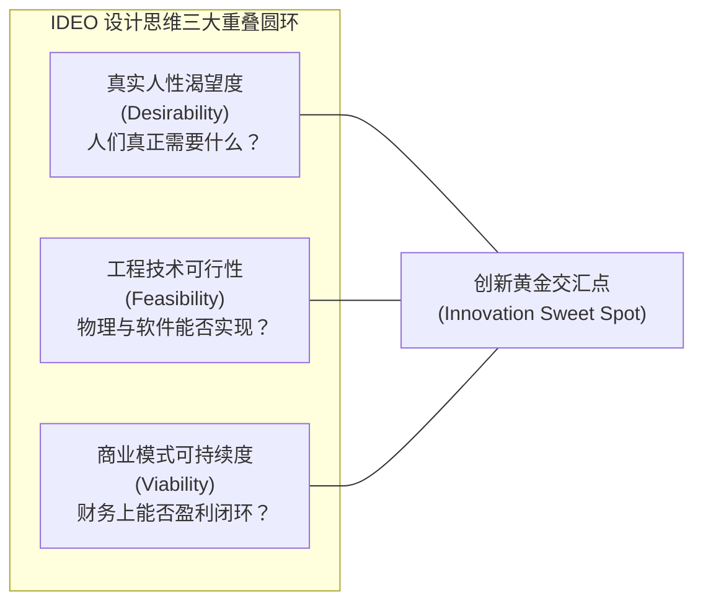
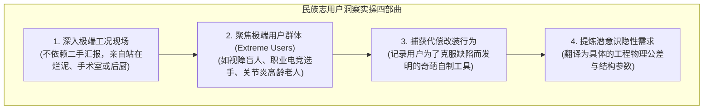

# Lec 12 IDEO 设计思维与工业设计实战：波士顿产品策略前沿演进 (IDEO Design Thinking & Product Strategy Practice)

> MIT Sloan School of Management · 15.351 Managing the Innovation Process · Prof. Jonathon Cummings

## TL;DR

- IDEO 波士顿产品策略负责人迈克尔·迈耶（Michael Meyer）系统解构以人为本的“设计思维（Design Thinking）”工程实践。
- 民族志观察（Ethnographic Research）深入真实使用现场，通过解构极端用户的反常代偿行为挖掘潜意识需求。
- 头脑风暴五大纪律：禁止即时批判、追求海量发散、在他人想法上搭积木、鼓励天马行空与高度视觉化。
- “草根粗糙原型（Rough-and-Ready Prototyping）”在数小时内用泡沫与热熔胶验证机械手感，以最低成本驱逐工程迷雾。

## 设计思维的核心本质：从技术推力转向人本拉力 / Design Thinking

在传统工程主导的科技企业中，研发流程往往始于“我们研发出了一项新技术，看看能把它卖给谁（Technology Push）”。然而，全球顶尖设计咨询机构 IDEO 波士顿产品战略总监迈克尔·迈耶（Michael Meyer）在 15.351 课堂上指出：**最伟大的创新，从来不是始于冰冷的晶体管或代码，而是始于对人类真实行为与情感的深切移情（Empathy）**。

### 为什么工程师往往做不出优秀的设计？

迈耶强调，绝大多数技术人员在开发产品时最容易犯的错误是**“把自己当成用户”**：
- 工程师精通系统配置、熟悉各种晦涩的命令行与多级嵌套菜单，并自豪于产品功能的繁复庞杂；
- 然而，真实世界里的普通消费者面对密密麻麻的按键与报错弹窗时，感到的只有困惑、挫败感与恐惧；
- 优秀的产品战略不是在机器上做加法，而是如何用极其优美的人机交互（UI/UX），将后台极其复杂的工程系统彻底封装起来，让用户在零学习成本下享受到科技的红利。

## 民族志观察：去现场发现未被满足的潜意识痛点 / Ethnography

IDEO 的秘密武器不是坐在空调办公室里发调查问卷，而是派出由人类学家、心理学家、机械工程师组成的跨界小队深入现场进行**民族志田野观察（Ethnographic Research）**。

::: definition 民族志观察与用户代偿行为 (Compensatory Behaviors)
- **民族志观察**：研究人员不带预设偏见地长期潜入用户的实际生活或工作工况现场，观察用户在毫无防备状态下的下意识行为与微表情。
- **代偿行为**：当现有商业工具极度不好用时，用户为了把事情办成，往往会自行发明的修补手段（例如在电饭煲按键上贴胶布写字、用回形针捅进机箱重置孔、用两把螺丝刀并排当镊子使）。**哪里有用户的非标准代偿行为，哪里就埋藏着十亿美元级别的突破性产品痛点！**
:::

### 聚焦“极端用户（Extreme Users）”的乘数效应

迈耶分享了一条至关重要的实操法则：**不要去调研平庸的普通大众用户，要去调研“极端用户”**！
- 如果你要设计一款好用的家用厨房切菜刀，不要去访谈每月只做一次饭的年轻白领；去访谈一位患有严重类风湿性关节炎、手部无法握紧的高龄老太太，或者一位在米其林餐厅后厨每天连续高强度切洋葱 10 小时的老厨师；
- 如果你能设计出一把让关节炎老太太在双手无力状态下依然能平稳切断胡萝卜、且绝不滑脱的刀柄（这正是 IDEO 为山姆大叔 OXO Good Grips 削皮刀打造的封神设计），那么这款产品推向普通大众市场时，将拥有降维打击般的极致舒适握感！

## 头脑风暴五大纪律与草根快速原型 / Brainstorming & Rapid Prototyping

很多企业内部的“头脑风暴”往往沦落为各怀心思的政治批斗会，或者被嗓门最大、官职最高的领导一人独揽话语权。迈耶强调，在 IDEO 内部，头脑风暴必须严格执行“五大神圣纪律”：

| IDEO 头脑风暴五大纪律 | 规则内涵与实操指引 | 破坏该规则的常见病态现象 |
| :--- | :--- | :--- |
| **1. 延迟判断与批评 (Defer Judgment)** | 会议前半段严禁任何人说“这在物理上不可能”或“成本太贵了” | 领导一句“别搞笑了”，全场瞬间鸦雀无声 |
| **2. 追求想法的数量 (Go for Quantity)** | 60 分钟内目标是产出 100 个以上的概念便利贴，以量引质 | 陷入对第一个平庸方案的长达一小时的细节纠缠 |
| **3. 在他人想法上搭积木 (Build on Ideas of Others)** | 听到荒谬的构想时，尝试用“是的，而且我们还可以加上……”来承接 | “你这个方案完全行不通，还是听我的吧” |
| **4. 鼓励天马行空的想法 (Encourage Wild Ideas)** | 允许提出看似科幻、违背直觉的极端构想，往往是突破定势的引线 | 全员提出毫无新意的竞品抄袭改良小补丁 |
| **5. 保持高度视觉化 (Be Visual & One Conversation at a time)** | 严禁长篇大论背诵 PPT，随手在白板上画出草图手板示意 | 全场分成几拨窃窃私语，讨论彻底跑题散焦 |

::: example IDEO 为著名医疗器械公司设计手术穿刺针原型
在为一家跨国医疗设备公司重新设计腹腔镜手术穿刺鞘管时，外科医生抱怨现有设备在单手插入时缺乏稳定握力反馈。IDEO 团队没有立刻启动昂贵的 CAD 建模，而是在当天下午去超市买回了一支白板马克笔、一个空除臭剂滚珠瓶和一个胶带底座。
设计师用热熔胶将滚珠粘在笔尖，并在半小时内削切出泡沫握把，让路过的外科医学顾问现场盲握。顾问当场惊呼：“就是这种阻尼手感！”这项耗费成本不足 5 美元的粗糙模型，为后续数千万美元的项目节省了至少半年的模具报废弯路。
:::

::: insight “快速失败以求更快成功”的深层工程经济学
“Fail early, fail often to succeed sooner.”这句话在很多公司被当作装饰口号，但在卓越的设计公司，它是一门精密的成本控制哲学。在概念设计阶段（草图与泡沫原型），修改一次设计错误的成本是 1 美元；在工程图纸阶段，修改成本是 100 美元；在开具钢模后，修改成本是 10,000 美元；而如果产品已经量产出货推向市场，一次设计召回的代价是 1,000,000 美元！快速原型的本质，是在成本最低的第一阶段，尽可能多地犯错并消灭全部潜在隐患。
:::

## 我的理解与实践洞察 / Personal Insight

从技术开发走向组织协同，任何创新项目最容易低估的都是跨领域的认知摩擦与制度惯性。在实践中，卓越的技术领袖不仅是精通参数指标的极客，更是深谙人际网络与组织动线的系统架构师。

::: insight 破除体制引力的核心法则
与其指望通过行政命令强迫不同职能部门步调一致，不如在底层建立透明的物理共享物（如可运行的粗糙手板原型、清晰的 API 契约与共担的业务损益 P&L）。用真实的物理反馈与利益一致性，替代虚妄的口头协调，这是跨越组织深井的唯一通途。
:::

## 思考题与实战研讨

1. 很多软件和硬件团队在做产品规划时，总是习惯于紧盯头部竞品的功能清单进行逐项像素级抄袭。根据 IDEO 迈克尔·迈耶的设计哲学，这种“竞品对标法”为什么永远做不出让市场惊艳的颠覆性产品？
2. 组织一次规范的 IDEO 式头脑风暴工作坊：挑选一个日常生活中令你感到极其反人类的产品（如某些公共卫生间的反人类感应水龙头），运用“极端用户观察”与“五大纪律”，构想三个跨界突破性方案。
3. 很多硬科技创业者常常为自己的产品缺乏“高级工业美学”而自卑，花费重金给机器喷涂昂贵的外壳烤漆。为什么真正的人本设计不仅是外壳的美化，更是对内部工程机械逻辑的人机工程赋能？
