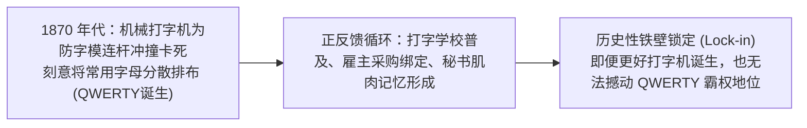
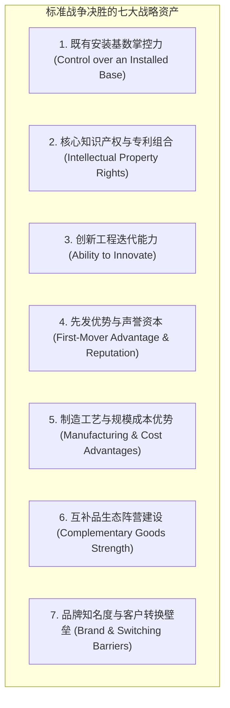
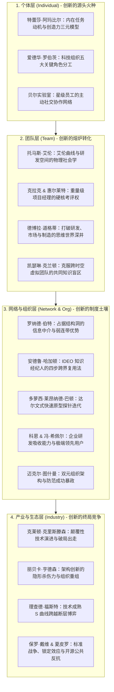

# Lec 13 技术标准战争、知识产权与开源生态：CompuServe GIF 专利危机与全课总结 (Standards Wars, Patents & Open Source: CompuServe)

> MIT Sloan School of Management · 15.351 Managing the Innovation Process · Prof. Jonathon Cummings

## TL;DR

- 保罗·戴维（Paul David）QWERTY 键盘案例揭示了技术标准形成中的路径依赖、技术互联性与锁定效应。
- 卡尔·夏皮罗（Shapiro & Varian）标准战争理论：正反馈网络效应、安装基数（Installed Base）与转换成本。
- CompuServe 与 Unisys 的 GIF 专利突袭事件引发全网开发者起义，直接催生出完全开源的 PNG 工业标准。
- 15.351 全课终局大闭环：从个体创造力、团队协同、网络资本、双元组织到产业技术生态的终极治理架构。

## 路径依赖与标准锁定：从 QWERTY 键盘谈起 / Path Dependence and Lock-in

为什么今天全世界所有电脑键盘与智能手机触控板上，二十六个字母的排列顺序都是极其别扭、打字效率低下的“QWERTY”布局，而不是在人机工学上击键速度提升 40% 的德沃夏克简化键盘（Dvorak Simplified Keyboard, DSK）？斯坦福大学著名经济史学家保罗·戴维（Paul David）在 1985 年发表于《American Economic Review》的传世名篇《克利奥与 QWERTY 经济学》（*Clio and the Economics of QWERTY*）中，深刻揭示了**技术标准的“路径依赖（Path Dependence）”与“历史锁定效应（Lock-in）”**。

::: definition 路径依赖与锁定效应 (Path Dependence and Lock-in)
- **路径依赖**：系统在当前演进路径上的选择，受到其历史偶发事件与早期决策的严重制约。一个并非技术最优的方案，一旦由于早期微小的偶然优势占领了市场先机，就会通过自我强化机制将整个社会系统锁死在该轨道上。
- **三大自我强化动力**：
  1. **技术互联性 (Technical Interrelatedness)**：打字机键盘排布必须与文字输入员的肌肉记忆深度适配；
  2. **规模经济与转换成本 (Economies of Scale & Switching Costs)**：打字培训学校、教材与雇主招聘全部绑定了 QWERTY 技能；
  3. **准不可逆投资 (Quasi-Irreversibility)**：重新更换所有设备并重训数百万打字员的社会成本，远远超越了打字速度微调所带来的边际收益。
:::

## 技术标准战争的博弈策略 / Waging a Standards War

加州大学伯克利分校信息经济学大师卡尔·夏皮罗（Carl Shapiro）与哈尔·瓦里安（Hal Varian）在《信息规则》（*Information Rules*）第九章中，系统梳理了科技企业在面对格式、接口与通信协议竞争时的**标准战争（Standards Wars）**实操法则：

### 开放还是封闭？标准演进的双刃剑

在发起标准战争时，企业面临着最根本的战略抉择：
- **开放阵营（Open Strategy）**：放弃对标准的排他性专利垄断，向全行业免费或平价公开接口（如 IBM PC 兼容机生态、安卓系统、开源 RISC-V 架构）。这一策略能迅速聚拢第三方开发者与配件厂商，形成庞大的网络效应，但发起者只能瓜分生态蛋糕的微薄利润；
- **封闭专有（Proprietary Strategy）**：死守底层核心专利，对所有试图兼容的厂商诉诸严苛的侵权诉讼（如苹果 iOS 生态、早期的索尼 Betamax 录像带与记忆棒）。如果能够凭借极致体验实现垄断，企业将获得无与伦比的超额暴利；但一旦落败，将彻底沦为被边缘化的历史孤魂。

## 赛博空间的公愤：CompuServe 与 Unisys 的 GIF 专利围剿危机

哈佛商学院经典案例《赛博空间的公愤：CompuServe 与 GIF 专利纠纷》（*Outrage in Cyberspace*），生动展现了专利流氓式伏击如何遭到全球开源工程师社区的毁灭性反击。

::: example CompuServe 与 Unisys 的 LZW 算法专利危机
- **历史背景**：1987 年，早期在线网络先驱 CompuServe 发明了革命性的图形交换格式——**GIF 格式**。GIF 采用了极其高效且无损的 **LZW 数据压缩算法**，使得在极其缓慢的拨号网络时代传输高质量彩色图片成为可能。为了迅速占领早期互联网，CompuServe 宣布 GIF 是一项向全世界自由开放的公共标准。在随后的七年里，GIF 成为全球万维网（World Wide Web）的视觉支柱。
- **暗藏的专利地雷**：然而，全球软件开发者与网民完全不知道的是，LZW 压缩算法的底层数学专利权并不属于 CompuServe，而是属于老牌大型机巨头**优利系统（Unisys）**！Unisys 在长达数年的时间里保持沉默，静静坐视 GIF 格式在全球互联网生根发芽、成为无法替代的基础设施。
- **1994 年底的“专利突袭”**：
  - 1994 年 12 月底，Unisys 突然向 CompuServe 发难并联合发布震撼通告：所有使用 LZW 算法的商业软件开发者，每售出一套软件必须向 Unisys 缴纳高额特许权使用费；随后，Unisys 更是贪婪地将索赔范围扩大到全网所有展示 GIF 图片的网站站长与非营利开发者！
- **全球开源社区的雷霆起义**：
  - Unisys 的突袭在赛博空间引发了史无前例的愤怒与抵抗（被称为“Burn All GIFs”全网烧除 GIF 运动）；
  - **技术层面的降维自救**：托马斯·布特尔（Thomas Boutell）等全球顶尖黑客不仅没有妥协，反而联手成立了开源攻坚小组。在短短几周内，黑客社区发明了完全基于公共领域 Deflate 算法的全新图形格式——**PNG 格式（Portable Network Graphics）**，并编写出完全自由开源的底层参考库 `libpng`；
  - PNG 格式在透明通道支持、真彩色深度与无损压缩率上全面秒杀老旧的 GIF，且永久免收任何专利税！
- **反转与惩罚**：随着 PNG 格式被万维网联盟（W3C）采纳为官方推荐标准，Unisys 不仅未能收到预期的巨额专利费，反而沦为全网唾弃的对象；而当 2003 年其 LZW 专利最终过期失效时，GIF 的垄断神话早已被开源社区的集体智慧所埋葬。
:::

| 维度 | Unisys 传统专利伏击范式 | 开源黑客共同体反击范式 |
| :--- | :--- | :--- |
| **权力来源** | 垄断性法典专利权、高薪律师团发出的侵权警告函 | 自由代码贡献、全网开源同行评议、Linus 定律 |
| **行动目标** | 从已有成熟生态中敲骨吸髓、榨取垄断寻租利润 | 绕过专有壁垒，打造更先进、更自由的公共技术资产 |
| **终局命运** | 遭遇全行业唾弃、声誉彻底归零，被新标准迅速淘汰 | PNG 成为互联网永恒基础设施，催生现代 Web 盛宴 |

::: insight 埃里克·雷蒙德与《大教堂与大集市》
开源教父埃里克·雷蒙德（Eric Raymond）在其名篇《大教堂与大集市》（*The Cathedral and the Bazaar*）中精辟总结：**“只要眼睛足够多，所有系统缺陷与专利陷阱都无所遁形（Linus's Law）”**。在高度互联的现代知识经济中，任何试图利用专有知识产权扼杀全球技术协作生态的贪婪尝试，最终都会激发出开源社区惊人的自组织创新动能，从而迎来自身被彻底解构的结局。
:::

## 15.351 创新过程管理：全课知识架构大闭环 / Course Synthesis

历经 13 讲的深度探索，我们从微观的工程师心理机制一直攀登至全球产业标准战争的顶峰。技术创新的本质从来不是单点技术的突破，而是贯穿了个体动机、团队协同、网络资本、双元组织以及产业生态的完整系统工程。

在个体层面上，特蕾莎·阿玛比尔的创造力模型与贝尔实验室的星级员工网络，揭示了内在动机与跨界求助的决定性力量；在团队层面上，托马斯·艾伦的物理空间动线曲线、克拉克与惠尔莱特的重量级项目经理制度、以及德博拉·道格蒂关于研发与市场“思维世界”隔阂的剖析，为打破部门壁垒提供了实操抓手；在网络与组织层面上，罗纳德·伯特的结构洞优势、安德鲁·哈加顿的知识经纪人模型、多萝西·莱昂纳德-巴顿的达尔文式快速原型探针、以及科恩与莱文索尔的吸收能力假说，奠定了敏捷试错与外部前沿整合的基石；而在产业宏观层面上，克里斯滕森的颠覆性轨迹、亨德森的架构创新陷阱、福斯特的技术 S 曲线跃迁、以及保罗·戴维与夏皮罗的标准锁定与开源博弈，展现了技术范式转移的终极竞争法则。

下方的全景架构图完整总结了贯穿全课的核心理论拼图与跨层级传导链条：

历经 13 讲的深度探索，我们从微观的工程师心理一直攀登至全球产业标准战争的顶峰。麻省理工学院 15.351 课程向所有未来的技术领袖交付了一张宏大的**创新管理战略全景图**：

技术创新的本质，从来不是孤军奋战的天才灵光，而是一套贯通了微观人性心理、中观团队物理流线、宏观组织政治防腐与生态网络博弈的**庞大社会系统工程**。唯有掌握这一系统框架的领导者，方能在风云变幻的硬科技创业与产业变革大潮中行稳致远。

## 我的理解与实践洞察 / Personal Insight

从技术开发走向组织协同，任何创新项目最容易低估的都是跨领域的认知摩擦与制度惯性。在实践中，卓越的技术领袖不仅是精通参数指标的极客，更是深谙人际网络与组织动线的系统架构师。

::: insight 破除体制引力的核心法则
与其指望通过行政命令强迫不同职能部门步调一致，不如在底层建立透明的物理共享物（如可运行的粗糙手板原型、清晰的 API 契约与共担的业务损益 P&L）。用真实的物理反馈与利益一致性，替代虚妄的口头协调，这是跨越组织深井的唯一通途。
:::

## 思考题与实战研讨

1. 很多大型软件企业曾试图起诉开源模拟器项目或对兼容接口收费（例如甲骨文起诉谷歌安卓使用 Java API 案）。结合 CompuServe GIF 专利诉讼的惨痛教训，这种诉讼策略是否真的保护了版权所有者的长远利益？
2. 结合保罗·戴维的 QWERTY 键盘锁定理论，当今天我们审视智能手机操作系统的两大阵营（iOS 与 Android）或个人电脑的 x86/ARM 生态时，什么样的外部外力才能真正打破现有的网络效应护城河？
3. 总结整门 15.351 课程，挑选你认为对你个人未来作为技术管理者或创业者**最震撼、最具启发意义的三条核心洞见**，并写下一份未来 180 天内在你的团队中推行落地的实操计划。
