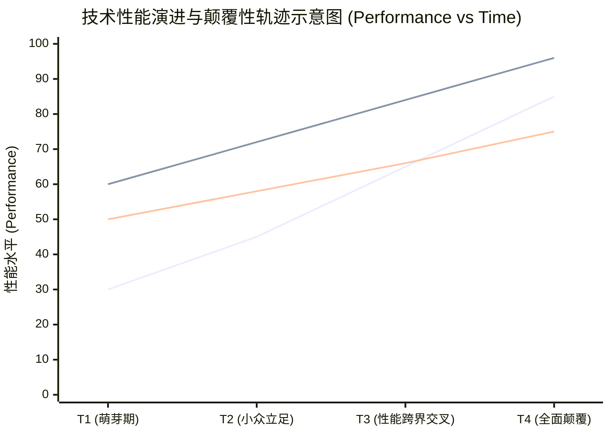

# Lec 2 创新的起源与颠覆性技术演进：机械硬盘行业与海军炮火案例 (Origin of the Process: Hard Disk Drives & Gunfire at Sea)

> MIT Sloan School of Management · 15.351 Managing the Innovation Process · Prof. Jonathon Cummings

## TL;DR

- 颠覆性技术在初期往往性能劣于主流市场指标，但凭借体积、成本或易用性开辟低端或新兴市场。
- 领先巨头之所以在颠覆性技术前败北，恰恰是因为他们对现有大客户做出了“最理性的倾听与资源分配”。
- 莫里森《海上炮火》案例揭示：对既有社会声望体系与操作技能的威胁，是组织抵制创新的最深层根源。
- 应对颠覆性威胁的唯一有效策略，是将新探索完全隔离并建立独立于母体财务模型的全新利润中心。

## 颠覆性技术与机械硬盘行业演进 / The Innovator's Dilemma

在管理学史上，克莱顿·克里斯滕森（Clayton Christensen）对机械硬盘（Hard Disk Drive, HDD）产业从 14 英寸到 1.8 英寸跨越数十年历史的实证研究，奠定了现代创新理论的基石。

::: definition 延续性技术 vs 颠覆性技术 (Sustaining vs Disruptive Technologies)
- **延续性技术 (Sustaining Technology)**：沿着主流市场既定客户最看重的性能维度（如硬盘容量、每兆字节成本、读写速度）持续提升的技术。无论是渐进式微调还是断崖式技术革命，只要服务于现有高端客户群，均属于延续性范畴。
- **颠覆性技术 (Disruptive Technology)**：在推出初期无法满足主流客户的核心性能要求，但在其他维度（如更小物理尺寸、更低功耗、更高便携性、极简操作界面）具备独特优势的技术。它首先在非主流或非消费边缘市场立足，随后沿着自身陡峭的技术提升曲线迅速向上渗透，最终颠覆原有市场格局。
:::

### 机械硬盘尺寸换代的经典宿命

机械硬盘产业每经历一次物理尺寸的缩小，老牌霸主就遭遇一次洗牌：
- **14 英寸向 8 英寸迁移**：14 英寸硬盘霸主专注大型主机（Mainframe），8 英寸硬盘容量小、单位容量价格昂贵，被大型主机客户完全鄙弃。然而，8 英寸硬盘却被小型机（Minicomputer）厂商如 DEC 疯狂采纳。
- **8 英寸向 5.25 英寸迁移**：5.25 英寸硬盘在小型机厂商看来容量严重不足，但却精准契合了正在兴起的个人电脑（Desktop PC）对桌面物理空间的严苛要求。希捷（Seagate）借此迅速崛起，而小型机硬盘霸主无一幸免。
- **5.25 英寸向 3.5 英寸迁移**：希捷坚持生产大容量 5.25 硬盘服务桌面 PC，Conner Peripherals 开发出抗震且低功耗的 3.5 英寸硬盘，并主导了便携式笔记本电脑（Laptop）革命。

| 硬盘尺寸 | 主导客户应用场景 | 初创颠覆者代表 | 失败的老牌巨头行为特征 |
| :--- | :--- | :--- | :--- |
| **14 英寸** | IBM 巨型主机 (Mainframes) | 控制数据 (CDC) 等 | 认为 8 英寸硬盘容量不足 20MB，商业价值极低 |
| **8 英寸** | DEC/王安小型机 (Minicomputers) | Shugart Associates, Micropolis | 坚信小型机客户绝对不会买 5.25 英寸玩具 |
| **5.25 英寸** | 桌面个人电脑 (Desktop PCs) | 希捷 (Seagate), 迈拓 (Maxtor) | 拒绝向容量仅 20MB 的 3.5 英寸产品投入主力研发 |
| **3.5 英寸** | 便携式笔记本电脑 (Laptops) | 康纳外设 (Conner Peripherals) | 试图强行将 5.25 架构缩小，成本与抗震性完败 |

::: insight 资源分配流程的“理性的暴政”
大企业的失败不是由于管理者的愚蠢、傲慢或技术人员的不称职，相反，恰恰是源于**最优秀、最理性、最严谨的管理实践**。大企业的销售团队和财务系统完全由利润率最高的现有大客户所绑架。当工程师研制出颠覆性原型时，销售总监会拿着它去询问核心客户，核心客户会一致表示“这东西性能太差，我们不需要”。于是，理性的大企业管理层决定削减该项目预算，将宝贵的研发资本重新投入到为现有大客户定制的高端产品线上——这正是走向覆灭的起点。
:::

## 莫里森与《海上炮火》：组织体制对创新的本能排斥

技术创新的阻力绝不仅限于商业计算，更深深根植于社会学意义上的组织身份与权力结构。麻省理工学院历史学家埃尔廷·莫里森（Elting Morison）在 1966 年发表的经典巨作《海上炮火：关于创新的案例研究》（*Gunfire at Sea*），通过 1898 年至 1902 年间美国海军引入连续瞄准射击术（Continuous-Aim Firing）的历史过程，深刻揭露了组织内部的防御机制。

::: example 威廉·西姆斯与连续瞄准射击术的抗争
- **历史背景**：在 19 世纪末，军舰开炮依靠舰体随海浪起伏上下摇摆。炮手必须在海浪将舰体推至最高点的瞬间拉动拉绳击发。全舰命中率极低，仅为 1.5% 左右。
- **技术突破**：英国海军珀西·斯科特上校与美国海军上尉威廉·西姆斯（William S. Sims）发明了“连续瞄准射击术”：通过改变火炮齿轮传动比，使得炮手能够克服火炮自重与海浪颠簸，让准星始终死死锁定敌舰水线；同时利用望远镜瞄准镜消除了传统机械照门震动对炮手眼睛的撞击。在演习中，西姆斯的炮手实现了连续射击全部命中的奇迹（射击效率提升超过 3000%）。
- **海军军械局的体制反抗**：西姆斯向华盛顿海军军械局提交了详尽的技术报告与靶试数据。然而，负责武器研发的军械局官僚做出了如下经典抗拒反应：
  1. **第一阶段：轻慢与置之不理**，声称数据肯定存在虚报与做戏成分；
  2. **第二阶段：理论反驳与物理抹黑**，军械局在陆地上将火炮固定在坚硬水泥地上进行测验，得出结论称“火炮机械装置在物理上不可能实现西姆斯宣称的调整精度，因此西姆斯的装置纯属伪科学”；
  3. **第三阶段：人身攻击与职业惩罚**，军械局官员指责西姆斯是一名“破坏海军纪律的偏执狂与刺头”，试图通过军事法庭对其进行制裁。
- **最终转机**：西姆斯冒着被军事法庭审判的巨大风险，越级直接写信给时任美国总统西奥多·罗斯福（Theodore Roosevelt）。罗斯福总统亲自调阅档案并下令在公海组织公开打靶验证，最终力排众议任命西姆斯为全海军射击总监。
:::

### 莫里森对创新阻力的深层组织洞察

为什么一套能够将战斗力提升数十倍的技术发明，会遭遇全海军上下的死命抵抗？莫里森给出了划时代的解释：
1. **创新不仅改变工具，更在摧毁既有的社会声誉系统**：在旧海军体制下，优秀的炮手依靠的是数十年的直觉、体魄与在风浪颠簸中击发的神勇，这是炮手在舰船上获得同袍尊敬的唯一资本。连续瞄准装置将这种“英雄艺术”降格为任何人经过简单培训即可机械操作的平庸程序，剥夺了资深士官的社会价值。
2. **海军军械局的技术自恋与权力护城河**：军械局的大佬们之所以能身居高位，是因为他们曾经主持设计了现役舰炮。承认西姆斯的改进有效，等于在体制上公开承认自己过去二十年的军械设计存在致命缺陷。
3. **官僚系统的稳态自愈性**：成熟组织像生物体一样具有免疫系统。任何外部异物（创新建议）进入体内时，免疫细胞的首要反应不是评估其营养价值，而是将其作为可能破坏机体稳态的病毒进行吞噬与围剿。

## 经典分拆架构：加腾量子公司与 Plus Development

面对克里斯滕森揭示的颠覆性窘境与莫里森揭示的体制免疫抗体，企业究竟该如何破局？加腾量子公司（Quantum Corporation）在 1980 年代面对个人电脑硬盘革命时的策略，被哈佛商学院奉为教科书级别的应对范例。

::: example Plus Development 公司的绝处逢生
加腾量子公司是一家成功的小型机硬盘供应商。1984 年，公司三名年轻工程高管洞察到 3.5 英寸微型硬盘在 PC 市场的巨大潜力。然而，加腾的现有董事会与主流销售团队完全不愿分散精力研发这种低单价产品。

加腾的管理层做出了极具魄力的制度安排：
- **物理与行政彻底隔离**：在远离母公司总部数十英里外注册成立了全新的子公司——**Plus Development Corporation**；
- **独立股权与激励机制**：核心创业团队持有子公司 20% 的股权，母公司保留 80% 控股权；
- **独立的财务损益结算 (P&L)**：Plus 团队无需承担母公司沉重的高管行政摊销，完全按照创业公司的轻资产模式运转；
- **重新定义产品范式**：Plus 团队敏锐地发现，早期 PC 用户在机箱内加装第二块硬盘时面临严重的跳线配置与驱动安装难题。他们打破了硬盘必须装在驱动器槽位的刻板思维，直接将超薄 3.5 英寸硬盘与控制器集成在一块扩展卡上，插在主板扩展槽即插即用——这便是风靡全球的“硬卡（Hardcard）”。Hardcard 创造了上亿美元的巨额利润，甚至在母公司传统业务衰退时反哺了整家母公司。
:::

| 维度 | 母公司 Quantum Corporation | 子公司 Plus Development |
| :--- | :--- | :--- |
| **考核指标** | 季度出货量、大客户应收账款周转率 | 新客户获取成本 (CAC)、原型验证周期 |
| **组织文化** | 等级严密、按部就班、害怕犯错 | 敏捷迭代、黑客文化、鼓励激进测试 |
| **渠道战略** | 依赖企业级直销与大型主机集成商 | 拥抱电脑零售店、邮购目录与终端极客 |

::: pitfall 内部温室孵化的“母爱毒素”
许多大企业在孵化颠覆性项目时，虽然设立了独立部门，但依然强迫项目团队使用母公司的公共法务、公关、财务与采购系统。母公司庞大的合规流程会迅速耗死初创团队的敏捷反应能力。真正的隔离必须是全维度的“防火墙”，只在资金和顶层董事会层面保持连接。
:::

## 我的理解与实践洞察 / Personal Insight

从技术开发走向组织协同，任何创新项目最容易低估的都是跨领域的认知摩擦与制度惯性。在实践中，卓越的技术领袖不仅是精通参数指标的极客，更是深谙人际网络与组织动线的系统架构师。

::: insight 破除体制引力的核心法则
与其指望通过行政命令强迫不同职能部门步调一致，不如在底层建立透明的物理共享物（如可运行的粗糙手板原型、清晰的 API 契约与共担的业务损益 P&L）。用真实的物理反馈与利益一致性，替代虚妄的口头协调，这是跨越组织深井的唯一通途。
:::

## 思考题与实战研讨

1. 很多传统汽车厂商在研发智能电动汽车时，往往遭遇传统燃油车动力总成部门高管的隐蔽抵抗。这种阻力与莫里森《海上炮火》中军械局的反应有何异曲同工之处？
2. 为什么克里斯滕森强调“颠覆性技术不能用传统市场调研方法来评估”？如果潜在用户从未见过某种产品形态，商业计划书中的财务预测模型错在哪里？
3. 对比 Plus Development 与你在本专栏其他讲次中学到的企业内部孵化器，什么样的股权结构与激励制度才能留住真正的技术探险家？
