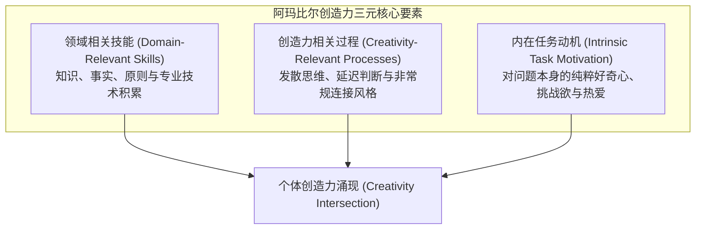

# Lec 3 个体创造力与创新人才选拔：宝洁新创业务与贝尔实验室星级员工 (Individual Contributions: P&G New Ventures & Bell Labs)

> MIT Sloan School of Management · 15.351 Managing the Innovation Process · Prof. Jonathon Cummings

## TL;DR

- 特蕾莎·阿玛比尔（Amabile）创造力三元模型：领域技能、创造性思维技能与内在任务动机是创新的必要条件。
- 外部金钱激励与严密监控会引发“过度辩护效应”，严重损害探索性工作的发散创造力。
- 罗伯茨与富斯菲尔德确立了科技企业五大关键角色：创意产生者、领军创业者、项目主管、信息守门人与资深赞助人。
- 贝尔实验室星级员工的秘密并非智商差异，而是其在企业内部主动构建的动态认知协作与专家求助网络。

## 组织创造力的成分理论 / Amabile's Model of Creativity

创新始于个体的头脑。然而，企业该如何甄别并激发员工的创造力？哈佛商学院心理学家特蕾莎·阿玛比尔（Teresa Amabile）提出了享誉全球的“创造力三元模型”（Componential Model of Creativity）：

### 创造力三要素的内涵与互动

1. **领域相关技能 (Domain-Relevant Skills)**：创造力绝非空中楼阁。没有扎实的半导体物理、高分子化学或编译器原理底蕴，任何直觉都只是盲目的幻想。知识库是产生新组合的原料基础。
2. **创造力相关过程 (Creativity-Relevant Processes)**：指个体在面对复杂问题时的思维习惯，包括：能否在模糊混乱中容忍不确定性？能否打破现有的思维定势（Functional Fixedness）？是否习惯将两个毫不相干的学科概念进行类比映射？
3. **内在任务动机 (Intrinsic Task Motivation)**：模型中最具实践意义的杠杆。阿玛比尔的大量心理学对照试验证明：
   - **外在动机（Extrinsic Motivation）**：如高额奖金承诺、打卡考核、竞赛评比或防备惩罚，能够提升机械性重复劳动的效率，但会迅速收窄注意力，诱使员工选择最平庸、风险最低的妥协方案；
   - **内在动机（Intrinsic Motivation）**：为了探索问题本身的优美感而工作。当一个人沉浸于纯粹的心流（Flow）状态时，认知广度最大，突破性创新的概率呈指数级攀升。

::: theorem 内在动机原则 (The Intrinsic Motivation Principle of Creativity)
当人们出于个人兴趣、享受、满足感和挑战性去面对一项工作，而不是出于外界强加的压力或功利性报偿时，其创造力的表现达到顶峰。企业试图通过单一的金钱挂钩来购买员工创造力的做法，往往适得其反。
:::

## 科技创新组织中的五大关键角色 / Staffing the Innovative Organization

麻省理工学院斯隆管理学院著名教授爱德华·罗伯茨（Edward Roberts）与阿兰·富斯菲尔德（Alan Fusfeld）在 1981 年的奠基之作中指出：一项科技创新从概念诞生到商业化交付，绝非由同质化的工程师团队独立完成，而必须由五种特质迥异的角色协同推进：

| 关键角色 | 核心行为与核心职责 | 典型性格与能力画像 | 若组织缺失该角色的后果 |
| :--- | :--- | :--- | :--- |
| **创意产生者 (Idea Generator)** | 提出全新概念、发现未被满足的痛点或探索前沿技术边界 | 知识面极广、好奇心旺盛、不墨守成规、思维发散 | 创新管道源头枯竭，企业陷入无休止的平庸优化 |
| **领军开拓者 (Champion / Entrepreneur)** | 为创意四处游说，克服体制阻力，不惜押上个人声誉为项目争取启动预算 | 意志坚定、极具政治敏感度、百折不挠、敢于承担职业风险 | 好创意停留在纸面幻灯片上，在委员会的推诿中夭折 |
| **项目主管 (Project Leader)** | 规划开发里程碑，协调研发、制造与测试，控制交付节奏与预算边界 | 严谨细致、善于跨职能沟通、情商高、工程交付纪律强 | 项目沦为永不交付的学术象牙塔，严重超支逾期 |
| **信息守门人 (Gatekeeper)** | 充当组织与外部世界的信息桥梁，消化前沿学术成果与专利情报，翻译给团队 | 热爱学术阅读、拥有庞大外部人脉、擅长技术信息降维传达 | 团队闭门造车，重复发明已被外部攻克的轮子 |
| **高层赞助人 (Sponsor / Coach)** | 在最高管理层为项目遮风挡雨，抵御传统业务部门的吞噬，在暗中提供战略指引 | 德高望重的资深高管、具有大局观、敢于为非共识项目背书 | 项目在第一次业绩波动或部门洗牌时即被作为成本砍掉 |

::: insight 角色重叠与职业晋升的制度错位
许多科技公司在工程职级晋升上存在严重误区：习惯性地将最卓越的“创意产生者”提拔为“项目主管”或人事经理。然而，纯粹的极客往往极度厌恶审批报销单、协调排期与部门政治，最终不仅毁掉了一个世界级的发明家，更收获了一个痛苦且低效的管理平庸者。卓越的研发机构必须开辟平行的“技术专家双轨制（Dual Career Ladder）”，让创作者在不从事管理行政的前提下，获得同等甚至超越管理岗的社会地位与薪酬回报。
:::

## 贝尔实验室的秘密：如何培养星级员工 / Bell Labs Star Performers

为什么在全世界顶尖科学家云集的 AT&T 贝尔实验室，少数“星级员工”（Star Performers）的产出能够达到普通研究员的 400% 到 800%？

卡耐基梅隆大学学者罗伯特·凯利（Robert Kelley）与珍妮特·卡普兰（Janet Caplan）对贝尔实验室进行了长达数年的深入双盲调研。结果颠覆了传统的认知：星级员工与普通员工在智商（IQ）、标准化考试成绩或名校学术文凭上**没有任何统计学显著差异**。星级员工的核心优势在于其独特的工作策略（Work Strategies）：

### 星级员工的九大关键能力维度

凯利与卡普兰提炼出的工作策略不仅包括纯粹的技术攻坚，更涵盖复杂的认知与人际网络工程：
1. **主动出击 (Initiative)**：超越既定工作职责，主动发起跨界探索；
2. **知识网络化 (Networking)**：建立可信赖的跨部门技术咨询网络，懂得在别人需要时提供无私帮助，从而积累“社交信用”；
3. **自我管理 (Self-Management)**：在多任务并行的混乱中快速排序，建立专注的深度工作区；
4. **技术全景洞察 (Perspective)**：站在行业演进与客户价值的终局视角审视当前的局部代码，避免技术偏狭；
5. **追随领导力 (Followership)**：在团队中既能担任主将，也能作为坚定可靠的僚机全力支持他人；
6. **团队协作机制 (Teamwork)**：懂得通过倾听与分工化解团队内部冲突；
7. **组织穿行敏锐度 (Organizational Savvy)**：洞悉大企业的权力分布与利益格局，巧妙绕过官僚死锁；
8. **说服性展示能力 (Show-and-Tell)**：用通俗生动的商业与工程语言，向非专业管理层阐明技术价值；
9. **认知多样性整合 (Cognitive Diversity)**：主动倾听团队内部的不同声音，避免盲目从众。

## 宝洁公司企业新创业务部（Corporate New Ventures）案例

即使拥有最顶级的科学家与五大角色，大型企业在组织机制上的僵化依然可能扼杀创新。哈佛商学院经典案例《宝洁新创业务部》（Corporate New Ventures at Procter & Gamble）生动展现了这一博弈。

::: example 宝洁 CNV 的制度困境与职业风险
- **设立初衷**：1990 年代初，宝洁为了打破各日化事业部（肥皂、洗衣粉、纸巾等）只关注微调改良的保守文化，特别由董事长直接批准成立了独立的“企业新创业务部（CNV）”，负责孵化具备跨品类颠覆潜力的全新商业概念。
- **考核体制的断层**：CNV 吸引了公司内部最聪明的品牌经理与化学博士。然而，宝洁百年传承的人力资源考核体系（Up-or-Out 晋升通道）是建立在现有主流业务的短期销售额增量与即时晋升积分之上的。
- **职业风险与寒蝉效应**：进入 CNV 的创新探险者发现，颠覆性业务需要 3 至 5 年的残酷试错周期。当一个充满前景但最终因市场未成熟而关闭的项目落幕时，参与的员工不仅没有任何功劳，反而在原有事业部的晋升评比中由于“过去三年缺乏量化销售业绩”而名落孙山，甚至面临被边缘化的下场。
- **教训与启示**：这一机制迅速在全公司释放了致命信号——“加入创新部门等于职业自杀”。从此，最优秀的年轻骨干纷纷拒绝调入 CNV，内部创业部门彻底沦为边缘化养老所。
:::

| 制度维度 | 宝洁传统事业部考核标准 | CNV 颠覆性业务客观需求 |
| :--- | :--- | :--- |
| **成败评估周期** | 季度与年度 P&L 财务报表结算 | 3 到 7 年的技术与市场培育期 |
| **容错底线** | 零失误容忍，执行偏差直接扣分 | 鼓励快速失败，从死因中提炼战略情报 |
| **员工退出机制** | 项目失败即意味着个人能力受质疑 | 项目关闭后，创新探险者应受到表彰并被核心部门争抢 |

::: pitfall 假借“创新之名”的赏罚错位
如果企业在口头上高喊“鼓励创新与冒险”，但实际晋升评优时却依然只奖励那些按部就班、绝不犯错的平庸守成者，并对试错失败的探险者进行降薪或冷冻，那么没有任何制度能拯救这家公司的创新活力。真正的创新文化必须由真金白银的职业兜底安全网来支撑。
:::

## 我的理解与实践洞察 / Personal Insight

从技术开发走向组织协同，任何创新项目最容易低估的都是跨领域的认知摩擦与制度惯性。在实践中，卓越的技术领袖不仅是精通参数指标的极客，更是深谙人际网络与组织动线的系统架构师。

::: insight 破除体制引力的核心法则
与其指望通过行政命令强迫不同职能部门步调一致，不如在底层建立透明的物理共享物（如可运行的粗糙手板原型、清晰的 API 契约与共担的业务损益 P&L）。用真实的物理反馈与利益一致性，替代虚妄的口头协调，这是跨越组织深井的唯一通途。
:::

## 思考题与实战研讨

1. 根据特蕾莎·阿玛比尔的理论，很多互联网大厂推行的“高额创新落地期权奖励”是否真的能激发科学家的创造力？这种机制在什么场景下会蜕化为拉帮结派与弄虚作假？
2. 在你所在的团队中，谁是真正的“信息守门人”？这个人在企业现有的组织架构图上是否拥有与其信息枢纽地位相匹配的声望与资源？
3. 如果你是宝洁的首席人力资源官（CHRO），你会设计怎样的考核与回流机制，来保护甚至奖励那些在企业新创业务部门（CNV）中勇于试错但最终遭遇项目技术失败的年轻骨干？
