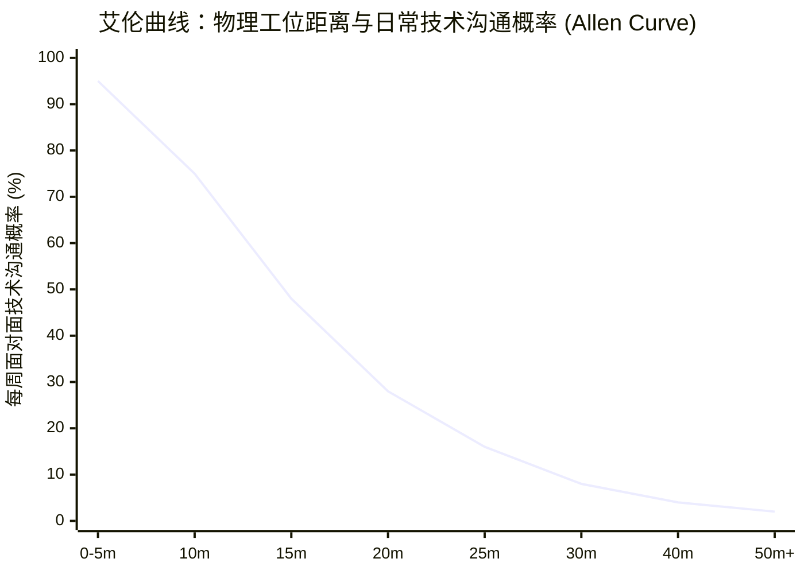
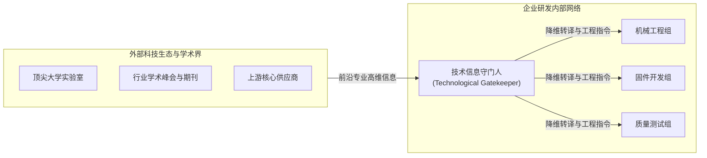

# Lec 4 技术沟通机制与边界跨越者：艾伦曲线与 Medtek 医疗仪器案例 (Technical Communication & Boundary Spanning: Allen Curve & Medtek)

> MIT Sloan School of Management · 15.351 Managing the Innovation Process · Prof. Jonathon Cummings

## TL;DR

- 托马斯·艾伦（Thomas Allen）曲线揭示：两名工程师之间的物理距离超过 30 米时，面对面沟通频率呈断崖式下跌至零。
- 科学家以发表学术论文为最高荣誉，工程师以生产可运行的物理原型为首要追求，两者价值取向存在天然分野。
- 组织边界跨越者（Gatekeepers）承担外部前沿知识翻译与内部信息分发的双重枢纽职能。
- Medtek 医疗仪器案例证明：跨部门技术语言脱节会导致尖端科研成果在产品转化阶段遭遇惨痛失败。

## 艾伦曲线与研发空间的物理社会学 / The Allen Curve

在数字化协同软件高度发达的今天，很多管理者认为办公物理距离已经无关紧要。然而，麻省理工学院斯隆管理学院教授托马斯·艾伦（Thomas J. Allen）在 1970 年代对数百家科技研发实验室的经典追踪研究，揭示了一条不可逾越的物理规律——**艾伦曲线（The Allen Curve）**。

::: definition 艾伦曲线 (The Allen Curve)
艾伦曲线描述了知识工作者之间的**物理空间距离**与他们之间的**自发面对面沟通频率**之间的负相关关系。实证数据表明，当两个人之间的工位直线距离从 5 米增加到 30 米时，双方自发沟通的概率呈现指数级暴跌；一旦物理距离超过 30 米（或隔开一个楼层/一道承重墙），日常技术交流的频次便衰减到接近于零的底线水平。
:::

### 现代办公环境对创新的误导与纠偏

艾伦的研究颠覆了传统的研发大楼设计观念：
1. **邮件与聊天软件无法完全替代物理临近**：随后的学者（包括 Cummings 教授）在现代互联网环境下的复现研究表明，**电子通信（如 Slack、邮件）并没有消除距离，反而放大了临近效应**——物理上坐得越近的工程师，在即时通讯软件中发消息的频率同样越高！物理接触建立的深层信任感，是线上协作得以顺畅展开的基石。
2. **动线设计（Circulation Paths）决定非正式碰撞**：贝尔实验室、皮克斯（Pixar）总部以及苹果 Apple Park 的核心设计哲学均脱胎于艾伦理论——通过将洗手间、咖啡吧、自动售货机和中央邮箱集中于中庭，强制不同技术背景的工程师在日常动线中产生不可预测的“走廊偶遇（Watercooler Effect）”，从而引爆跨学科创意。

## 科学家 vs 工程师：两种截然不同的心智模型

在研发团队管理中，管理者常常将“科研人员（Scientists）”与“工程技术人员（Engineers）”混为一谈，这是导致技术沟通瘫痪的隐蔽病因。艾伦教授深入剖析了两者的认知价值体系差异：

| 比较维度 | 科学家 (Scientists) | 工程师 (Engineers) |
| :--- | :--- | :--- |
| **终极价值导向** | 探索未知自然规律，追求科学真理的纯粹性 | 解决现实具体约束，制造可商业化运行的产品 |
| **社会声望货币** | 论文在顶级同行评议期刊发表（公开发布优先权） | 专利所有权、高可靠性物理硬件或代码交付 |
| **信息流动取向** | 具有强烈的**外部取向**，紧密关注全球同行的学术动态 | 具有强烈的**内部取向**，沉浸于本组织的产品架构与接口细节 |
| **沟通载体形式** | 严谨的数学公式、抽象概念模型与正式文本 | CAD 工程图纸、物理手板原型、仿真波形与经验法则 |

::: insight 科学编码与技术编码的“翻译摩擦”
如果一个高科技项目既需要顶尖的基础科学探索，又需要严苛的工业级工程落地，那么管理者的核心使命绝不是让科学家去直接指挥流水线工程师，而是必须在两者之间搭建起高效的“翻译机制”。否则，科学家的理论傲慢与工程师的务实蔑视会迅速形成一道无形的深墙。
:::

## 组织边界跨越者与信息守门人 / Boundary Spanners and Gatekeepers

哥伦比亚大学商学院著名组织学者迈克尔·图什曼（Michael Tushman）在 1977 年进一步丰富了技术沟通理论，提出了**组织边界跨越者（Boundary Spanners / Technological Gatekeepers）**的核心概念。

### 守门人的核心特质与关键职能

1. **双重解码能力（Bilingual Decoding）**：他们既能看懂《Nature》、《Science》或 IEEE 顶级期刊上晦涩复杂的理论数学推导，又能用本公司产线熟练工和初级工程师听得懂的语言，将其转化为具体的公差参数或控制算法。
2. **高强度的外部网络链接**：他们常年活跃在国际标准化组织、高校联合实验室与开源技术论坛，是公司探知外部技术颠覆的第一道雷达。
3. **极高的内部非正式威望**：守门人往往不是组织图谱上挂牌的管理层干部，但在普通工程师心中，他们是遇到真正硬核技术卡点时唯一能够给出破局线索的“隐形扫地僧”。

## 医疗仪器先锋的悲剧：Medtek 公司案例分析

哈佛商学院经典案例《Medtek 公司》（The Medtek Corporation）是技术沟通失效导致惨痛失败的教科书式样本。

::: example Medtek 公司超声波医疗诊断仪研发滑铁卢
- **公司背景**：Medtek 是一家享誉全球的高端医疗设备巨头。面对竞争对手在超声波成像领域的追赶，公司启动了代号为“OmniScan”的次世代超声诊断仪研发项目。
- **物理与行政隔离**：
  - **核心声学科学家团队**：被安置在风景秀丽的郊区前沿研究院，由欧洲高薪聘请的声学物理博士主持，追求极致的波束成像分辨率；
  - **硬件与数字信号工程团队**：驻扎在市中心的传统工程中心，负责电路板布线、电源抗干扰与散热设计；
  - **临床医学市场部**：位于总部大楼，负责与各大医院主任医师沟通临床人机工学诉求。
- **沟通瘫痪与推诿**：
  - 物理博士们闭门研发了三年，开发出了一套在数学理论上无可挑剔的波束形成算法，但该算法要求硬件团队使用价格极其昂贵且发热量巨大的定制芯片；
  - 硬件工程师拿到方案后发现机箱散热完全无法达标，在未与科学家深入沟通的情况下，擅自削减了采样通道数，导致图像噪点严重激增；
  - 临床市场团队直到最后一轮产品发布会前夕，才第一次看到整机样机，赫然发现设备重量高达 120 公斤且操作面板充斥着上百个极其复杂的专业物理旋钮，超声科医生在诊室根本无法单人推行和盲操。
- **惨痛结局**：OmniScan 项目耗资超过 8000 万美元，最终在临床医院试用中遭遇医生集体退货，产品被迫彻底下架召回。
:::

| 部门角色 | 沟通语言与关切重点 | 对其他部门的偏见 | 导致的最终系统缺陷 |
| :--- | :--- | :--- | :--- |
| **声学科学家** | 声阻抗匹配、多普勒频移、理论极限 | 认为工程部只会偷工减料，缺乏科学审美 | 芯片功耗爆炸，忽视实际工程工艺约束 |
| **电子工程师** | 印刷电路板层数、热耗散瓦数、元器件成本 | 认为科学家脱离现实，提出物理不可能指标 | 擅自切断关键数据通道，摧毁成像画质 |
| **临床市场部** | 医生手部握持手感、检查床推入便利性、操作步骤 | 认为研发人员冷漠自闭，不懂商业生存法则 | 交付出重如坦克的机器，人机工学彻底归零 |

::: pitfall 缺少“设计结构矩阵（DSM）”的技术架构盲目开发
麻省理工学院斯隆管理学院史蒂夫·埃平格（Steven Eppinger）教授在研究分布式产品开发时强调：系统工程的沟通架构必须与产品物理接口架构一一对应（Design Structure Matrix, DSM）。如果两个硬件模块之间存在高频的热量、数据或机械耦合，而负责这两个模块的团队却相隔两地且没有设立跨职能接口人，系统联调时必然爆发毁灭性的级联故障。
:::

## 我的理解与实践洞察 / Personal Insight

从技术开发走向组织协同，任何创新项目最容易低估的都是跨领域的认知摩擦与制度惯性。在实践中，卓越的技术领袖不仅是精通参数指标的极客，更是深谙人际网络与组织动线的系统架构师。

::: insight 破除体制引力的核心法则
与其指望通过行政命令强迫不同职能部门步调一致，不如在底层建立透明的物理共享物（如可运行的粗糙手板原型、清晰的 API 契约与共担的业务损益 P&L）。用真实的物理反馈与利益一致性，替代虚妄的口头协调，这是跨越组织深井的唯一通途。
:::

## 思考题与实战研讨

1. 结合艾伦曲线（Allen Curve），审视当下流行的“全员远程居家办公（Remote Work）”潮流。在从事探索性、非标准化的突破性软硬件研发时，完全远程的团队会丧失哪些至关重要的非正式认知机制？
2. 在 Medtek 案例中，如果你是这家医疗仪器公司的执行副总裁，你应该在项目启动的第一天建立怎样的组织机制，才能防止科学家与工程师演变成两个相互猜忌的对立阵营？
3. 很多高科技企业在评估绩效时，主要依据技术文档的提交量和代码行数。这种考核体系对那些默默在背后充当“信息守门人”、将大量精力花在为他人解答疑问和翻译外部论文的隐形功臣是否公平？企业该如何度量“知识溢出价值”？
