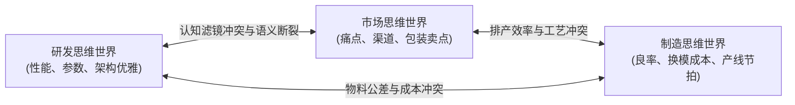

# Lec 5 跨职能整合与重量级产品开发团队：乐柏美思维壁垒案例 (Cross-Functionality & Heavyweight Teams: Rubbermaid)

> MIT Sloan School of Management · 15.351 Managing the Innovation Process · Prof. Jonathon Cummings

## TL;DR

- 克拉克与惠尔莱特团队组织模型将新产品团队划分为职能型、轻量级、重量级与自主型四类。
- 重量级项目经理（Heavyweight Project Manager）拥有人员调配权与跨职能预算裁决权，是高风险突破创新的关键保障。
- 德博拉·道格蒂（Dougherty）“思维世界（Thought Worlds）”理论揭示了研发、市场与制造在认知过滤上的根本冲突。
- 乐柏美（Rubbermaid）狂热追求“每天推出一款新产品”的机械化考核，最终在跨职能协同崩溃中被巨额内耗吞噬。

## 新产品开发团队的四大组织结构 / Organizing Development Teams

哈佛商学院金·克拉克（Kim Clark）与斯蒂芬·惠尔莱特（Steven Wheelwright）在 1992 年的开创性研究中，系统梳理了科技制造企业组织跨职能产品开发团队的四种典型结构。这四种模式在项目经理的权力大小、职能部门的掌控度以及资源分配逻辑上展现出本质差异：

### 四大团队结构深度对比剖析

| 组织结构形式 | 项目经理权力级别 | 职能团队成员归属感 | 最适用的研发项目类型 | 潜在致命缺陷 |
| :--- | :--- | :--- | :--- | :--- |
| **职能型团队 (Functional Team)** | 无（仅有各职能主管按专业分工把守） | 100% 归属于本专业职能部门（如机械、电路、采购） | 成熟产品的微小改款、零部件标准化降本 | 没有任何人对最终商业结果负责；各部门推诿严重 |
| **轻量级团队 (Lightweight Team)** | 极低（初级协调员，仅负责收集甘特图进度） | 主要效忠于职能部门领导，项目会议流于形式 | 现有产品线的小幅延展、风险极低的组合升级 | 项目经理沦为“会议记录员”，无法调动任何关键资源 |
| **重量级团队 (Heavyweight Team)** | 极高（资深高管挂帅，直接掌控成员考核与预算） | 双重汇报线，但在项目期内全力以赴效忠于项目目标 | 全新平台级产品架构开发、突破性技术商业化 | 与传统职能部门产生权力摩擦，老干部的权威受到挑战 |
| **自主型突击队 (Autonomous / Tiger Team)** | 绝对最高（相当于独立创业公司 CEO） | 完全脱离母公司原有部门，物理搬迁至隔离厂区 | 颠覆性技术革命、行业规则重写型秘密项目 | 彻底脱离母体现有供应链与销售网络，难以复用规模优势 |

::: definition 重量级项目团队 (Heavyweight Project Team)
由高级别、高威望的资深业务领袖领导，各职能部门（工程、营销、生产、财务）选派核心骨干全职加入的作战组织。与传统项目制的核心区别在于：**重量级经理拥有对团队成员绩效考核的硬核打分权，并对产品从概念设计到工厂投产上市的全生命周期商业利润承担直接责任**（例如摩托罗拉 Bandit 寻呼机自动化生产线开发团队）。
:::

## 德博拉·道格蒂与“思维世界”壁垒 / Interpretive Barriers to Innovation

为什么哪怕高层领导反复强调“跨部门团结”，研发、市场和制造部门坐在一起开会时依然像鸡同鸭讲？宾夕法尼亚大学沃顿商学院组织学者德博拉·道格蒂（Deborah Dougherty）在 1992 年发表的里程碑式论文中，提出了**“思维世界”（Thought Worlds / Gedankenwelten）**理论。

::: example 道格蒂对跨职能“思维世界”的深度解构
道格蒂在对 15 家大型企业数十个新产品项目的深度调研中发现，不同专业背景的人并不是在“故意找茬”，而是他们戴着由长期职业训练和部门考核铸就的“认知滤镜”在审视同一个现实：
1. **技术研发人员的思维世界（Technical / Engineering Realm）**：
   - **关注焦点**：系统可行性、物理性能极限、架构的优美性与抗干扰冗余；
   - **典型话语**：“只要我们把信噪比提升 6 个分贝，用户自然会被震撼！”
2. **市场营销人员的思维世界（Market / Customer Realm）**：
   - **关注焦点**：消费者的情感共鸣、渠道准入佣金、竞争对手当季定价动态与市场声量；
   - **典型话语**：“客户根本不在乎你的信噪比是几，他们只要外观小巧、颜色讨喜、价格再便宜 20 块钱！”
3. **制造与供应链人员的思维世界（Manufacturing / Operations Realm）**：
   - **关注焦点**：模具公差良率、自动化贴片产线节拍、换模停机停产成本与原材料呆滞风险；
   - **典型话语**：“这个外壳曲面如果倒角这么大，注塑成型冷却时间要翻倍，工厂本月的产能指标谁来兜底？绝对不行！”
:::

道格蒂指出，这三大“思维世界”如果缺乏高超的协同机制，新产品开发就会演变为无休止的政治拉锯战：研发埋头造出了无人问津的高精尖怪物；市场销售了工厂根本造不出来的非标定制品；工厂为了完成稼动率指标狂产即将被市场淘汰的老旧库存。

## 乐柏美（Rubbermaid）狂飙突进与崩溃的教训

美国家居用品巨头乐柏美（Rubbermaid）曾被《财富》杂志连续数年评选为“全美最受尊敬的公司”第一名，其成功的核心秘诀正是建立在被华尔街交口称赞的跨职能“业务团队制（Business Teams）”之上。然而，这套体系最终却演化为拖垮巨头的致命绞索。

::: example 乐柏美公司的产品狂热与组织反噬
- **光辉岁月（1980 年代 - 1990 年代初）**：在传奇 CEO 沃尔夫冈·施密特（Wolfgang Schmitt）的带领下，乐柏美组建了由产品经理、工业设计师、模具制造工程师与财务代表组成的跨职能业务团队。他们推出了防漏储物箱、洗菜篮、塑料垃圾桶等风靡全球的爆款。施密特立下了铁律：**“乐柏美每 33 天必须进入一个全新的产品品类，每天必须推出一款新产品！”**
- **体制异化与疯狂内耗**：
  - **KPI 走火入魔**：为了达成“每天一款新产品”的惊人指标，跨职能团队不再从事深度消费者调研，而是为了立项而立项。团队将同一款塑料盆染成 10 种不同颜色，或者将把手加长 2 厘米，就冠以“颠覆性新产品”报送总部；
  - **模具与生产线过载**：塑料注塑需要极其昂贵的钢模。乐柏美每年开模数千套，工厂排产被切得粉碎，换模损耗高达 40% 以上。制造工人与工程师长期超负荷运转，士气崩溃；
  - **渠道巨头的无情抛弃**：伴随着沃尔玛（Walmart）等平价零售巨头的崛起，渠道商开始要求严苛的准时交付率（OTIF）与极低的供货价。此时，乐柏美发现由于过度开发，其内部 SKU 高达数万种，供应链后台完全失控，无法按时向沃尔玛交货。当树脂原材料价格暴涨时，乐柏美试图转嫁成本，遭到沃尔玛直接将其商品从货架清空；
- **黯然落幕**：1999 年，深陷巨额亏损与供应链死锁的乐柏美被迫以大幅折价卖身给纽威尔集团（Newell），一代创新神话终结。
:::

| 维度 | 乐柏美初期的健康机制 | 乐柏美后期的病态异化 |
| :--- | :--- | :--- |
| **战略目标** | 捕捉未被满足的家庭收纳真实痛点 | 机械完成“每年 400 款新产品”的虚荣 KPI |
| **跨职能团队运作** | 深度碰撞、深入家庭厨房洗碗池做观察 | 疲于奔命、沦为盖章通过图纸的流水线工具 |
| **供应链响应能力** | 专注大单品规模效应，生产节拍极其平稳 | 数万个非标 SKU 导致换模瘫痪，交付彻底崩盘 |

::: insight 速度陷阱与“形式主义敏捷”
乐柏美的溃败给现代企业的跨职能整合敲响了警钟：**不要把“创新的数量”等同于“创新的质量”**。当跨职能团队被赋予过度刚性的考核指标时，团队会本能地通过稀释技术含量、制造大量毫无市场价值的“伪创新”来应付考核。真正的跨职能整合，其目的在于提升决策的深度与系统的健壮性，绝非单纯为了追求数字狂欢。
:::

## 我的理解与实践洞察 / Personal Insight

从技术开发走向组织协同，任何创新项目最容易低估的都是跨领域的认知摩擦与制度惯性。在实践中，卓越的技术领袖不仅是精通参数指标的极客，更是深谙人际网络与组织动线的系统架构师。

::: insight 破除体制引力的核心法则
与其指望通过行政命令强迫不同职能部门步调一致，不如在底层建立透明的物理共享物（如可运行的粗糙手板原型、清晰的 API 契约与共担的业务损益 P&L）。用真实的物理反馈与利益一致性，替代虚妄的口头协调，这是跨越组织深井的唯一通途。
:::

## 思考题与实战研讨

1. 很多大型互联网和智能硬件公司宣称推行“敏捷开发”与“项目制”，但实际运作中项目经理没有任何人事考评权，所有绩效依然由各职能中台总监打分。这种团队属于克拉克模型中的哪一种？它在推进重大创新时会遭遇什么困境？
2. 结合德博拉·道格蒂的“思维世界”理论，当研发工程师认为某项安全冗余绝对不能削减，而产品经理坚持为了用户体验必须把机身厚度做薄时，一个合格的“重量级项目经理”应该依据什么框架来进行终极仲裁？
3. 乐柏美被沃尔玛下架的教训，对今天依赖亚马逊、抖音电商或大型商超渠道的硬件创业企业有何前车之鉴？为什么过度频繁的产品上新反而会摧毁公司的供应链护城河？
