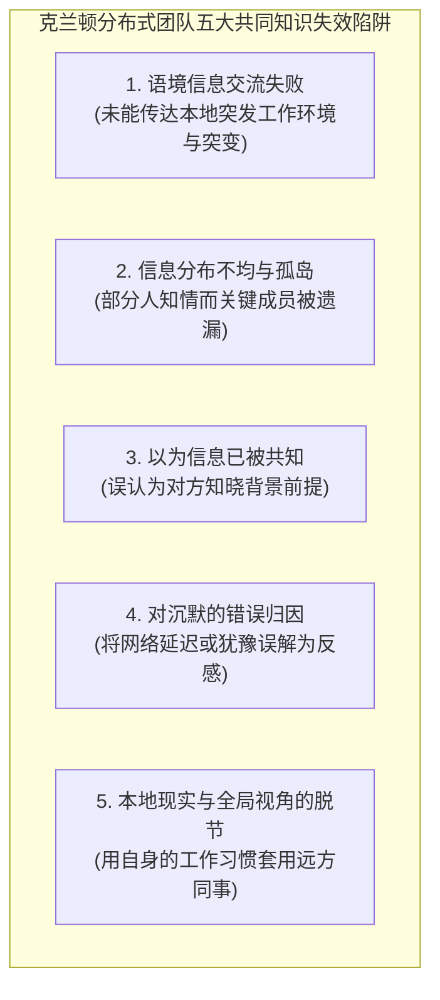
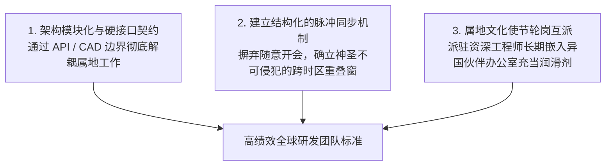

# Lec 6 地理分散与虚拟团队跨时空协作：联合利华 Butter-Beater 案例 (Geographic Dispersion & Virtual Teams: Unilever)

> MIT Sloan School of Management · 15.351 Managing the Innovation Process · Prof. Jonathon Cummings

## TL;DR

- 凯瑟琳·克兰顿（Catherine Cramton）共同知识问题揭示了分布式团队在背景语境、信息分布与沉默解读上的系统性盲区。
- 跨国虚拟团队往往面临“时区滞后”与“文化编码冲突”的双重阻力，盲目依赖异步工具会加剧心理距离。
- 联合利华 Butter-Beater 全球产品研发案例生动展现了英、德、法三地对“黄油涂抹”认知差异所引发的研发内耗。
- 分布式协作成功的关键在于：建立强制性语境同步机制、明确模块物理界限与早期面对面信任破冰。

## 共同知识问题与分布式协作盲区 / The Mutual Knowledge Problem

随着全球化跨国企业的发展，跨越不同国家与时区的“虚拟团队（Virtual Teams）”成为常态。然而，管理学者凯瑟琳·克兰顿（Catherine Cramton）在 2002 年发表于《Organizational Dynamics》的奠基性研究指出：分布式团队最大的敌人不是网络带宽，而是**“共同知识问题（The Mutual Knowledge Problem）”**。

::: definition 共同知识 (Mutual Knowledge)
共同知识不仅指“双方都掌握了某项信息”，更是指**“双方都知道彼此掌握了该项信息，并且彼此都知道对方知晓这一点”**。在面对面的物理环境中，眼神交流、身体前倾、即时点头等微表情会自动完成共同知识的确认；但在远距离分布式沟通中，共同知识的生成机制被彻底阻断。
:::

### 克兰顿五大陷阱的现实破坏力

1. **语境信息交流失败 (Failure to Communicate Context)**：例如，驻扎在孟买的工程师遭遇了当地百年一遇的暴雨停电，导致服务器无法访问。他们认为“这属于不可抗力，大家肯定理解”；而在纽约总部的产品经理看到代码仓库没有更新，直接得出了“印度外包团队在偷懒旷工”的偏见结论。
2. **对“沉默”的恶意归因 (Uneven Attribution of Silence)**：在异步邮件或协同软件中，当一方发送了一条方案提议后，远方团队迟迟未回复。发送者往往本能地解读为“对方蔑视我的方案”或“对方在消极对抗”，而事实上对方可能正在休法定国家假日，或者由于母语非英语正在字斟句酌地修改回复草稿。
3. **关键信息未被均匀广播 (Uneven Distribution of Information)**：在总部的核心成员喝咖啡时闲聊出了一个架构重大变更，随后仅在走廊上口头通知了身边的同事，完全忘记同步给远在异国分部的研发人员，导致异国团队在已被废弃的旧分支上白白浪费数周心血。

## 联合利华 Butter-Beater 案例：跨国创新的文化与认知深渊

跨国日化巨头联合利华（Unilever）的哈佛经典案例《Butter-Beater》（黄油打发器项目），将地理分散与文化偏见对创新的破坏展现得淋漓尽致。

::: example 联合利华跨国黄油创新项目的混乱溃败
- **项目初衷**：在欧洲市场，从冰箱里刚拿出来的传统硬块动物黄油极其坚硬，涂抹在面包上容易将松软的面包撕裂；而植物人造黄油（Margarine）虽然易于涂抹，但风味与健康属性饱受消费者诟病。联合利华决定启动“Butter-Beater”绝密创新项目，研发一种既保持纯正黄油风味，又能像人造黄油一样在摄氏 4 度冷藏状态下轻松涂抹的革命性乳品加工技术。
- **三地割裂的跨国研发团队**：
  - **英国研发中心（Port Sunlight）**：负责基础乳脂胶体化学与宏观产品战略；
  - **德国汉堡工程中心（Hamburg）**：负责工厂级高压均质剪切设备的设计与工艺制造；
  - **法国巴黎市场营销部（Paris）**：负责终端消费洞察与高端品牌定位。
- **认知鸿沟与跨国冲突爆发**：
  - **文化维度的“黄油认知”根本对立**：法国市场总监认为黄油是高贵优雅的餐桌艺术，必须具备浓郁的奶香与金黄的色泽；德国工程师则将黄油视为一种严格受控的流体力学乳化体系，强调熔点与机械屈服强度的标准化数值指标；英国团队则深陷于英式下午茶的涂抹习惯，无法理解欧陆消费者的细微偏好。
  - **跨时空协作的相互指责**：德国工程师团队抱怨英国化学家提交的实验配方缺乏严谨的工程边界，完全无法在汉堡工厂的连续生产线上放大；法国营销部门则指责德国人造出的是一种“毫无口感灵魂的工业塑料膏”。
  - **信息封锁与项目自保**：由于缺乏统一的强力领导与面对面沟通，三地据点开始互相隐瞒测试数据，只向集团最高执委会汇报有利于本部门的漂亮指标，对出现的乳水分离缺陷推诿扯皮。
- **最终惨剧**：该项目历时数年、耗资千万欧元，最终推向市场的试销产品不仅口感黏滞怪异，而且在夏季室温下迅速发生不可逆的油水分离变质。全欧洲各大商超集体退单，联合利华董事会最终被迫将该项目永久封存。
:::

| 研发中心据点 | 团队擅长领域 | 主导文化心理与偏见 | 沟通断层带来的致命后果 |
| :--- | :--- | :--- | :--- |
| **英国港日光中心** | 胶体化学基础理论 | 居高临下、自诩为战略大脑，轻视制造工程 | 实验室级配方无法适配量产重型剪切反应釜 |
| **德国汉堡工程部** | 精密机械与产线自动化 | 刻板教条、沉迷设备参数，反感外部频繁修改 | 拒绝为营销部门提出的微妙口感差异微调管路 |
| **法国巴黎营销部** | 品牌叙事与消费者审美 | 傲慢挑剔、认为技术人员是一帮不懂美食的机器 | 无法将抽象的“美味直觉”量化为技术指标 |

::: insight 虚拟团队的“第一天信任定律”
麻省理工学院对全球数百个高绩效虚拟团队的追踪表明：**完全从线上开始建立的团队，其相互信任度的攀升速度极其缓慢，且抵御危机的韧性极差**。真正卓越的跨国项目管理者，即便预算再紧张，也必须在项目启动的第一周将所有核心据点的骨干集中在同一物理空间，共同吃住、白板研讨、喝酒社交。这种面对面建立的“情感存款（Emotional Bank Account）”，是在未来长达数月的跨时区争吵与延误中维系团队不致散架的唯一安全气囊。
:::

## 克服地理分散的核心治理框架

针对虚拟团队的顽疾， Cummings 教授与跨国研发专家总结了三大系统性治理策略：

1. **架构彻底模块化（Extreme Architecture Modularity）**：将复杂系统拆解为定义极其严格的子模块。例如，底盘团队与上装团队之间只通过标准电气物理接口协议沟通。只要接口不发生变动，异地团队可以在各自内部拥有 100% 的设计自由，将跨洋沟通的频次降低一个数量级。
2. **结构化“黄金重叠窗（Overlap Window）”**：明确界定每天跨时区团队同时在线的 2 个小时为“最高优先级同步时段”，严禁在此期间安排本国单边事务。所有关键跨国决策必须在此窗口期内通过实时视频面对面对齐，严禁通过又臭又长的邮件链条进行跨洋论战。
3. **“文化使节（Cultural Ambassadors）”常态化轮岗**：定期选派核心技术人员到异国办公室工作 3 至 6 个月。当英国工程师亲自在德国汉堡车间站过两周产线，或者德国工程师亲自参加过巴黎消费者的焦点访谈室之后，原先根深蒂固的部门成见便会在理解中消融。

## 我的理解与实践洞察 / Personal Insight

从技术开发走向组织协同，任何创新项目最容易低估的都是跨领域的认知摩擦与制度惯性。在实践中，卓越的技术领袖不仅是精通参数指标的极客，更是深谙人际网络与组织动线的系统架构师。

::: insight 破除体制引力的核心法则
与其指望通过行政命令强迫不同职能部门步调一致，不如在底层建立透明的物理共享物（如可运行的粗糙手板原型、清晰的 API 契约与共担的业务损益 P&L）。用真实的物理反馈与利益一致性，替代虚妄的口头协调，这是跨越组织深井的唯一通途。
:::

## 思考题与实战研讨

1. 很多跨国跨区域团队在遇到代码报错或交期延误时，第一反应是在微信群或 Slack 群里公开艾特所有人质问。根据凯瑟琳·克兰顿的研究，这种做法为什么极易引发防御性的推诿与信任崩塌？更职业的处理方式应该是什么？
2. 在联合利华 Butter-Beater 案例中，如果你是集团新上任的全球研发副总裁，在面对英、德、法三地的文化与技术死锁时，你会如何重构项目团队的汇报线与决策权？
3. 对于今天在中美、中欧两地布局的硬科技初创企业，如何平衡中国强大的供应链制造效率与海外本土市场的敏锐用户洞察？本讲的理论能够提供哪些具体的组织架构指引？
