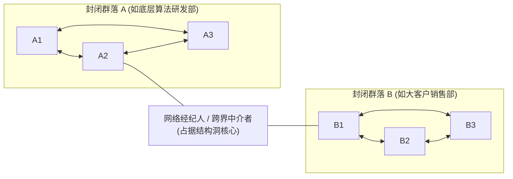

# Lec 7 企业内部社交网络与结构洞：DEC 柯达外包与非正式关系网 (Intra-Organizational Networks & Structural Holes: DEC)

> MIT Sloan School of Management · 15.351 Managing the Innovation Process · Prof. Jonathon Cummings

## TL;DR

- 罗纳德·伯特（Ronald Burt）结构洞理论指出：跨越无连接群落的信息中介（Broker）拥有最高的信息垄断收益与创新动能。
- 大卫·克拉克哈特（Krackhardt）非正式网络模型将组织透视为三层隐形网络：技术建议网、情感信任网与日常沟通网。
- 弱连带（Weak Ties）与跨部门电子邮件列表往往是打破局部技术盲区、实现低成本求助的有效机制。
- DEC 与柯达外包案例表明：自上而下的行政命令如果遭到非正式信任网络的集体抵制，重大战略合作必将搁浅。

## 结构洞理论与社会资本 / Structural Holes and Social Capital

在科技企业中，很多人误以为“拥有最多人脉的人最具影响力”。然而，芝加哥大学著名社会学家罗纳德·伯特（Ronald Burt）在 1992 年出版的《结构洞：竞争的社会结构》（*Structural Holes*）中证明：**人脉的数量远不如人脉的结构关键**。

::: definition 结构洞 (Structural Hole)
在社会网络中，某些个体或群体之间虽然存在着互利合作的潜在可能，但彼此之间却没有任何直接连带（Ties）。这种存在于网络节点之间的“空白断裂区域”，即被称为**结构洞**。跨越在结构洞两端并建立连接的人，被称为**知识中介者（Network Broker）**。
:::

### 占据结构洞的创新者收益

伯特的研究发现，占据结构洞的工程师或产品经理在企业中展现出压倒性的优势：
1. **信息优势（Access, Timing & Referrals）**：他们能在第一时间获取来自不同领域的异构信息，比同一群体内相互交流同质化信息的普通员工早数周察觉到技术瓶颈与市场机遇；
2. **第三获益者杠杆（Tertius Gaudens）**：当群落 A 与群落 B 存在认知冲突或利益博弈时，身处中间的中介者能够通过巧妙地整合与调度两端资源，设计出双赢的创新方案，从而获得巨大的个人威望与晋升资本；
3. **早期的非共识创意孵化**：真正的颠覆性创意往往产生于两个看似风马牛不相及的学科交叉处。占据结构洞的人天生具备将 A 领域的现成工具移植到 B 领域解决顽固难题的直觉。

## 隐形组织图谱：克拉克哈特的非正式网络模型

哈佛商业评论发表的大卫·克拉克哈特（David Krackhardt）与杰弗里·汉森（Jeffrey Hanson）的经典研究《非正式网络：组织图谱背后的真实公司》（*Informal Networks*），为管理者揭开了企业正式组织架构（Org Chart）背后的真实运作机理。

| 隐形网络类型 | 网络定义与探测方式 | 核心功能与对创新的价值 | 潜在风险与失效征兆 |
| :--- | :--- | :--- | :--- |
| **技术建议网络 (Advice Network)** | “日常工作中遇到技术死锁时，你最信任向谁请教？” | 展现企业内部解决技术瓶颈的实际知识流动路线图 | 若所有箭头指向极少数明星专家，极易引发专家过载与单点瘫痪 |
| **情感信任网络 (Trust Network)** | “在公司遭遇不公、职业危机或分享高风险绝密想法时，你敢向谁倾诉？” | 在组织面临裁员、重组或高风险技术试错时提供心理安全感 | 信任网络通常极其狭隘，容易演化为拉帮结派与对抗高层决定的山头 |
| **日常沟通网络 (Communication Network)** | “在过去两周内，你因工作事务与谁进行过日常交流？” | 反映跨职能流程的实际运作效率与信息堵塞节点 | 沟通冗余度过高，导致全员陷入无效会议与日常闲聊泥潭 |

::: insight 组织架构图的致命欺骗性
企业的正式行政汇报线只说明了“权力由谁下达”，却丝毫不能反映“知识由谁生产”与“战略能否落地”。一位在架构图上只是底层 P5 级别的测试工程师，如果他在“技术建议网络”中处于绝对核心中枢，那么任何研发流程的推行如果忽略了他的意见，都将遭遇无声的抵触。卓越的管理者必须具备绘制非正式网络图谱的洞察力。
:::

## 电子弱连带的威力：“陌生人的仁慈”

斯坦福大学学者戴安娜·康斯坦特（Diana Constant）、李·斯普鲁尔（Lee Sproull）与萨拉·基斯勒（Sara Kiesler）在 1996 年发表的经典研究《陌生人的仁慈》（*The Kindness of Strangers*），实证追踪了大型高科技企业内部电子邮件技术列表对解决技术卡点的惊人贡献。

::: example 弱连带在分布式企业中的知识溢出
- **强连带的局限**：一个工程师日常最要好的三五个密友（强连带），其知识结构往往与其高度重叠。当遇到全新的技术盲区时，密友们通常同样束手无策；
- **弱连带的爆发力**：当工程师鼓起勇气在全公司泛技术邮件列表中抛出一个极其具体的底层驱动报错日志时，远在几千英里外、素未谋面的异国资深架构师往往会在下班途中随手回复一条核心排查思路。
- **动因机制**：为什么陌生人愿意无偿提供昂贵的智力援助？研究表明，除了自我认同与展示专业造诣的心理满足外，对本企业大共同体的组织公民认同感（Organizational Citizenship Behavior）是促成这种无私互助的核心引擎。
:::

## 巨头联姻的流产：数字设备公司（DEC）与柯达外包案例

哈佛商学院案例《数字设备公司：柯达外包协议》（Digital Equipment Corporation: The Kodak Outsourcing Agreement）生动展示了自上而下的行政权威如何被盘根错节的内部非正式网络所绞杀。

::: example DEC-柯达大型外包协议的触礁
- **世纪合作背景**：1989 年，小型机鼻祖 DEC 试图向企业级 IT 服务提供商转型，并与传统影像巨头伊士曼柯达（Eastman Kodak）达成了一项划时代的战略合作意向：柯达将其全球数十处数据中心与数千名员工全部外包给 DEC 进行一体化升级运营。
- **高层的傲慢推行**：DEC 最高决策层认为这是一项能为公司带来数十亿美元经常性收入的标志性胜利，未经基层详尽论证便自上而下签署了战略备忘录。
- **内部非正式信任网络的激烈反扑**：
  - **技术文化断层**：DEC 内部以崇尚极客自由、追求纯粹技术卓越的工程网络著称。底层工程师与中层架构师在自己的非正式交流群中，将柯达的外包资产嘲弄为“一堆被老旧大型机塞满的电子垃圾场”；
  - **派系抵制与无声消极怠工**：DEC 各硬件事业部的关键负责人不仅拒绝派驻王牌工程师支援该项目，反而在内部信任网络中散播恐慌，声称“给柯达当网管会严重拉低 DEC 作为顶级计算机研发企业的品牌声誉”；
  - **协议执行走样**：由于缺乏一线技术骨干的真诚投入，DEC 派往柯达接管机房的人员士气极其低落，双方系统联调故障频发。
- **最终苦果**：这项曾被寄予厚望的世纪级外包合作在内耗中狼狈收场，直接加速了 DEC 在随后的个人电脑与开放系统浪潮中的陨落。
:::

| 维度 | DEC 最高管理层决策视角 | DEC 内部非正式工程网络现实 |
| :--- | :--- | :--- |
| **战略定性** | 从硬件制造向高利润服务业转型的灯塔工程 | 替传统化学胶卷公司擦屁股的平庸运维脏活 |
| **推进手段** | 签发红头文件、成立跨部门行政委员会 | 私下串联抵制、保护本部门技术骨干不被抽调 |
| **信任基础** | 假定合同与高额预算能自动驱动全员配合 | 工程师对新战略毫无心理认同，深感被出卖 |

::: pitfall 忽视“弓领结结构（Bow-Tie Structure）”的危险
在社会网络分析中，如果一个部门的所有信息输入与输出完全被某一个中层经理死死掐住（形成如同蝴蝶结中央绳结一般的单点依赖），该经理就获得了巨大的行政寻租与信息屏蔽权力。一旦该经理由于部门利益而选择消极封锁，外部的任何创新倡议都将在此处被彻底绞杀。
:::

## 我的理解与实践洞察 / Personal Insight

从技术开发走向组织协同，任何创新项目最容易低估的都是跨领域的认知摩擦与制度惯性。在实践中，卓越的技术领袖不仅是精通参数指标的极客，更是深谙人际网络与组织动线的系统架构师。

::: insight 破除体制引力的核心法则
与其指望通过行政命令强迫不同职能部门步调一致，不如在底层建立透明的物理共享物（如可运行的粗糙手板原型、清晰的 API 契约与共担的业务损益 P&L）。用真实的物理反馈与利益一致性，替代虚妄的口头协调，这是跨越组织深井的唯一通途。
:::

## 思考题与实战研讨

1. 绘制你所在业务单元的“隐形组织图谱”：谁是大家真正遇到技术死锁时排队请教的“非正式技术领袖”？这位领袖是否获得了企业资源体系的足够支撑？
2. 结合罗纳德·伯特的结构洞理论，为什么一个在工程部和市场部之间担任“产品经理”的人，最容易招致两边同事“这人两头讨好、缺乏真才实学”的批评？企业管理者该如何保护并合理评价这些珍贵的“网络中介者”？
3. 在 DEC 与柯达外包案例中，如果你是 DEC 当时的战略转型执行总监，面对内部工程师技术网络的强烈排异反应，你会设计怎样的利益分享与荣誉认证机制来化解阻力？
