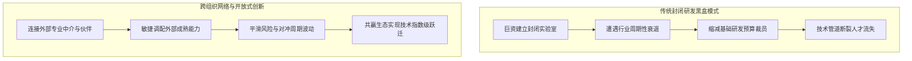
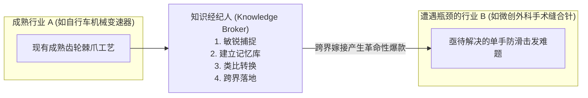

# Lec 8 跨组织创新网络与知识经纪人：NYPRO-Vistakon 抛弃式隐形眼镜案例 (Inter-Organizational Networks & Knowledge Brokers: NYPRO)

> MIT Sloan School of Management · 15.351 Managing the Innovation Process · Prof. Jonathon Cummings

## TL;DR

- 约翰·沃尔珀特（John Wolpert）开放式创新指出：依赖单一企业内部研发的“创新黑盒”正被专业中介网络所打破。
- 安德鲁·哈加顿（Andrew Hargadon）知识经纪（Knowledge Brokering）四步法：捕捉、保存、转换与跨行业移植应用。
- NYPRO 与强生 Vistakon 的战略联盟创造了全球首款日抛型隐形眼镜（Acuvue），攻克了高精密注塑与无菌包装的工艺极限。
- 成功的技术联盟必须打破“甲乙方委托代工”的传统偏见，建立风险共担、专利共有与长周期深度协同机制。

## 走出创新黑盒：跨组织网络与开放式创新 / Breaking Out of the Innovation Box

在过去的一个世纪里，企业创新的主导范式是“中央研究院模式”：像贝尔实验室、施乐帕洛阿尔托研究中心（Xerox PARC）或通用电气全球研发中心一样，企业将成百上千名顶级博士关在围墙内闭门造车。然而，创新学者约翰·沃尔珀特（John Wolpert）在 2002 年发表于《哈佛商业评论》的经典文献《打破创新黑盒》（*Breaking Out of the Innovation Box*）中指出：**这种重资产自给自足的闭门模式正在遭遇严重的经济学极限**。

### 开放式创新网络的四大支柱

1. **创新周期的繁荣与萧条循环（Boom-Bust Cycle）**：内部研发具有极强的固定成本刚性。在繁荣期，企业过度扩张实验室；一旦遭遇宏观衰退，财务部门首先砍掉的就是 5 年后才能变现的研究预算。这种暴饮暴食彻底摧毁了技术的积累连续性；
2. **专业中介网络（Networks of Intermediaries）**：在现代科技生态中，大量的独立设计公司（如 IDEO）、合同研究组织（CRO）、先进制造外包商与知识产权经纪人正在崛起。企业应当像拼乐高积木一样，将外部已经验证的成熟模块接入自身的核心系统；
3. **技术溢出的双向流动**：企业不仅要从外部吸收创意，更要将自己内部暂时用不上的闲置技术专利通过授权、分拆（Spin-off）或开源的方式释放出去，在外部生态中培育肥沃的土壤。

## 知识经纪人理论：哈加顿与 IDEO 的创新复用模型

为什么像 IDEO 这样的著名工业设计公司，既能设计出苹果第一款商业鼠标，又能设计出革命性的微创手术器械、甚至是宝洁的牙膏挤压泵？加州大学戴维斯分校教授安德鲁·哈加顿（Andrew Hargadon）提出了著名的**“知识经纪（Knowledge Brokering）”**理论。

::: definition 知识经纪 (Knowledge Brokering)
知识经纪是指组织跨越原本互不往来的行业与技术领域，将一个行业中司空见惯的现成技术、材料或工程设计，创造性地“移植并转译”到另一个深陷技术死锁的行业中，从而在客户眼中展现出“突破性颠覆”的创新模式。
:::

### 知识经纪四步循环法 (The Four-Phase Brokering Cycle)

1. **广泛捕捉（Capturing Good Ideas）**：设计师与工程师必须保持杂食性的好奇心，不带偏见地考察玩具制造、航空钣金、纺织印染甚至垃圾回收站的一切巧妙结构；
2. **沉淀组织记忆（Keeping Ideas Alive）**：将收集到的实物奇巧构件陈列在公司的“材料灵感墙”或内部零件库中，确保全体员工能够随时触摸、拆解与把玩；
3. **类比与概念转换（Imagining New Uses for Old Ideas）**：在头脑风暴中强迫团队思考：“这个在遥控赛车底盘上使用的抗冲击注塑卡扣，能不能用来固定心脏起搏器的导线？”
4. **在新赛道测试应用（Putting Ideas to the Test）**：迅速制作粗糙手板原型，验证跨界移植的可行性，以极低的成本绕开目标行业原有的思维定势。

## 极限制造联盟：NYPRO 与强生 Vistakon 的抛弃式隐形眼镜奇迹

哈佛商学院经典案例《挑战不可能的制造：NYPRO/Vistakon 抛弃式隐形眼镜项目》（*Molding the Impossible*），展现了跨组织创新联盟的最高境界。

::: example 强生 Vistakon 与精密切削巨头 NYPRO 的生死共研
- **商业构想与技术死锁**：在 1980 年代，隐形眼镜是一种昂贵且耐用的医疗用品。用户必须使用药水反复浸泡清洗，极易滋生细菌感染角膜。强生旗下的 Vistakon 洞察到“日抛型隐形眼镜（Acuvue）”的巨大蓝海市场。然而，这在工程制造上被全球公认为“天方夜谭”：
  - 传统隐形眼镜依靠极其缓慢的手工车床逐个切削打磨，单片生产成本高达数十美元；
  - 若要做成售价几美分的日抛耗材，必须使用全自动化注塑成型技术，但隐形眼镜光学曲率要求注塑模具公差小于 1 微米，且脱模后镜片绝对不能存在任何毛刺或分子取向变形。
- **寻找跨界盟友 NYPRO**：强生走遍全球顶级注塑厂，全部被对方以“物理不可能”为由拒之门外。唯独位于马萨诸塞州克林顿小镇的高精密注塑老厂 NYPRO 接受了挑战。NYPRO 总裁戈登·拉赫顿（Gordon Lankton）做出了惊人的战略承诺：
  - **打破传统代工合约**：双方没有签署简单的采购买卖合同，而是组建了联合技术攻坚指挥部；
  - **技术资产共创**：NYPRO 投资数千万美元，为强生专门建造了全球最高规格的无菌洁净生产车间，自主研发出前所未有的超高速多腔热流道注塑系统与机器视觉在线全检算法；
  - **深度绑定与互信**：强生工程师与 NYPRO 模具师傅同桌办公长达数年，攻克了水凝胶水合膨胀过程中的非线性收缩难题。
- **划时代商业胜利**：1988 年，Acuvue 日抛型隐形眼镜正式震撼上市。两家公司联合创造的高速自动化产线将单片镜片生产周期压缩至数秒以内，生产成本下降了 90% 以上。Acuvue 迅速席卷全球 50% 以上的市场份额，成为强生历史上最赚钱的医疗消费品之一，而 NYPRO 亦一跃成为全球精密医疗塑料制造无可撼动的龙头。
:::

| 合作维度 | 传统甲乙方外包采购模式 | NYPRO - Vistakon 创新共生联盟 |
| :--- | :--- | :--- |
| **契约本质** | 严苛的价格压榨、按件计价、防备技术泄露 | 共同承担技术试错风险、共享规模红利与专利衍生收益 |
| **信息透明度** | 严格屏蔽底层图纸与工艺参数，彼此防备 | 研发底层 CAD 数据、良率波动与财务成本彻底向对方透明 |
| **工程师心态** | “客户要求怎么干就怎么干，搞砸了与我无关” | “这是两家公司共同的孩子，必须突破物理极限！” |

::: pitfall “知识被偷走”的囚徒困境与契约设计
跨企业创新合作中最致命的暗礁是“道德风险”：小公司害怕核心技术被大公司窃取后被一脚踢开；大公司害怕小公司拿了自己的研发资助转头卖给竞争对手。NYPRO 与强生之所以成功，关键在于在合同中设置了严密的**排他性保护期（Exclusivity Window）与超额利润阶梯返还机制**，用制度彻底锁死了背叛收益。
:::

## 我的理解与实践洞察 / Personal Insight

从技术开发走向组织协同，任何创新项目最容易低估的都是跨领域的认知摩擦与制度惯性。在实践中，卓越的技术领袖不仅是精通参数指标的极客，更是深谙人际网络与组织动线的系统架构师。

::: insight 破除体制引力的核心法则
与其指望通过行政命令强迫不同职能部门步调一致，不如在底层建立透明的物理共享物（如可运行的粗糙手板原型、清晰的 API 契约与共担的业务损益 P&L）。用真实的物理反馈与利益一致性，替代虚妄的口头协调，这是跨越组织深井的唯一通途。
:::

## 思考题与实战研讨

1. 结合安德鲁·哈加顿的知识经纪理论，很多当下的硬科技硬件创业者往往习惯于“为了这项芯片指标自研一整套全新设备”。为什么优秀的技术经纪人更倾向于在消费电子、汽车甚至玩具供应链中寻找成熟的替代替代解决方案？
2. 在 NYPRO 与强生的合作中，如果 NYPRO 当时仅仅将自己定位为“赚取微薄加工费的代工厂”，这个项目为什么绝对无法成功？
3. 对于初创科技企业而言，与行业头部的跨国巨头组建联合研发联盟时，应该如何起草知识产权（IP）归属条款，才能既保证巨头的渠道支持，又守住公司的生死命脉？
