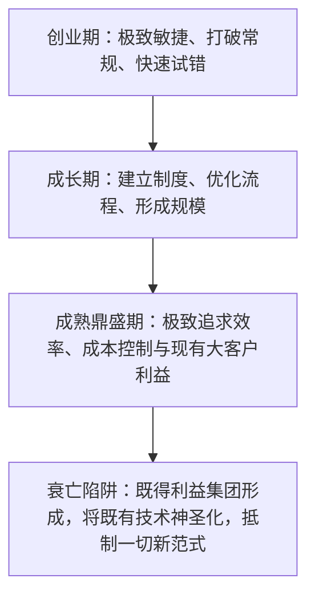

# Lec 9 组织创新特征与实验原型开发：太阳微系统与成功暴政 (Organizational Features & Prototyping: Sun Microsystems)

> MIT Sloan School of Management · 15.351 Managing the Innovation Process · Prof. Jonathon Cummings

## TL;DR

- 多萝西·莱昂纳德-巴顿（Leonard-Barton）指出：原型制作绝非产品定型后的验证工具，而是驱动组织认知的最核心探针。
- “达尔文式快速原型实验”通过并行推进多个粗糙方案的竞争性试错，在真实约束下快速逼近最优解。
- 太阳微系统（Sun Microsystems）凭借开放标准、通用现成零部件（COTS）与去中心化工程文化席卷工作站市场。
- 迈克尔·图什曼“成功的暴政”理论警示：当企业的核心能力固化为无法革新的神圣教条时，灭顶之灾便已悄然降临。

## 原型作为认知探针：莱昂纳德-巴顿的实验理论 / Prototyping as an Inquiry Tool

在传统工业管理理念中，原型开发（Prototyping）通常被视为产品开发流水线末端的一个单向验证环节：设计师画好完美的蓝图，工程师制造出一台高保真样机，然后进行破坏性测试。然而，哈佛商学院技术管理大师多萝西·莱昂纳德-巴顿（Dorothy Leonard-Barton）在《知识之泉》（*Wellsprings of Knowledge*）第五章中提出了革命性的颠覆观点：**原型制作在本质上是组织探索未知、沉淀隐性知识的最强有力探针**。

::: definition 达尔文式原型演化 (Darwinian Prototyping)
不同于耗资数百万美元、追求一次性成功的“大教堂式”单一样机制造，达尔文式原型主张在项目极早期，利用纸板、泡沫、粗糙打样 PCB 板甚至简陋软件脚本，同时构建 3 到 5 个针对不同技术路线的竞争性原型，在真实客户或实际极端工况下进行“残酷淘汰赛”。在这个过程中，原型的目的不是“向客户证明我们有多棒”，而是**“以最低的代价引诱系统尽快暴露潜在的致命设计缺陷”**。
:::

### 原型开发的三大认知功能

1. **破除部门“思维世界”隔阂的共同物理锚点**：正如第 5 讲所述，研发、市场和制造人员之间往往无法通过纯概念语言达成共识。但只要把一个粗糙的物理模型摆在会议桌中央，工程师能立刻指出模具卡扣位置，市场总监能立刻感受握持手感，抽象的口水战瞬间转化为具体的参数权衡；
2. **界定“未知的未知（Unknown Unknowns）”**：计算机仿真软件（Simulation）只能基于已知的物理公式进行模拟。但现实世界中材料的非线性膨胀、电磁微弱串扰、甚至机箱组装工人的手指肥厚程度，只有在亲手装配物理原型时才会猛然显形；
3. **驱动移情设计（Empathic Design）**：让终端用户在毫无准备的情况下摆弄简陋原型，观察用户在哪些步骤皱起眉头、产生犹豫或误操作，从而挖掘出连用户自己都无法用语言表达的真实潜在痛点。

## 太阳微系统（Sun Microsystems）的崛起与开放架构神话

1982 年，四位年仅二十多岁的斯坦福大学与加州大学伯克利分校年轻极客（安迪·贝克托尔斯海姆、维诺德·科斯拉、斯科特·麦克尼利与比尔·乔伊）创立了太阳微系统公司（Sun Microsystems）。在短短数年内，Sun 凭借工作站产品（Workstation）击溃了阿波罗计算机（Apollo）、DEC 与 IBM 等老牌霸主，成为硅谷乃至全球最令人畏惧的科技先锋。

::: example Sun Microsystems 的颠覆性组织与工程密码
- **拒绝垂直整合，拥抱通用商业现成件（COTS）**：当时的计算机巨头（如 IBM 和 DEC）坚信从晶体管、专有 CPU 架构、操作系统到机箱外壳必须 100% 自研。Sun 则反其道而行之，奉行极度的开放架构哲学：
  - CPU 采用摩托罗拉现成的 68000 芯片；
  - 总线采用标准的 Intel Multibus 工业总线；
  - 操作系统采用加州伯克利分校开源的 BSD Unix（由创始人比尔·乔伊亲自操刀）；
  - 图形系统采用行业通用的 TCP/IP 与 X Window。
- **极致的开发速度与价格破坏**：因为无需重复发明轮子，Sun 仅用不到两周就拼装出了首台工作站原型（Sun-1），性能匹敌售价数十万美元的小型机，但售价仅为数千美元。Sun 的口号“网络就是计算机（The Network is the Computer）”迅速成为行业圣经。
- **去中心化的叛逆工程文化**：在 Sun 内部，工程师拥有极高的自治权。没有繁文缛节的审批表格，只要工程师在白板上画出逻辑并在周末焊出一块跑得通的板子，就能直接拉着麦克尼利进行现场演示。公司内部弥漫着浓厚的黑客主义与崇尚实战的氛围。
:::

| 竞争维度 | 传统小型机霸主 (IBM / DEC / Apollo) | 太阳微系统 (Sun Microsystems) |
| :--- | :--- | :--- |
| **技术架构理念** | 专有封闭系统（Proprietary Lock-in），深度绑定用户 | 彻底开放标准、支持异构互联（Open Standards） |
| **硬件开发模式** | 重资产全自研芯片与外围 ASIC，周期长达 3-5 年 | 大量采用行业成熟 COTS 芯片，数月内完成换代 |
| **软件生态战略** | 封闭私有 OS，向第三方开发者收取高昂授权费 | 拥抱开源 Unix 生态，随后孕育出发明世界的 Java 语言 |

## 迈克尔·图什曼：“成功的暴政”与双元组织 / The Tyranny of Success

然而，天下没有任何一家公司能永远躺在过去的辉煌上。哥伦比亚大学教授迈克尔·图什曼（Michael Tushman）与斯坦福大学教授查尔斯·奥莱利（Charles O'Reilly）在合著的《创新致胜》（*Winning through Innovation*）第一章中，提出了振聋发聩的**“成功暴政（The Tyranny of Success）”**警示。

::: theorem 成功暴政假说 (The Tyranny of Success)
使一家企业在今天取得辉煌成功的组织架构、价值观、流程与核心能力，会在时间的沉淀下逐渐凝固，最终演化为阻止该企业拥抱明天下一个技术周期的最大绊脚石。企业的规模越庞大、在当前主营赛道上的统治力越强，其组织惯性与核心刚性就越牢不可破。
:::

### 太阳微系统的陨落：昔日颠覆者终成体制牺牲品

曾经靠开放架构摧毁旧巨头的 Sun Microsystems，最终也没能逃脱“成功的暴政”：
1. **沉迷于专有 SPARC 架构与高端服务器的高毛利**：进入 1990 年代后期，Sun 逐渐背离了初创期的开放精神，将公司命运押注在专有的 UltraSPARC 处理器与 Solaris 高端服务器上，沉醉于电信运营商与华尔街金融机构带来的 60% 惊人毛利率；
2. **对 x86 PC 服务器与 Linux 的狂妄蔑视**：当英特尔 x86 芯片性能飙升、廉价的商用 Linux 操作系统在戴尔（Dell）和惠普（HP）白牌服务器上崛起时，Sun 的高管们嘲弄 Linux 不过是“业余玩具”。他们拒绝将 Solaris 系统彻底开源并深度适配廉价 x86 平台；
3. **网络泡沫破裂后的悲情结局**：2000 年互联网泡沫破灭，华尔街和互联网初创公司纷纷抛弃售价昂贵的 Sun 服务器，转投平价的 Linux 集群。Sun 的营收发生雪崩，连年巨亏，最终在 2009 年以区区 74 亿美元的残值被甲骨文（Oracle）全盘收购。

::: insight 双元组织的核心秘密 (The Ambidextrous Organization)
图什曼与奥莱利指出，避免“成功暴政”的唯一组织解法是构建**“双元组织（Ambidextrous Organization）”**。企业的大脑必须能够同时操盘两种截然相反的系统：一方面，让成熟业务团队保持极致的纪律、良率与成本控制，榨干现有现金牛业务的每一分利润；另一方面，在行政与物理上坚决隔离前沿探索单元，赋予其与母体完全不同的黑客文化与容错机制。两支部队的指挥官只能在母公司最高 CEO 层面实现统一协调，绝对不能让守成部门的官僚染指探索部队的生杀大权。
:::

## 我的理解与实践洞察 / Personal Insight

从技术开发走向组织协同，任何创新项目最容易低估的都是跨领域的认知摩擦与制度惯性。在实践中，卓越的技术领袖不仅是精通参数指标的极客，更是深谙人际网络与组织动线的系统架构师。

::: insight 破除体制引力的核心法则
与其指望通过行政命令强迫不同职能部门步调一致，不如在底层建立透明的物理共享物（如可运行的粗糙手板原型、清晰的 API 契约与共担的业务损益 P&L）。用真实的物理反馈与利益一致性，替代虚妄的口头协调，这是跨越组织深井的唯一通途。
:::

## 思考题与实战研讨

1. 很多现代工程团队在开发硬件时，过分依赖高端 CAD 有限元仿真软件，直到量产前夕才组装第一台物理机器。结合多萝西·莱昂纳德-巴顿的理论，这种做法最容易踩中哪些意想不到的暗雷？
2. 对比太阳微系统初创期的“开放架构 COTS 策略”与其后期的“专有 SPARC 封闭高毛利依赖”，你能从当下全球智能手机芯片与操作系统阵营（如苹果 iOS vs 谷歌安卓/开源 RISC-V）的博弈中看到哪些极其相似的宿命？
3. 如果你是一家年营收百亿、正处于巅峰期的科技硬件巨头 CEO，面对可能颠覆自己主营业务的新技术萌芽，你应该如何在组织内部搭建图什曼所提倡的“双元组织”，并平息传统核心功勋高管的焦虑与反弹？
