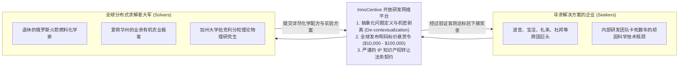

# Lec 10 分布式研发与众包网络：InnoCentive 开放式研发案例 (Distributed R&D & Crowdsourcing: InnoCentive Case)

> MIT Sloan School of Management · 15.352 Managing Innovation: Emerging Trends · Prof. Eric von Hippel

## TL;DR

- 礼来制药分拆孵化的 InnoCentive 平台开辟了全球分布式众包研发（Crowdsourced R&D）新纪元。
- 挑战者（Seeker）与求解者（Solver）的双边撮合模型：将企业内部卡死多年的绝密科研死锁通过去语境化悬赏公布。
- 认知多样性（Cognitive Diversity）的奇迹：超过三分之一的顽固技术死锁是由“专业领域之外的跨界外行”攻克解决的。
- 众包研发经济学：极低的前期固定成本投入，只有在方案经过实验室实测验证完全达标后才支付悬赏奖金。

## 医药研发的万亿美元绝境与 InnoCentive 的诞生 / The R&D Crisis

在 2000 年代初，全球跨国制药巨头面临着严峻的“专利悬崖（Patent Cliff）”与研发生产力断崖式下跌：
- 研发一款全新分子实体靶点药物（NCE）的平均耗资从几亿美元飙升至超过 10 亿美元，周期长达 12 到 15 年；
- 大型药企虽然养着数万名全球顶尖的化学与生物学博士，但研究员们的思维模式高度同质化。一个有机分子合成步骤在企业内部实验室卡壳长达数年、耗尽数百万经费依然一筹莫展的情况司空见惯。

全球著名药企礼来公司（Eli Lilly）的高管阿方索·甘巴代拉（Alphonsus Gambardella）与达伦·卡罗尔（Darren J. Carroll）做出了极其激进的体制突破：**在 2001 年分拆创办了独立的开放研发撮合平台——InnoCentive**。

15.352 课堂邀请 InnoCentive 总裁兼首席执行官达伦·卡罗尔亲临现场，为学员们全景复盘了分布式研发的底层逻辑。

## 认知多样性的奇迹：为什么外行往往攻克了内行卡死的问题？

InnoCentive 平台上最震撼哈佛与 MIT 学者的统计学实证结果，是由卡里姆·拉哈尼等学者随后发表在《Harvard Business Review》上的追踪论文：**在成功解决的数百个复杂科学悬赏项目中，有整整超过三分之一的获胜者，其主修专业与提出问题的专业领域毫无任何交集！**

::: example 埃克森·瓦尔迪兹油污凝固难题的意外解法
- **百年环境灾难难题**：1989 年，埃克森·瓦尔迪兹号油轮在阿拉斯加发生特大原油泄漏。在极度严寒的亚北极气温下，黏稠的原油与海水形成极其致密的胶状乳化物，堵塞了所有清污泵的滤网，工业级离心机完全瘫痪。全球顶级海洋环境治理工程师攻关了十余年，毫无进展；
- **发布悬赏**：清污应急机构在 InnoCentive 上发布了 2 万美元悬赏令，要求在不使用有毒化学溶剂的前提下，在零下温度阻止原油凝固成块；
- **来自混凝土建筑工人的降维打击**：
  最终攻克这一旷世难题的，不是任何海洋学博士或石油高管，而是一位在伊利诺伊州从事商品混凝土浇筑的一线技术员约翰·戴维斯（John Davis）！
  戴维斯在一分钟内就看破了玄机：“我们每天在工地浇筑高标号水泥时，如果遭遇严寒，混凝土也会迅速结块堵塞泵管。我们只需要在管道中插入一根高频气动微振动棒（Vibrating Wand），利用流体的剪切变稀非牛顿流体特性，原油乳液就会像水一样自由流动！”
- **实验验证大获全胜**：工程团队将戴维斯的构想带入冷库进行实机测试，高频振动棒在几秒钟内彻底液化了冻结的原油凝块，成本几乎为零！
:::

| 维度 | 企业内部专家研发体系 | InnoCentive 跨界求解网络 |
| :--- | :--- | :--- |
| **思维框架约束** | 深陷行业主流假说的定势之中（“必须用更好的表面活性剂”） | 不受任何教条束缚，运用完全不同学科的类比经验破局 |
| **研发成本风险** | 无论成败，每年必须全额支付数百万美元全职高薪与折旧 | **零固定成本**（只有方案在实验中真正成功解决时才付奖金） |
| **智力池规模** | 受限于本公司研发大楼里的几十名工程师 | 瞬间调动分布在全球 170 多个国家的数十万名异构科学家 |

::: insight 边缘视角的类比迁移 (Analogical Problem Solving)
“对于拿着锤子的人来说，全世界都是钉子。”当一个行业在某一技术路线上深耕数十年后，行业内部专家的大脑便被死死锁死在原有的专业语法之中。真正的突破，往往源自将 A 领域中司空见惯的普通工艺，以“跨界类比（Cross-domain Analogy）”的方式投射到 B 领域的盲区之中。这就是分布式众包研发不可替代的深层认知价值。
:::

## InnoCentive 的系统工程设计：如何剥离商业机密？

达伦·卡罗尔在课堂上强调，很多大企业不敢尝试众包，是因为害怕泄露核心配方。InnoCentive 的核心商业壁垒正在于其精湛的**“问题去语境化与架构解耦（Problem De-contextualization）”**能力：
- 宝洁公司想改进一款洗发水在硬水环境下的起泡稳定性；
- InnoCentive 的专业咨询顾问在撰写悬赏令时，会彻底抹去“宝洁、洗发水、头发、日化”等所有行业字眼，将其提炼为一个纯粹的高等物理化学抽象问题：**“如何在含有高浓度钙镁离子的弱酸性水溶液中，使阴离子表面活性剂的胶束临界浓度降低 40%？”**
- 这一举措既完美保护了宝洁的商业意图，又使得全球研究电镀废水处理、矿山选矿浮选剂的跨界化学家都能一眼看懂并施展拳脚！

## 我的理解与实践洞察 / Personal Insight

“最聪明的人，永远都在别人的公司里。”

::: insight 研发组织边界的消融
比尔·乔伊（Bill Joy，Sun Microsystems 联合创始人）曾提出著名的乔伊定律（Joy's Law）：“无论你雇佣了多么庞大的天才团队，世界上绝大多数最聪明的人都绝对不在你的雇员名单上。”传统企业试图将天下所有英才全部招入麾下的想法，在经济学上既不可能也极度低效。卓越的研发战略必须从“拥有人才（Owning Talent）”转向“接入全球智力网络（Accessing Talent Networks）”。
:::

## 思考题与实战研讨

1. 很多大型制造企业在遇到技术瓶颈时，高管第一反应是花几百万请传统的麦肯锡或波士顿咨询公司做方案。结合 InnoCentive 的机制，分析为什么这类传统咨询公司在解决硬核科学与工艺死锁时往往束手无策，而众包网络却屡创奇迹？
2. 尝试为你当前业务或工程中遇到的一个顽固技术卡点，写一份“去语境化”的 InnoCentive 风格悬赏任务书：如何剥离掉你的产品商业外壳，将其还原为一个纯粹的数学、机械公差或算法抽象难题？
3. 在众包研发中，如何设计严密的知识产权（IP）转让条款，才能保证企业在向外部求解者下拨奖金的同时，彻底杜绝未来的专利权属纠纷？
