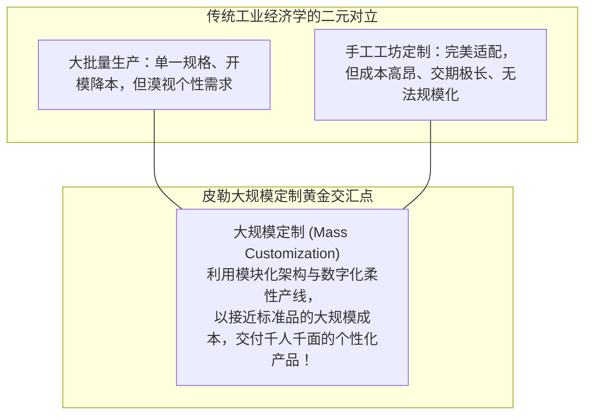
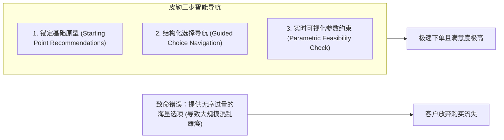

# Lec 11 大规模定制的产品设计与敏捷制造：弗兰克·皮勒模型 (Design & Manufacture of Mass-Customized Products)

> MIT Sloan School of Management · 15.352 Managing Innovation: Emerging Trends · Prof. Eric von Hippel

## TL;DR

- 弗兰克·皮勒（Frank Piller）大规模定制（Mass Customization）理论：在保持近乎大批量生产效率的同时满足千人千面的个性化需求。
- 共同设计过程（Co-design Process）三大支柱：个性化偏好引导、选择导航与避免“大规模混乱（Mass Confusion）”。
- 敏捷制造后端支撑：极端模块化产品架构、延迟制造策略（Postponement）与柔性数控流水线。
- 戴尔电脑、阿迪达斯定制跑鞋与工业非标设备案例证明：个性化定制是摆脱价格战内耗的终极蓝海。

## 大规模定制：破解规模与多样性的世纪悖论 / The Mass Customization Paradox

在工业制造史上，“规模经济（Economies of Scale）”与“个性化定制（Customization）”被视为不可调和的零和博弈：
- **福特式大规模生产**：成本极低、出货量极大，但亨利·福特的名言是：“任何客户都可以将汽车漆成任何他想要的颜色，只要它是黑色的！”用户必须牺牲一切个性；
- **传统手工作坊定制**：完全契合客户身体与品味，但交期长达数月，单件成本极其昂贵，只有极少数贵族才能享用。

世界著名制造与创新战略大师、麻省理工学院兼职研究员、德国亚琛工业大学（RWTH Aachen）弗兰克·皮勒教授（Prof. Frank Piller）亲临 15.352 课堂，系统解构了破解这一悖论的现代工程利器——**大规模定制（Mass Customization）**。

::: definition 大规模定制 (Mass Customization)
大规模定制是指：**利用现代信息技术、模块化产品架构以及高敏捷度柔性制造系统，以接近甚至等同于传统大批量流水线生产的低单位成本与极速交期，向每一个独立客户交付高度定制化的物理产品或数字服务的生产与商业模式**。
:::

## 共同设计过程与防范“大规模混乱” / The Co-Design Process

在大规模定制中，客户不再是被动的收货人，而是成为了产品的“共同设计师（Co-designer）”。然而，皮勒教授严肃警示：**过度自由的选择往往会演化为一场灾难——“大规模混乱（Mass Confusion）”**！

::: definition 大规模混乱陷阱 (The Mass Confusion Trap)
当企业向客户提供一个包含上千种颜色、上万个零件搭配的空白自由画布时，绝大多数普通客户会瞬间产生严重的“选择超载（Choice Overload）”与认知瘫痪。客户在挑选了半小时后筋疲力尽地关闭网页，甚至在收到货后感到后悔与不满意。
:::

### 破解大规模混乱的三大工程设计

1. **智能推荐基准原型（Starting Point Solution）**：永远不要给用户一张空白纸！根据用户的简单初筛问答，先向其推荐一个符合其大致画像的高分“基础款（Baseline Template）”，让用户在此基础上进行局部微调；
2. **渐进式选择漏斗（Guided Choice Funnel）**：将复杂的决策分解为逻辑递进的步骤（第一步选核心功能平台，第二步选人机交互界面，第三步微调个性化颜色与刻字），避免所有变量同时轰炸大脑；
3. **软硬件参数防呆约束（Parametric Guardrails）**：系统在底层必须实时联动制造工艺数据库。当用户选择了一款高发热量芯片时，系统自动锁定并强制必须选配高效散热风扇，杜绝客户配置出物理不可行的废案。

## 敏捷制造的工程基石：模块化与延迟制造策略

很多企业认为“大规模定制全靠前端网页做得花哨”，这是一种致命的浅薄。皮勒教授指出，大规模定制的胜负手**百分之百取决于后端物理供应链的架构设计**：

| 制造架构基石 | 工程运作机理与实操标准 | 代表性产业应用实践 |
| :--- | :--- | :--- |
| **模块化产品架构 (Modular Product Architecture)** | 将系统拆解为拥有高度标准化标准电气与物理接口的子模块，实现乐高积木式拼装 | 戴尔（Dell）直销 PC 架构、宜家平板家具系统 |
| **延迟制造策略 (Postponement / Delayed Differentiation)** | 在供应链上游尽可能长期保持通用半成品形态，直到最后一刻收到客户确切订单时才进行个性化差异赋形 | 贝纳通（Benetton）毛衣白胚织造后按当季流行色染色 |
| **直接直通制造 (Direct-to-Fabrication Digital Thread)** | 前端客户点击下单的瞬间，参数无需人工转译，自动生成 CNC 切割机与 3D 打印机的加工代码 | 精密定制牙齿隐形矫正器（隐适美 Invisalign） |

::: example 隐适美（Invisalign）的大规模定制商业帝国
隐适美隐形牙套是人类制造业历史上最大规模定制的终极典范：
- 全世界没有两个人拥有完全相同的牙齿排列，每一位患者的矫正方案都需要经过数十副在毫米级上逐渐微调的透明牙套；
- 传统手工牙套制作成本极其昂贵且无法规模化；
- 隐适美开发了顶尖的口内三维扫描仪与自动化正畸算法工具包。诊所医生在电脑上微调牙齿移动轨迹；数据实时回传至全自动化工厂，由工业级立体光刻 3D 打印机与自动化吸塑机械手彻夜不停运转；
- 隐适美每天向全球交付数十万件**绝对独一无二、但成本却与流水线塑料制品一样低廉的医疗级定制产品**，创造了数百亿美元市值的商业神话！
:::

## 我的理解与实践洞察 / Personal Insight

大规模定制的终局，是彻底消灭商业世界的头号杀手——**库存（Inventory）**。

::: insight 现金流的降维打击
在传统商业模式下，企业必须提前数月预测下一季的流行趋势，向工厂下达数百万件生产订单，将宝贵的现金流变成压在仓库里、每天都在贬值的存货；一旦预测失误，只能打折甩卖甚至全盘报废。而**大规模定制奉行‘先收客户全款，再启动工厂生产’的零库存模式！**它不仅消除了坏账与呆滞风险，更让企业在商业博弈中拥有了无与伦比的自由现金流护城河。
:::

## 思考题与实战研讨

1. 很多传统服装品牌试图模仿大规模定制，在电商网站上推出了“自由定制西装”功能，但推出几个月后由于退货率高达 30%、交付延误长达数月而草草收场。结合弗兰克·皮勒的理论，排查该品牌在“个性化引导”与“后端敏捷制造”上最可能犯下了哪些典型错误？
2. 比较戴尔（Dell）在 1990 年代凭借“按单定制直销模式（Build-to-Order）”对传统 PC 霸主康柏（Compaq）和 IBM 的降维打击：这种优势究竟是纯粹的营销胜利，还是一场深刻的供应链与产品模块化工程革命？
3. 如果你现在要为你所在的硬件产品搭建一套大规模定制系统，你会如何划分“标准化通用底座”与“客户自由定制模块”的物理边界？
