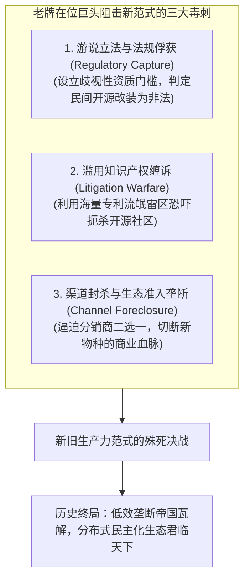
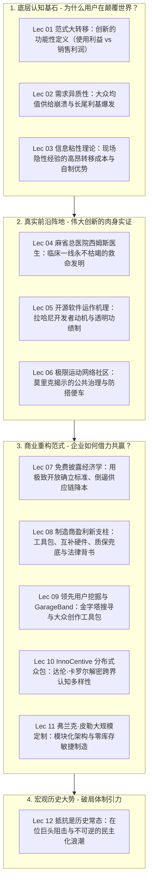

# Lec 12 既得利益者的体制抵抗与创新范式演进阻力 (Resistance to Innovation & Incumbent Inertia)

> MIT Sloan School of Management · 15.352 Managing Innovation: Emerging Trends · Prof. Eric von Hippel

## TL;DR

- 创新遭遇强烈抵制是历史常态：新范式的引入必然打破既有产业链的权力和利益分配格局。
- 老牌在位巨头（Incumbents）的三大防御杀手锏：法规俘获（Regulatory Capture）、知识产权缠诉与行业标准封锁。
- 分布式用户创新范式的不可逆性：技术工具平民化与网络协同效应，正在以不可阻挡之势重构全球生产力。
- 15.352 全课宏观终局闭环：从个体需求异质性、低成本生态位、开源共创、知识经纪到分布式生态治理的创新范式全景。

## 创新的宿命：抵制是常态，平稳是假象 / Resistance to Innovation is the Norm

当我们学完了整门 15.352 课程，目睹了用户创新、开源软件、分布式众包与大规模定制带来的惊人生产力飞跃时，很多学员往往会产生一种盲目乐观的错觉：“既然新范式如此高效优美，全世界的所有企业肯定会迫不及待地张开双臂拥抱它！”

然而，埃里克·冯·希佩尔教授在课程的结课终章，给全体学员浇下了一盆极其冷静、深刻且无情的冷水：**“在新技术和新管理范式的演进史上，遭受狂暴的抵制与漫长的迟滞，才是绝对的历史常态！只要在位既得利益者手中还握有一丝选择权，他们就会动用一切政治、法律与商业武器，死死阻击新范式的扩散！”**

## 在位巨头为何拼死抵抗新范式？深层制度经济学剖析

新范式的每一次崛起，从来不是平滑的学术研讨，而是一场残酷的**存量财富与权力的大洗牌**：
1. **沉没资本的绝望护盘**：老牌巨头在过去数十年里，在集中式流水线、专有专利池和封闭渠道上质押了成百上千亿美元的沉没资产。承认“分布式用户创新更好”，等于在财务上宣告这些巨额重资产在一夜之间变为废铁坏账；
2. **知识资产的贬值恐惧**：大企业的高管们之所以能享受数百万年薪，是因为他们精通旧体制下的部门博弈与繁文缛节。在扁平透明的开源功绩制生态中，这些老官僚的技能储备瞬间归零，沦为毫无竞争力的冗员；
3. **法规俘获（Regulatory Capture）的肮脏手段**：当传统巨头在市场上打不过敏捷的分布式创新者时，他们最常用的下三滥招数就是游说政府立法部门。例如，传统农机巨头游说国会通过严苛的软件版权保护法案，将农民“自行维修与刷机自己的拖拉机”定性为联邦犯罪！

| 竞争博弈维度 | 传统在位垄断巨头防御阵营 | 分布式用户创新与开源阵营 |
| :--- | :--- | :--- |
| **核心武器** | 华盛顿游说团、昂贵的诉讼律师函、闭门行业协会标准 | 优雅的代码、活跃的极客论坛、千百万用户的切身痛点 |
| **组织敏捷度** | 极其迟缓僵化，任何重大战略调整需经层层委员会审批 | 极度敏捷，全球开发者每天 24 小时去中心化协同迭代 |
| **历史必然性** | 顺应的是工业时代集权垄断的旧势能，注定随周期衰亡 | 顺应的是信息时代技术平民化的高阶势能，具有不可逆性 |

## 15.352 创新管理新趋势：全课知识架构大闭环 / Course Synthesis

历经 12 讲的激荡探索，埃里克·冯·希佩尔教授为我们构建了一幅超越传统教科书、直面 21 世纪创新本质的**宏观范式跃迁全景图**。这一体系彻底瓦解了工业时代神圣化的中央集权研发模式，将创新的主动权归还给了每一个拥有真实痛点与创造热情的用户。

从微观的经济学底层来看，功能性创新的二元分野（使用利益 vs 销售利润）解释了创新的原生驱动力，需求异质性长尾粉碎了大众均值产品的神话，而信息粘性理论则确立了用户在工作现场从事自制改造的天然成本优势；在实战前沿阵地上，麻省总医院西姆斯医生在车库自研输液泵的传奇、拉哈尼所揭示的开源黑客礼物文化与代码功绩制、以及莫里克笔下极限运动社区依靠互惠规范化解公地悲剧的实证，展示了民间分布式协同的巨大韧性；在商业重构维度上，免费披露所带来的标准确立与供应链规模红利、制造商向工具包提供商与法律质保兜底方的转型、InnoCentive 众包网络对跨界认知多样性的调度、以及弗兰克·皮勒的大规模定制与延迟制造架构，为现代企业描摹了一幅全新的生态共生共赢路线图；而在宏观终局上，尽管老牌在位巨头会动用一切政治游说与专利武器进行垂死阻击，但技术平民化的洪流终将冲垮一切守旧藩篱。

下方的全景知识架构图，将贯穿全课的四大逻辑阶段与十二大核心专题完整缝合为一个闭环的动态系统：

创新的民主化不是遥远未来的科幻预言，它就是此时此刻正在我们身边咆哮前行的工业现实。从 3D 打印到开源大模型（如 LLaMA 生态），从民间极客硬件改装到千万开发者共建的公共软件基础设施，创新的火种已经彻底脱离了巨头神殿的垄断，撒向了全人类繁星闪烁的田野。

## 我的理解与实践洞察 / Personal Insight

站在新旧范式交替的历史十字路口，每一位技术领袖与创业者都必须做出自己的灵魂抉择。

::: insight 顺应时代的最大势能
历史的车轮滚滚向前，凡是妄图在巨型公司的围墙内垄断所有智慧、靠构筑专利壁垒和信息不对称向公众收取暴利的时代，已经一去不复返了。**未来最伟大的商业帝国，绝不再是那些高高在上的‘产品教皇’，而是那些敢于彻底放低姿态、向全球万千用户赋能、为分布式创造力提供最坚固基础设施的‘仆人式领袖’**。拥抱分布式，拥抱开源，拥抱用户，你才能真正拥有属于未来的星辰大海。
:::

## 思考题与实战研讨

1. 很多大型传统科技公司的法务总监与知识产权部门，至今依然把“全公司当年提交了多少篇专利申请”作为核心 KPI。结合整门 15.352 课程的洞见，这种考核机制在多大程度上正在扼杀公司拥抱开源与分布式创新的可能性？
2. 回顾你在本课程中学习到的所有案例（西姆斯输液泵、Apache 开源服务器、皮划艇社区、InnoCentive 众包、GarageBand 工具包等），挑选一个与你当前工作或创业方向最相关的模式，撰写一份《未来三年组织创新范式重塑战略白皮书》。
3. 为什么埃里克·冯·希佩尔教授坚信：**“创新的民主化不仅是一场商业模式的革新，更是一场提升全人类福祉与创造力自由的社会学解放”**？谈谈你对这句话的深刻理解。
