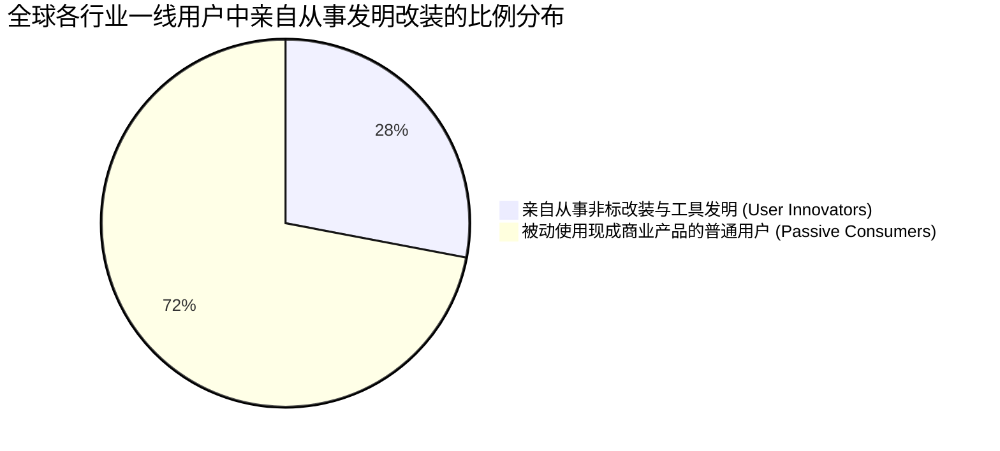
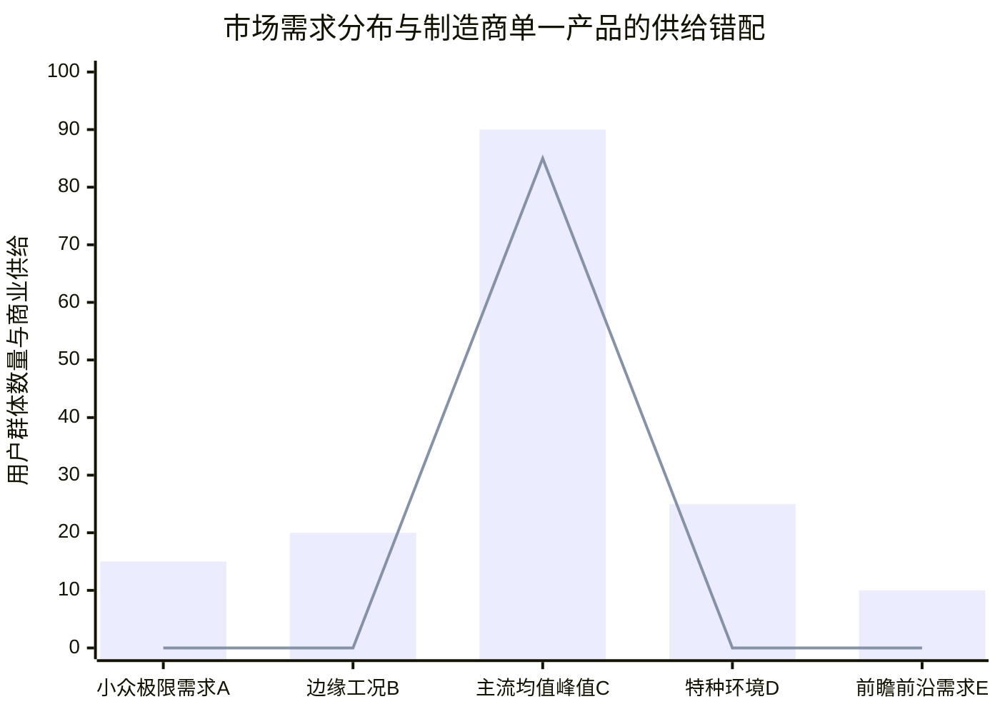

# Lec 02 用户即创新者：异质性需求与突破性创新起源 (Many Users Innovate: Heterogeneous Needs)

> MIT Sloan School of Management · 15.352 Managing Innovation: Emerging Trends · Prof. Eric von Hippel

## TL;DR

- 大规模实证研究表明：在工业设备、软件与极限运动中，10% 到 40% 的用户都在从事自主创新与改装。
- 异质性需求长尾理论：市场上的真实需求极其离散多样，制造商的大众均值产品只能满足狭窄的波峰。
- 用户不仅是创新的主体，更承担了高风险非共识创新的探索成本，为行业过滤出已被验证的原型。
- 制造商必须建立“长尾捕获漏斗”，利用网络社区聚合零散的用户创新火种。

## 用户创新的惊人普适性：全球大规模实证数据 / Empirical Evidence of User Innovation

在很长一段时间里，管理学界一直将用户创新视为极少数狂热极客的孤立偶发行为。为了彻底粉碎这种偏见，埃里克·冯·希佩尔教授联合来自欧洲、美国和亚洲的顶尖学者，在数十个行业展开了严谨的大样本实证调查。其结果震撼了整个商业管理界：

| 调研产业领域 | 样本受访群体 | 亲自开发或激进改装产品的用户比例 | 代表性用户发明突破案例 |
| :--- | :--- | :--- | :--- |
| **工业印刷电路板 CAD 软件** | 商业芯片与硬件设计工程师 | **24.3%** 的工程师自行开发了新功能插件或脚本 | 自动化布线优化算法、信号完整性仿真外挂 |
| **专业管路系统与工程机械** | 市政供水与石油石化一线技术工人 | **19.5%** 的技术工人自行焊制了非标专用安装夹具 | 狭窄空间法兰防漏扭矩扳手、快速打压检漏接头 |
| **极限户外运动装备** | 激流皮划艇、滑浪风帆与攀冰爱好者 | **37.8%** 的运动专家亲自削切改装甚至自制核心装备 | 充气式水力平衡尾舵、防脱落轻量化钛合金冰爪 |
| **开源企业级 Apache 软件** | 部署全球 Web 站点的系统运维工程师 | **19.1%** 的用户修改了源代码并向社区提交补丁 | 模块化动态加载机制、多层安全过滤中间件 |
| **临床重症医学监护系统** | 欧美顶尖医院重症监护室（ICU）麻醉医生 | **22.0%** 的医生自行改装了机械通气与药物配比仪 | 自动化闭环麻醉深度监测仪、新生儿防呛管路 |

数据铁证如山地表明：**近三分之一的专业用户根本不满足于市场上销售的现成商品，他们每天都在自己的工位与车间里从事非标创新！**

## 需求异质性理论：为什么制造商无法满足所有人？ / Heterogeneous Needs

为什么实力雄厚的跨国制造巨头，投入了数百亿美元做市场调研，却依然生产不出让用户完全满意的产品？冯·希佩尔教授提出了深刻的**“需求异质性理论（Heterogeneity of User Needs）”**。

::: definition 需求异质性 (Heterogeneity of Needs)
需求异质性是指：**在一个给定的目标市场中，不同用户所期望的产品属性、使用场景约束与性能权重存在着极其巨大的离散差异**。大众消费者的需求并不是紧密围绕在一个完美的“正态分布均值”周围，而是呈现出极其扁平、拥有无数微小峰值的长尾分布（Fat-tailed Distribution）。
:::

### 制造商的经济学两难困境

在传统集中制造模式下，制造商面临着无法克服的物理与财务约束：
1. **开模与规模化摊销的刚性成本**：制造一条现代化流水线或开具全套高精度注塑钢模，需要数百万元的沉没投资。为了实现盈亏平衡，单一款式的出货量必须达到十万台以上；
2. **对大众均值的妥协折中**：为了让一款产品同时卖给老年人、年轻人、专业技术人员和家庭主妇，产品经理不得不将产品的所有锐角磨平，设计出一个“平均主义的怪胎”——它对于所有人来说都是勉强能用，但对任何一个具有深度专业诉求的人来说都极其平庸难用；
3. **被遗弃的长尾痛点**：对于处于图表中 A、B、D、E 位置的专业用户，他们的需求高度定制且极为严苛。制造商由于在财务模型上算不过来账，只能将其无情地归类为“边缘非主流市场”而拒绝为其研发。

## 用户创新的自我救赎与社会福利增益

正是在这种制度性供给短缺的逼迫下，用户被迫拿起了扳手与编译器，展开了自我救赎：
- **用户自给自足的经济可行性**：当用户为自己开发解决方案时，他**无需取悦全球十万人**，他只需要满足自己这一个人的核心诉求！因此，他不需要花费巨资进行全人群公关、不需要设计花哨的包装箱，他在工位上花费两个周末焊出的粗糙装置，其投资回报率对他个人而言就是极具吸引力的；
- **社会知识池的非共识外溢**：在传统模式下，大企业由于害怕犯错，往往扼杀高风险的激进构想。而全球数百万用户基于自身热爱的独立试错，宛如一场跨越全球的分布式遗传算法演进，以极低的个体代价为人类社会筛选出了下一代突破性技术的基因。

## 我的理解与实践洞察 / Personal Insight

长久以来，工业界的傲慢让许多企业误以为“用户是无知且缺乏想象力的”。这种傲慢的根源，是因为企业往往把调研的麦克风递给了普通大众。

::: insight 寻找那些“愤怒的用户”
如果你在市场上发现某一类用户在使用现有产品时极其愤怒、脏话连篇，甚至自己在机身上钻孔、贴强力胶布、给开源代码疯狂打补丁，请务必立刻脱帽致敬并蹲下来向他们请教！这些愤怒的用户不是无理取闹的挑剔者，他们是上帝派来给你指引下一个十亿美元商业帝国的引路天使。
:::

## 思考题与实战研讨

1. 很多大型硬件消费电子企业（如手机或无人机大厂）非常反感用户“私自拆机或刷机（Root/Jailbreak）”，并在保修条款中规定私自改装一律失去保修。结合本讲理论，这种严厉防备用户的策略是否正在亲手掐断公司最前沿的突破性创新管道？
2. 在很多专业工业制造场景（如机加工车间、注塑厂或汽车 4S 店），工人们自制了大量被称为“土工装（Shop-floor Jigs）”的非标工具。如果你是该工厂的精益改善总监，你会采取什么机制将这些自发的用户创新制度化并向全厂推广？
3. 为什么在互联网 Web 2.0 与移动应用时代，很多现象级功能（如 Twitter 上的标签 `#`、转发 `RT` 与艾特 `@`）最初完全不是官方产品经理设计的，而是由早期终端极客用户自行发明并在社区中自发普及的？
