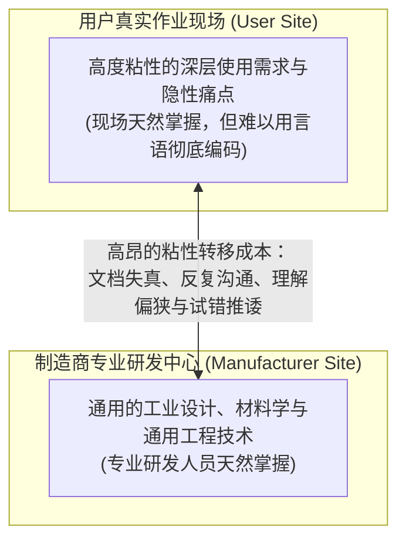
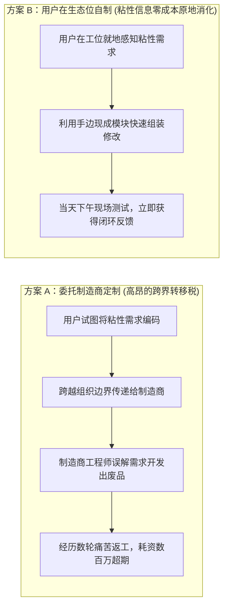

# Lec 03 自制还是购买？低成本创新生态位与信息粘性 (Innovate or Buy? Low-Cost Innovation Niches)

> MIT Sloan School of Management · 15.352 Managing Innovation: Emerging Trends · Prof. Eric von Hippel

## TL;DR

- 冯·希佩尔信息粘性（Sticky Information）理论：将深奥的现场使用痛点完整转移给制造商的成本极其昂贵。
- “用户低成本创新生态位”：用户在自身工作现场天然免费拥有场景粘性信息，只需补充少量通用技术即可自制。
- 制造商开发定制品时面临巨大的“信息跨界转移税”与反复返工的认知损耗。
- 自制还是购买的临界点取决于：用户痛点信息的粘性程度与制造商解决方案的定制化溢价对比。

## 信息粘性：跨界知识转移的物理阻尼 / The Concept of Sticky Information

当一个用户需要某种非标功能时，正统交易成本经济学往往会提出一个直观的疑问：**“既然社会存在专业化分工，为什么用户不把需求写成规格说明书，出钱委托专业的制造商来定制，反而要自己挽起袖子动手干？”**

为了解答这一根本谜题，埃里克·冯·希佩尔教授在 1994 年发表于《Management Science》的名篇中，提出了划时代的**“信息粘性（Sticky Information）”**概念。

::: definition 粘性信息 (Sticky Information)
信息粘性是指：**某项特定信息在从其原始产生地点，转移、解释、消化并成功应用于另一个地点的过程中，所必须付出的高昂增量成本（Incremental Expenditure）**。
- **低粘性信息**：容易用标准化数字、公式或文本进行结构化编码的信息（如某款电机的额定电压、芯片的标准尺寸公差）；
- **高粘性信息**：深植于特定真实物理现场、与操作者的隐性经验和突变工况深度绑定的知识（如外科医生在缝合病变组织时的阻尼手感、机加工老师傅听切削震颤声音判断刀具磨损的直觉）。
:::

### 造成信息极度粘稠的四大现实根源

1. **信息的隐性本质（Tacit Nature）**：很多极前沿的专业需求，用户自己甚至无法用清晰的语言提前表达出来（“波兰尼悖论：我们所知远多于我们所能言说”）。只有当物理样机拿在手上运转时，用户才能猛然意识到哪里设计错了；
2. **海量现场语境数据的吞吐瓶颈**：一个复杂的工艺环境包含温度骤变、粉尘震动、操作工人流动性等成千上万个微弱耦合变量。试图通过一份 50 页的《产品需求文档（PRD）》将这些现场语境完整搬迁给远在千里之外的制造商研发中心，在物理上注定会发生严重的信息丢失；
3. **技术方对应用场景的认知鸿沟**：制造商的工程师虽然精通电路仿真与应力分析，但他们从未在急诊抢救室连续站过 12 个小时，也从未在荒芜的深海油气钻井平台上换过管路，缺乏消化吸收高维应用场景的背景知识库；
4. **迭代排错的交互成本**：定制开发从来不是一次性交付完成的。如果每次微调都需要用户写邮件、开跨洋会议、寄送样品并等待下一次打样，沟通链条中的时间损耗会直接逼疯任何追求效率的业务一线。

## 用户低成本创新生态位 / The Low-Cost Innovation Niche

基于信息粘性理论，冯·希佩尔教授推导出了极具颠覆性的组织洞察：**在很多前沿探索场景下，用户自己动手开发的综合成本，远远低于委托外部制造商的成本！**

::: theorem 低成本创新生态位原理 (Low-Cost Innovation Niche)
用户在其自身独特的日常工作与生活环境内部，**天然、免费、零成本地拥有着关于应用场景的最核心、最高粘性的深层信息**。此时，用户只需在自身已有的专业技能之上，补充少量通用性的开发工具（如学会简单的 Python 脚本或基础 3D 打印），就能以极低的综合成本在自己的“低成本生态位”中完成闭环原型开发。
:::

### 自制与购买的决策权衡矩阵

| 评估维度 | 选择自己动手做（Innovate for Self） | 选择向制造商购买/委托定制（Buy from Supplier） |
| :--- | :--- | :--- |
| **需求独特性与前沿度** | 极其独特、处于全球行业前沿、没有现成商业方案 | 大众通用、经过验证的标准工况，市场上竞品林立 |
| **痛点信息粘性** | 极高（高度依赖现场隐性经验与多变量实时反馈） | 极低（可以通过明确的参数、公差和接口协议量化定义） |
| **对交付速度的要求** | 刻不容缓（业务卡在当下，明天必须上线跑通） | 容忍度高（愿意等待数月的商业招投标与外包交付排期） |
| **最终成果满意度** | **100% 契合自身的极端特殊约束**，无多余冗余功能 | 充斥着妥协折中，经常发生致命的工况排异反应 |

::: insight 程序员的自动化脚本是这一原理的绝佳印证
为什么几乎每一个优秀的软件架构师或量化交易员，都会在本地写上百个简陋的 Bash 或 Python 小脚本，而不是向公司的 IT 采购部门申请购买大型商业商业软件？因为“他当下的调试痛点”是极度粘稠的，等他向 IT 采购部门提交完需求审批单、采购完成合同谈判、系统部署上线，这个项目早就结束了。在自己的生态位内用半小时写个小脚本，是全宇宙成本最低、效率最高的解决方案！
:::

## 传统采购流程在非共识创新面前的瘫痪

大型企业在面对前沿技术探索时，往往强行推行标准化的“集中招投标与采购法务流程”：
- 采购经理要求项目负责人提供未来三年的精准投入产出比（ROI）与详尽无遗的功能规格说明书；
- 然而，前沿探索的本质恰恰是“在动手制作之前，没有人确切知道最终的装置长什么样”；
- 这种机制逼迫团队将大量精力耗费在编造虚假的采购论证报告上，最终招标进来的大型系统集成商，交付出一套完全脱离一线实际痛点的昂贵系统，沦为被所有人闲置的电子垃圾。

## 我的理解与实践洞察 / Personal Insight

“自制还是购买”的博弈，本质上是“信息转移成本”与“制造规模经济”之间的一场拔河。

::: insight 寻找信息粘性最高的土壤
如果你想成立一家科技服务公司，千万不要去接那些需求完全标准化、可以用十页纸写得清清楚楚的平庸项目，那类项目最终必然陷入残酷的价格战与红海血拼。你应该去寻找那些客户自己说不清、但在现场痛不欲生的复杂高粘性场景。把你的顶尖工程师直接空投到客户的车间、机房与手术室现场，在现场原地消化粘性信息，你将获得压倒性的技术垄断溢价。
:::

## 思考题与实战研讨

1. 很多大型跨国企业的管理层常常下达死命令：“为了控制安全合规风险，全公司严禁任何基层员工私自编写脚本或改装生产线工装，必须统一提报给 IT 部门或设备中心统一部署。”结合本讲关于“信息粘性”的理论，这种看似规范的管控会给公司的创新敏捷度带来怎样毁灭性的打击？
2. 为什么在生物医药、高能物理以及尖端半导体研发领域，世界顶级科学家的实验室往往自己雇佣全职的高级机加工师傅和嵌入式软件极客，而不是向外部商业公司采购现成的实验仪器？
3. 如果你是一家专业测量仪器制造商的首席技术官，你该如何重塑你的产品架构，才能让身处“低成本创新生态位”的专业用户能够极度方便地在你的仪器上编写自己的测量算法？
