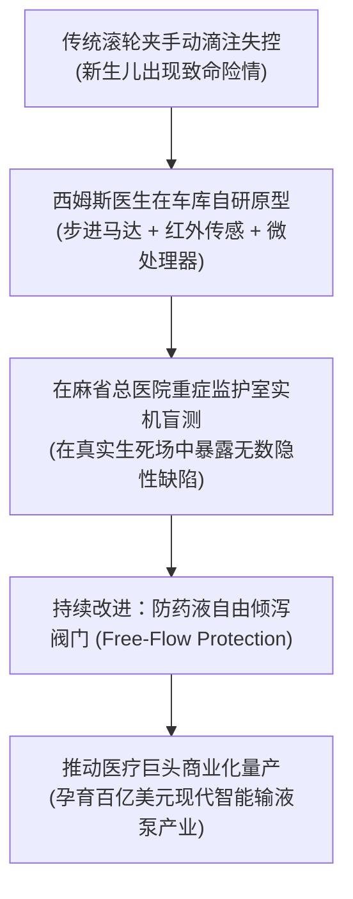

# Lec 04 医疗用户创新实战：麻省总医院奈特·西姆斯与输液泵革命 (Dr. Nat Sims: Medical User-Innovator at MGH)

> MIT Sloan School of Management · 15.352 Managing Innovation: Emerging Trends · Prof. Eric von Hippel

## TL;DR

- 麻省总医院（MGH）麻醉医生奈特·西姆斯（Nat Sims）是全球临床用户创新的标杆领袖。
- 致命痛点引爆发明：因传统简陋夹管输液滴速失控导致新生儿面色发青，促使西姆斯自研智能计算机输液泵。
- 用户创新者不愿离职创业的制度悖论：西姆斯坚决留在医院一线，利用真实临床反馈持续迭代十多项核心器械。
- 医疗巨头商业化转化困局：用户发明了改变世界的救命设备，但推动保守制造商采纳并量产耗费了长达数年的拉锯。

## 致命事故与车库发明：智能计算机输液泵的诞生 / The Infusion Pump Breakthrough

在波士顿享誉全球的麻省总医院（Massachusetts General Hospital, MGH），哈佛医学院麻醉学教授奈特·西姆斯博士（Dr. Nathaniel Sims）不仅是一位每天在手术台挽救生命的资深医生，更是当代最传奇的**医疗用户创新大师**。

15.352 课堂特别邀请西姆斯医生亲临现场，为学员们还原了一段惊心动魄的真实发明历程。

::: example 一次刻骨铭心的婴儿窒息危机
- **时代背景**：在 1970 年代末至 1980 年代初，全球各大医院使用的静脉输液装置极其原始粗糙，完全依靠护士用一个塑料滚轮夹手动调节输液软管的截面积，通过肉眼观察滴壶中的药滴滴速来估算给药剂量；
- **致命险情**：在一个深夜，重症监护室的一名危重新生儿在接受极其烈性的血管活性药物滴注时，由于塑料软管受热变软变形，药滴在无人察觉的情况下突然发生不受控的加速倾泻！当西姆斯医生巡房冲进病房时，婴儿的全身皮肤由于药物严重过量已经发青窒息，心跳骤降至濒死边缘；
- **抢救与顿悟**：经过惊心动魄的心肺复苏，婴儿奇迹般地保住了性命。但那张发青的面孔深深刺痛了西姆斯的灵魂。他猛然意识到：**在现代重症医学中，烈性药物的微克级滴速控制关乎生死，继续依赖护士的人工肉眼数水滴无异于在轮盘赌博！**
- **车库里的第一台计算机输液泵原型**：
  西姆斯不仅懂医学，业余时间更是一名痴迷电子工程与单片机的极客。回到家里的地下车库，他拆解了一台老旧的步进马达、一个红外光学滴速传感器以及一台微型 Apple II 电脑主板。经过数个通宵的焊接与汇编语言编程，西姆斯制造出了**人类历史上第一台能够根据预设剂量自动闭环控制滴速、并在气泡或堵塞时触发报警的“微电脑智能输液泵（Computerized Infusion Pump）”**粗糙原型。
:::

## 为什么用户创新者往往拒绝辞职去创办商业公司？

很多商业记者和商学院教授习惯性地认为：“西姆斯医生既然发明了这么伟大的设备，他应该立刻从哈佛辞职，下海创办一家输液泵创业公司，担任 CEO 并谋求纳斯达克上市。”

然而，西姆斯医生给出的抉择让全场动容：**他坚决拒绝了全职离职创业的诱惑，终其一生选择留在麻省总医院担任临床一线医生**。

::: definition 用户创新者的现场羁绊 (Clinical Immersion)
为什么顶尖的用户创新者不愿意离开自己的原生工作现场？
1. **失去现场等于失去创新的源泉**：一旦全职下海成为企业高管，每天的生活将被财务报表、人力招聘、法务纠纷与供应商谈判所吞噬，被迫彻底脱离真实的临床重症第一线。离开了一线，创新的触角就会立刻枯萎；
2. **内在救死扶伤的使命感压倒金钱欲望**：正如第 3 讲特蕾莎·阿玛比尔的创造力模型所述，西姆斯的内在驱动力是“让婴儿不再窒息、让手术室更安全”，这种纯粹的内在任务动机带来的心流体验，远远超越了纸面股票期权的诱惑；
3. **真实临床环境是唯一的实证检验场**：留在麻省总医院，西姆斯可以在白天巡房时随时发现新的痛点，晚上焊出一块新板子，第二天清晨直接带进动物实验室或特许病房进行实证验证，这是任何脱离医院的外部商业公司梦寐以求的特权。
:::

| 职业路径抉择 | 辞职全职下海创立商业公司 | 坚决留守医院临床一线（西姆斯模式） |
| :--- | :--- | :--- |
| **日常工作重心** | 融资路演、供应链砍价、团队考评、销售公关 | 守护病床病人、主刀复杂麻醉、洞察极端并发症痛点 |
| **创新信息的获取** | 依赖销售代表从医院收集的滞后、失真的二手调研 | 每天亲身沉浸在高粘性的一线现场，零延迟捕获痛点 |
| **持续创新能力** | 往往只能吃老本维持最初的那一项发明 | 在随后的三十年里接连发明了十余种革命性临床器械 |

在坚守临床的同时，西姆斯医生在接下来的职业生涯中，利用这一模式接连发明了：**智能化麻醉气体混合器、重症病人床旁快速血气分析仪、手术室通用监护设备插头标准体系**等十多项核心器械，造福了全球数以亿计的患者。

## 逆流而上：推动保守医疗制造巨头采纳的漫长苦旅

然而，一个一线医生想要让傲慢保守的医疗器械制造巨头采纳自己的发明，其艰难程度甚至超越了技术发明本身。

::: example 西姆斯在商业化推广中遭遇的巨大阻力
- **老牌厂商的冷漠与傲慢**：西姆斯带着在 MGH 运行良好、成功挽救数十名危重病人的输液泵样机，拜访了当时统治全美输液器市场的几大医疗耗材巨头。然而，大公司的管理层做出了经典的冷漠回应：
  - “我们现在的重力滴注软管每年出货数千万套，毛利率高达 70%，没有任何事故投诉；为什么我们要去生产这种昂贵、脆弱、需要插电的复杂电子机器？”
  - “医院护士都是低学历群体，根本搞不懂你们这种微电脑编程，出了医疗事故责任谁负？”
- **破局策略：联合麻省理工学院建立联盟**：
  面对商业巨头的拒绝，西姆斯没有气馁。他联合麻省理工学院机械与电子工程实验室，进一步优化了泵体的机械可靠性，并推动麻省总医院董事会成立了专门的“生物医学工程转化中心”；
- **全行业法规与安全标准的倒逼**：西姆斯联合全美重症医学会与 FDA 监管官员，公开发表临床多中心对照研究论文，用冷酷的数据向公众展示了传统重力输液滴速失控所导致的隐性致死率。随着安全标准的全面升级，各大医疗器械巨头最终被迫全盘低头，以极高价格向西姆斯及 MGH 购买专利授权。
:::

今天，全球智能计算机输液泵每年的市场规模高达数十亿美元，已成为全人类所有现代医院 ICU 和手术室不可或缺的生命守护神。

## 我的理解与实践洞察 / Personal Insight

奈特·西姆斯医生的传奇人生，是对“科技向善（Tech for Good）”与“用户创新”的最崇高注脚。

::: insight 伟大的创新始于悲悯
技术发明从来不是冰冷的代码与齿轮，它的最高境界始于对人类苦难的深切悲悯。西姆斯之所以能在简陋的车库里熬过无数个寒夜、攻克复杂的机械控制难题，不是因为他算出了输液泵能卖几百亿美元，而是因为在深夜的监护室里，那个窒息发青的婴儿瞳孔刺痛了他的良知。在硬科技创业的大潮中，我们常常被融资估值与资本狂欢迷花了双眼，而唯有真正以解决真实世界血泪痛点为归宿的发明，才能在历史的长河中熠熠生辉。
:::

## 思考题与实战研讨

1. 很多医疗科技投资机构在尽职调查时，有一条硬性死规定：“如果创始人医生不从公立医院全职辞职，我们绝对不投一分钱。”结合西姆斯医生的真实经历，思考这条投资规则在什么场景下是极其荒谬和短视的？投资人该如何与这类“坚守一线的超级用户创新者”建立良性利益绑定？
2. 在西姆斯推广智能输液泵的过程中，老牌医疗耗材巨头本能地抵制新技术，因为新技术会威胁其高毛利塑料软管的既得利益。这种现象与我们在 15.351 课程中学习到的克里斯滕森“创新者的窘境”有何惊人的一致性？
3. 如果你今天作为一名软件工程师或产品经理，希望在医疗健康或生命科学领域寻找颠覆性的产品机会，你应该如何走进像麻省总医院这样的临床前线？你该如何跨越“医生不懂工程、工程师不懂医学”的专业鸿沟？
