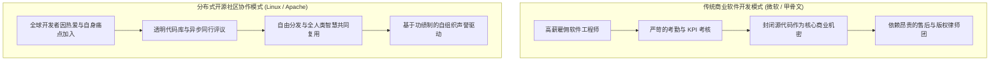
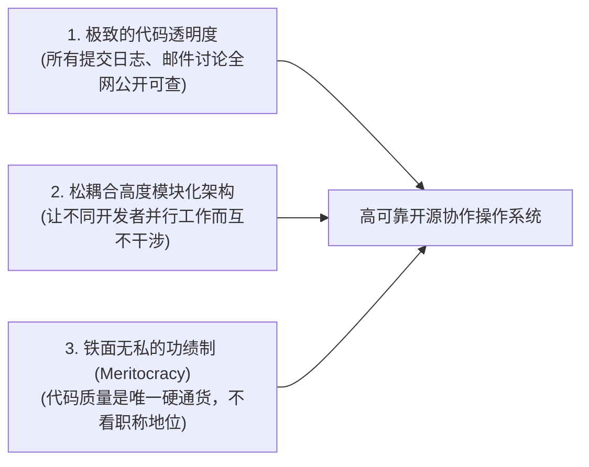

# Lec 05 开源软件的运作机理：卡里姆·拉哈尼与分布式志愿协作 (How Open Source Software Works: Karim Lakhani)

> MIT Sloan School of Management · 15.352 Managing Innovation: Emerging Trends · Prof. Eric von Hippel

## TL;DR

- 哈佛商学院学者卡里姆·拉哈尼（Karim Lakhani）系统解构开源软件社区的运作机制与开发者动机。
- 开发者内在动机矩阵：享受编程的“心流（Flow）”乐趣与解决个人实际工作痛点是持续贡献的最强引擎。
- 开源协作的三大组织工程制度：极致的代码透明度、松耦合模块化软件架构与基于功绩制（Meritocracy）的声誉阶梯。
- Apache 网络服务器与 Linux 操作系统证明：分布式志愿黑客社区在代码质量与交付迭代速度上完全能碾压跨国巨头。

## 开源软件现象对传统经济学的震撼打击 / The Open Source Puzzle

在 1990 年代以前，如果有人告诉华尔街的经济学家或微软的高管：“未来统治全球服务器的操作系统，将由全世界成千上万名不拿一分钱工资、从未见过面的业余黑客，在业余时间自发协作编写而成，而且任何人都可以免费下载源代码”，他们一定会认为这纯属精神错乱。

然而，由芬兰大学生林纳斯·托瓦兹（Linus Torvalds）发起的 Linux 内核，以及由一群网站网管联合维护的 Apache Web 服务器，在极短的时间内席卷了全球，彻底击溃了包括微软、IBM 和甲骨文在内的数十亿美元商业专有软件产品。

哈佛商学院教授卡里姆·拉哈尼（Karim R. Lakhani）受邀来到 15.352 课堂，系统解构了这一颠覆传统管理学的**开源协作机理**。

## 开发者为何无偿贡献代码？动机多维实证模型 / What Motivates Developers?

拉哈尼联合波士顿咨询公司（BCG）对全球 684 名核心开源软件开发者展开了详尽的大样本实证调查，揭开了驱使黑客们通宵达旦无偿贡献代码的真实心理拼图：

| 动机维度分类 | 核心心理诉求与驱动机制 | 调查中认同该动机的开发者比例 |
| :--- | :--- | :--- |
| **解决自身工作实际痛点 (User Need)** | “我在自己的日常运维中遇到了一个棘手的 Bug，顺手把它修好了并提交出来” | **58.7%** 的核心开发者将其列为主因 |
| **纯粹的智力心流与乐趣 (Intrinsic Fun / Flow)** | “攻克精妙算法带来的无与伦比的智力愉悦感，编程就像玩电子游戏一样上瘾” | **44.9%** 的开发者强烈认同此项 |
| **技术打磨与职业技能提升 (Human Capital Improvement)** | “在顶级开源项目代码库中能学到全世界最顶尖架构师的真实代码规范” | **41.3%** 的年轻工程师视其为绝佳跳板 |
| **同行声誉与专业极客地位 (Peer Recognition)** | “在全网开发者面前展示自己的硬核技术造诣，赢得顶级社区元老的尊重” | **33.1%** 的资深极客深以为傲 |
| **职业求职中的强力信号传递 (Signaling / Career Advancement)** | “GitHub 上的高星开源贡献比哈佛或 MIT 的文凭在硅谷顶级科技公司面试中更有说服力” | **27.5%** 的求职者将其作为个人资产 |

::: definition 动机挤出与“礼物文化” (Gift Culture & Intrinsic Motivation)
拉哈尼指出，开源社区在本质上是一种人类学意义上的“礼物文化（Gift Culture）”。在礼物文化中，一个人的社会地位不是取决于他占有了多少财产，而是取决于他**向公共池塘中贡献了多少卓越的价值**。如果一家商业公司试图直接给开源开发者发奖金来买断某个功能，反而会引发心理学上的“动机挤出效应（Crowding-out Effect）”，摧毁社区神圣的纯粹性。
:::

## 开源社区的三大制度支柱与协调工程

成千上万名分布在全球各地的业余开发者，为什么没有让开源项目陷入无休止的争吵与混乱？拉哈尼剖析了开源社区背后的三大组织工程机制：

1. **极致透明度（Radical Transparency）**：在 Apache 社区，有一句至理名言：**“如果一件事没有发生在公共邮件列表中，那它就从未发生过（If it didn't happen on the list, it didn't happen）”**。严禁任何人在私底下搞小圈子密谋，所有关于架构设计的争吵与权衡全部永久归档，供全人类检索学习；
2. **松耦合模块化架构（Modular Architecture）**：Linux 内核之所以能容纳数万人协作，关键在于其将网络协议栈、文件系统、设备驱动等解耦为成千上万个高度独立的子模块。开发者只需在自己的模块内深耕，无需频繁打扰整个内核；
3. **基于代码的功绩制（Meritocracy）**：在开源世界，没有人关心你的真实姓名、肤色、年龄、性别或文凭；唯一的通行证是你提交的代码质量与测试用例的健壮性。从普通提交者（Contributor）晋升为核心代码提交者（Committer），必须经过数年如一日卓越代码的洗礼与核心元老团队的投票认可。

## 我的理解与实践洞察 / Personal Insight

开源软件运动给整个人类商业社会带来的最大启示，是证明了**“非货币化、去中心化的自组织协作”在复杂智力劳动中完全能够超越传统的等级官僚制**。

::: insight 开源哲学的跨界溢出
开源模式绝不仅限于编写代码。今天，从维基百科（Wikipedia）的知识编纂，到开源硬件（RISC-V 芯片指令集、树莓派外设），甚至是生物医药领域的蛋白质折叠开源计算，拉哈尼所揭示的“透明度、模块化与功绩制”正在重塑全人类所有知识密集型行业的生产关系。
:::

## 思考题与实战研讨

1. 很多传统软件公司的高管习惯了使用甘特图、严格的工时排期与日报周报来管控外包团队。如果让这样一位管理者去领导一个由开源志愿者组成的分布式社区，他最容易犯下哪些致命错误？
2. 结合卡里姆·拉哈尼关于开发者动机的研究，如果你的初创科技公司正在开发一款面向全球开发者的开源基础工具，你应该如何设计社区治理体系与荣誉勋章机制，才能吸引全球顶尖的极客为你无偿贡献代码？
3. 为什么微软公司在 2000 年代初曾公开声称“Linux 是一种癌症（Cancer）”，而在二十年后的今天却成为了全球开源社区最大的贡献者与 GitHub 的拥有者？这一历史反转背后反映了怎样的商业竞争范式转移？
