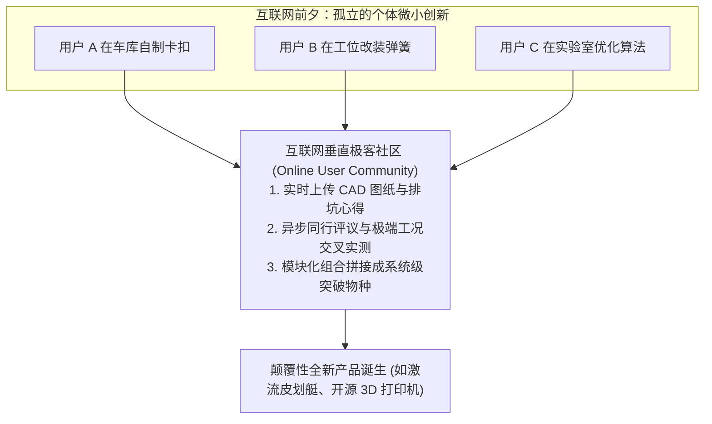
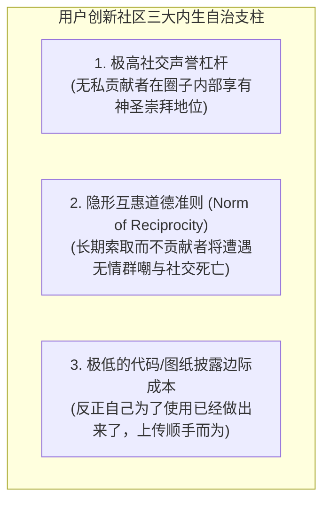

# Lec 06 用户创新社区：伊森·莫里克与互联网协同网络 (User Innovation Communities: Ethan Mollick)

> MIT Sloan School of Management · 15.352 Managing Innovation: Emerging Trends · Prof. Eric von Hippel

## TL;DR

- 伊森·莫里克（Ethan Mollick）解构了离散的个体用户如何通过互联网社区汇聚成颠覆性的集体创新网络。
- 极限运动（激流皮划艇、滑浪风帆）与工业制造实证表明：社区是小众利基知识聚合与交叉验证的核心场所。
- 社区公共治理机制：通过社交声誉激励、行为规范与非正式排斥，有效化解“搭便车（Free-riding）”困境。
- 制造商与用户社区的边界重构：企业必须从敌对防备走向生态赋能，充当社区成果的物理制造承接方。

## 小众孤岛的汇聚：用户创新社区的崛起 / The Rise of User Innovation Communities

在互联网诞生之前，哪怕一个用户在其工作现场发明了一个极其绝妙的改装装置，这项创新也很难走出他的车间或车库。分散在各地的用户彼此处于物理孤立状态，每个人都在重复发明相同的轮子。

沃顿商学院教授伊森·莫里克（Ethan Mollick）与埃里克·冯·希佩尔在 15.352 课堂中指出：**现代互联网的本质不是作为商品销售的货架，而是充当了将全球离散的“低成本创新利基”焊接在一起的高速神经中枢，催生了“用户创新社区（User Innovation Communities）”**。

## 极限运动产业实证：从皮划艇到滑浪风帆的社区共创

莫里克与冯·希佩尔对极限激流皮划艇（Rodeo Kayak）与滑浪风帆（Windsurfing）产业长达数年的追踪研究，提供了最鲜活的实证样本。

::: example 激流皮划艇爱好者的社区技术突围
- **传统大厂的平庸产品**：早期的皮划艇全部由大型塑料注塑厂批量制造。船体长达 4 米以上，极其笨重，只能在平缓河流中平稳巡航。当一群追求刺激的发烧友试图在凶险的瀑布漩涡中做空中翻滚（Rodeo Tricks）特技时，笨重的商业船体直接导致多名运动员骨折受伤；
- **发烧友的车库革命**：面对主流厂商的嘲讽，发烧友们在自己的后院用电锯锯断了传统船身，使用轻质碳纤维与环氧树脂自制了长度仅有 2 米的超短凹底激流艇；
- **在线论坛的核爆级演进**：
  发烧友们在垂直网络论坛上开辟了专门的“造船图纸与测试专区”。一名来自瑞士的玩家上传了船首水流切角的 CAD 数据；三天后，一名科罗拉多州的玩家将其下载并在当地的科罗拉多大峡谷激流中实测，并在论坛上贴出视频指出高速冲浪时的颠簸缺陷；随后，一名新西兰的高分子化学家在跟帖中给出了改良树脂配方；
- **商业化收编**：在短短两年内，全球极限皮划艇社区自发完成了 50 余轮迭代，打造出了现代极限特技皮划艇的标准形态。此时，老牌商业制造商不得不买下社区领军人物的图纸，彻底关闭了传统船型的流水线。
:::

| 研发维度 | 传统商业制造商研发部门 | 用户创新网络社区 |
| :--- | :--- | :--- |
| **测试场景真实度** | 依靠人工水槽和计算机仿真实验 | 全球数千名顶级运动员在各大洲极限瀑布中残酷实测 |
| **试错迭代频率** | 漫长的季度立项、预算审批与模具开具 | 每天 24 小时在全球不同时区接力修改并即时发帖讨论 |
| **投入研发资本** | 每年数百万美元高管薪酬与差旅开销 | **零财务支出**（纯粹依靠成员的热爱与自我装备升级） |

## 克服公地悲剧：用户社区的自治与防搭便车机制

正统社会学常常警告“公地悲剧（Tragedy of the Commons）”与“搭便车（Free-riding）”困境：既然所有图纸和心得在论坛上都是免费公开的，每个人都只想偷看别人的成果而不想自己贡献，社区最终难道不会枯竭瓦解吗？

莫里克教授指出，真实的高效用户社区建立了一套极其精妙的**社会心理学防御机制**：

### 为什么搭便车者无法毁灭社区？

1. **非竞争性数字资产的本质**：物理资产（如草场或面包）一个人吃掉了别人就没有了；但一份数字 CAD 图纸或代码，被一千个人下载使用并不会让原作者损失任何一分钱。相反，下载使用的人越多，发现 Bug 并回馈改进建议的概率反而越高！
2. **“提出真问题”本身就是重大贡献**：在技术社区中，即使一个新手没有编程能力，只要他能在极端特殊工况下详细记录崩溃日志并反馈给核心开发者，他就为整个生态提供了宝贵的测试数据。

## 制造商对待社区的三种态度与终局命运

在面对自发崛起的用户创新社区时，商业制造商通常会经历三代思维的演进：

1. **第一代：敌对与起诉（Hostility & Litigation）**：指控用户私自改装侵犯了知识产权，甚至向社区版主发送律师函勒令关闭论坛。这必然引发全网用户的联合抵制，导致品牌声誉彻底破产；
2. **第二代：被动窥视与剽窃（Passive Spying）**：暗中潜伏在论坛里，偷偷将用户的改装构想抄袭回公司注册为自己的专利。这种做法会迅速被火眼金睛的极客社区揭露，并被公诉为毫无技术操守的寄生虫；
3. **第三代：主动赋能与生态共赢（Symbiotic Enablement）**：为社区免费提供底层 CAD 原始文件、测试夹具与官方活动赞助，主动邀请社区技术领袖担任客座首席设计师，并将社区最具共识的改良成果以合理版税或官方认证配件的形式推向全球量产大流水线。

## 我的理解与实践洞察 / Personal Insight

互联网最伟大的力量，是让全世界最孤独的异类发烧友能够瞬间找到同频的彼此。

::: insight 社区是不可复制的终极护城河
在工业时代，企业的护城河是巨额资产购建的机床与销售渠道。而在数字经济时代，**一个充满狂热生机、具备高频自发创新能力的用户社区，是任何竞争对手即使砸下十倍资本也绝对无法像素级抄袭的终极护城河**。聪明的企业应当甘当社区的土壤与服务员，让万千用户在你的生态中尽情绽放。
:::

## 思考题与实战研讨

1. 很多科技公司在创办初期建立了自己的用户交流论坛，但随着公司规模扩大，公关部门开始严厉审查论坛上的负面发帖，将所有吐槽产品质量或讨论破解改装的帖子全数删除，最终导致论坛沦为虚假繁荣的广告栏。结合本讲理论，这种管控方式给公司的创新生态带来了怎样的毁灭性后果？
2. 在大疆无人机、特斯拉改装或乐高玩具（Lego Mindstorms）等产业中，你能找到哪些制造商与用户社区实现深度共创共赢的经典案例？企业在其中承担了什么角色？
3. 如果你现在要为你负责的产品搭建一个高活力的“用户创新极客社区”，除了建立一个网页群聊之外，你该如何设计第一批种子的准入机制与荣誉体系？
