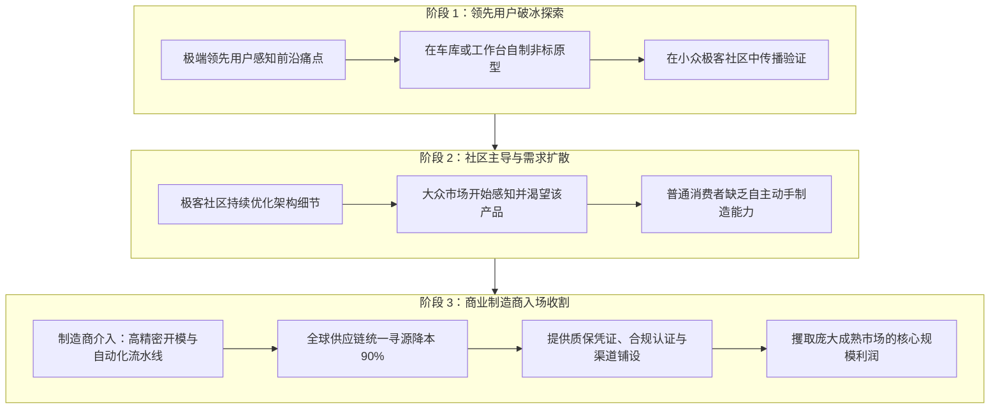
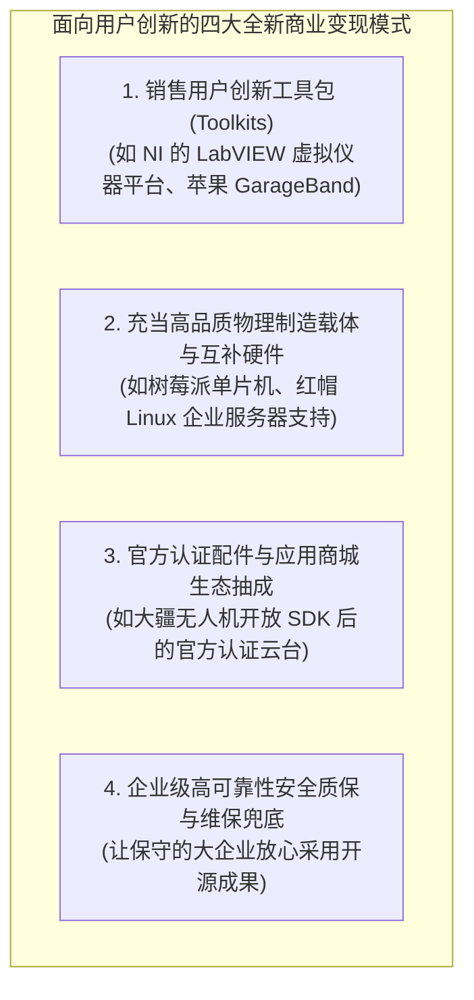

# Lec 08 制造商如何在用户创新时代盈利：竞合范式与商业模式重构 (How Manufacturers Make Money)

> MIT Sloan School of Management · 15.352 Managing Innovation: Emerging Trends · Prof. Eric von Hippel

## TL;DR

- 传统制造商在用户创新时代面临的核心焦虑：“既然用户自己就能搞发明，我们所有制造商难道都要喝西北风饿死吗？”
- 范式重构与生态位变迁：用户在“产品概念定义与定制原型”上占优，制造商在“规模化制造、全球分销与售后保障”上拥有绝对护城河。
- 领先用户社区与商业制造商的协同共生模型：领先用户开辟技术滩头阵地，制造商承接规模化红利。
- 商业变现四大新支柱：销售开发工具包（Toolkits）、提供互补性硬件载体、定制化云端运维与企业级质保服务。

## 制造商的生存恐慌：用户在抢走我们的饭碗吗？ / The Manufacturer's Dilemma

当埃里克·冯·希佩尔教授向全球各大跨国制造巨头的高管阐述“用户创新”理论时，台下的企业 CEO 们最常爆发出的焦虑与质问便是：
**“冯·希佩尔教授，照你这么说，用户自己会识别痛点、自己会造原型、还会免费公开发布在开源社区，那还要我们制造商干什么？我们投资数亿美元建的工厂、销售团队和研发中心难道都要破产倒闭吗？我们到底该怎么赚钱？”**

这种恐慌在工业界具有极大的代表性。传统制造商长期习惯于垄断“从需求调研、图纸设计、物理制造到渠道分销”的全产业链条。当用户开始利用低成本工具跨界自制并在网络社区中免费分享时，很多管理者的第一反应是将其视为来抢夺饭碗的敌人。

然而，冯·希佩尔教授指出，这种恐惧源于对产业演进分工的严重误读。创新绝非单一主体的零和博弈，而是随着产品成熟度演进呈现出清晰的“三阶段接力模型”。在第一阶段，身处极端环境的领先用户负责在车库中完成高风险的原型摸索；在第二阶段，垂直极客社区通过开源协作与高频交叉测试将产品架构逐步收敛；而到了第三阶段，广大主流消费者开始渴望拥有该产品，但他们既没有时间也没有专业车床去亲手打造，此时商业制造商以无可匹敌的规模化制造能力、供应链整合能力与全球分销网络果断切入，承接最大的商业变现红利：

通过这一演进视角，我们清晰地看到：制造商不仅没有被淘汰，反而在用户社区的免费前置探索中，获得了几乎零风险的创新项目池！传统模式下制造商要承担 90% 的新产品夭折率，而在新模式下，进入制造商视线的产品早已在极客社区中完成了实证闭环。

## 重新审视比较优势：用户擅长什么？制造商擅长什么？

很多制造企业之所以陷入迷茫，是因为他们试图在“用户占绝对优势的领域”去跟用户硬拼，而在“自己本应统治的领域”却毫无作为。

| 价值链核心环节 | 用户及用户社区的比较优势 | 传统商业制造商的比较优势 |
| :--- | :--- | :--- |
| **痛点感知与需求定义** | **绝对压倒性优势**：每天身处真实作业现场，对隐性需求拥有最敏锐直觉 | **极度劣势**：依赖二手调研与问卷，反应迟钝、充满理解偏狭 |
| **概念原型早期验证** | **极高灵活性**：为了自身使用，能容忍极简粗糙外观，试错成本几乎为零 | **极度低效**：受制于合规审批、部门墙与高昂工时，小项目立项困难 |
| **精密批量制造与模具加工** | **严重劣势**：普通用户无法在车库里开具 100 吨冲压机或高精度无尘注塑模具 | **绝对垄断优势**：精通六西格玛质量控制、公差配合、自动化产线装配 |
| **全球法规准入与安全认证** | **无法逾越的壁垒**：个人黑客根本无法承受 FDA 医疗认证、CE 认证等巨额开销 | **核心法务护城河**：成熟的合规团队、实验室安全资质与政府公关能力 |
| **全球仓储物流与渠道售后** | **零能力**：个人无法为全球几十万名买家提供 7x24 小时客服与备件支持 | **庞大网络**：成熟的分销商代理体系、逆向物流网络与企业级服务体系 |

::: theorem 创新价值链的分工定理 (Comparative Advantage in Innovation)
在成熟的现代工业社会中，**最具经济效率的分工体系是：将‘产品架构定义与功能原型开发’让渡给一线极端领先用户，而商业制造商则全面收缩并坚守在‘大规模精密制造、供应链成本优化、全球法规认证与渠道售后服务’这一坚不可摧的资产护城河之中**。试图由制造商大包大揽所有创新环节的做法，在经济学上是极其低效且注定失败的。
:::

## 制造商在用户创新时代的四大经典盈利模式

认清了自身比较优势的先进制造企业，不仅没有在用户创新大潮中衰亡，反而借此开辟了前所未有的暴利新商业模式：

### 1. 销售用户创新工具包（Toolkits for User Innovation）
不要去替用户设计最终产品，转而为用户开发“能够让他们随心所欲自己做设计的工具包”！
- 例如，美国国家仪器公司（National Instruments, NI）不再试图为每个科学实验室定制专用测试仪，而是发明了 **LabVIEW 图形化编程平台与模块化数据采集卡**。全球数百万名物理学家与机械工程师在工位上使用 LabVIEW 为自己编写非标测试软件，而 NI 则靠销售底层的通用硬件板卡与软件授权赚取了数十亿美元的超高毛利！

### 2. 成为开源生态的“物理宿主与硬件基座”
在纯软件开源的世界里，用户依然需要坚固耐用、高可靠性的物理硬件来承载计算。
- 例如，IBM 在 2000 年代初毅然放弃了自研的专有操作系统，向开源 Linux 与 Apache 社区捐赠了数十亿美元的技术资产与专利。IBM 的智慧在于：全世界企业采纳开源系统的规模越庞大，对 IBM 大型主机、高并发存储矩阵以及企业级系统架构咨询服务的需求就越旺盛。IBM 借此实现了从死气沉沉的软件销售商向全球 IT 战略霸主的华丽蜕变。

### 3. 企业级合规与法律责任“买断服务”
对于通用电气、波音飞机或花旗银行这样的大型跨国巨头而言，虽然开源软件完全免费，但他们的法务与安全合规部门绝对不敢直接从网上下载匿名黑客的代码部署进核心业务。
- 开源商业巨头红帽（Red Hat）的商业模式正是建立于此：红帽不卖 Linux 软件版权，红帽卖的是**“代码审计背书、漏洞即时修补 SLA 承诺以及侵权法律责任兜底保证”**。大企业心甘情愿每年向红帽缴纳数百万美元的订阅费，本质上是在为自身的商业经营安全购买保险。

## 我的理解与实践洞察 / Personal Insight

“打不过他们，就加入他们并成为他们的军火商。”这是所有面对用户创新浪潮冲击的传统制造商唯一正确的生存铁律。

::: insight 创新的军火商永远稳赚不赔
在加州淘金热中，绝大多数挖金矿的矿工最终血本无归，唯有在矿山路口向矿工们兜售牛仔裤、铁锹与淘金筛子的商人（如李维斯 Levi's）赚得盆满钵满。在技术创新的大潮中，与其耗尽心力去猜测哪一个消费风口能火，不如将自己打造成全球创新者不可或缺的底层通用制造平台、高精尖工具包提供商与法律质保兜底方。让万千创新者为你冲锋陷阵，你稳坐大后方收割确定的时代红利。
:::

## 思考题与实战研讨

1. 很多传统制造企业的研发总监本能地认为：“如果我们把产品的所有接口和 API 全部公开，第三方开发者和用户很快就会做出配件，这难道不是在砸我们自己原装高价配件的饭碗吗？”结合本讲理论，你该如何用“互补性资产溢价”来反驳这一保守观点？
2. 比较苹果公司的 iOS 应用商店（App Store）模式与传统的任天堂卡带卡槽授权模式：苹果如何通过向全球数百万独立开发者提供强大的 Xcode 创新工具包与 Swift 语言，在自己完全不编写游戏的前提下，打造出了人类历史上最赚钱的数字生态帝国？
3. 如果你是一家年产值数亿的专业医疗康复器械工厂的负责人，面对很多残障人士自己用 3D 打印改装假肢和轮椅的民间潮流，你会设计怎样的业务线来将这些民间的用户智慧转化为公司的下一代主打产品？
