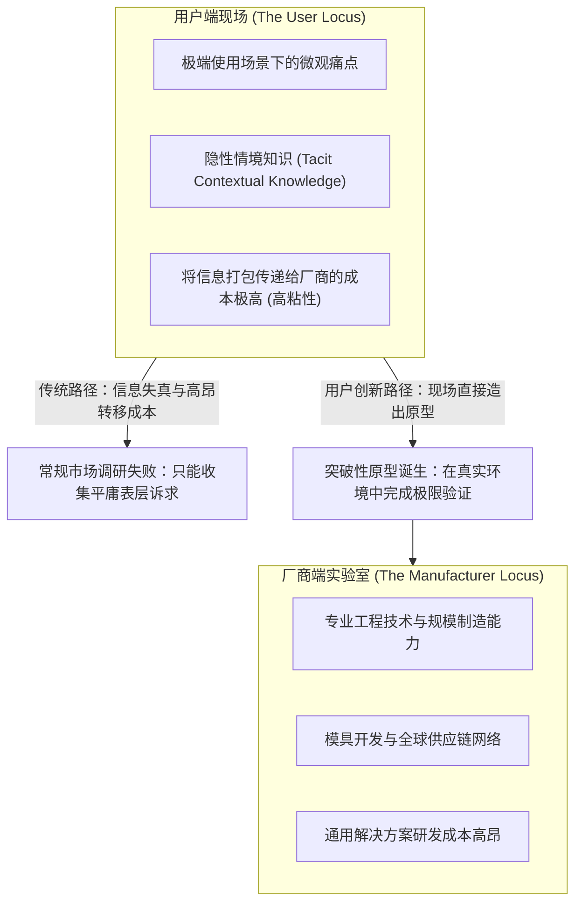

# Lec 01 用户创新范式：打破厂商中心主义神话 (The User Innovation Paradigm)

> 授课教师：Prof. Eric von Hippel · MIT Sloan School of Management

## TL;DR

- 冯·希佩尔教授推翻了“所有商业创新均源自生产制造厂商”的传统经济学假设。
- 实证研究表明绝大多数突破性功能创新最初是由遭受极端痛点的最终用户发明的。
- 用户创新者追求的是使用过程中的直接效用，而厂商追求的是通用销售利润。
- 粘性信息（Sticky Information）在空间上的不对称分布决定了创新发源地。

## 谁才是真正的发明家？传统厂商中心论的破产

在过去数个世纪的经典经济学与管理学教科书中，创新的过程被描述为一个高度专业化、由制造厂商（Manufacturers）主导的封闭循环：企业投资设立中央研发实验室，雇佣科学家研究前沿技术，随后由市场营销部门通过焦点小组（Focus Group）或问卷调查去询问普通消费者的需求，最后制造出量产产品摆在货架上销售给被动的用户。

麻省理工学院斯隆管理学院著名教授**埃里克·冯·希佩尔（Eric von Hippel）**在开创性巨著《创新的民主化》（Democratizing Innovation）与《创新的来源》（Sources of Innovation）中，通过数十年的大规模实证研究，彻底粉碎了这一神话：**在科学仪器、半导体制造、极限户外运动、医疗设备乃至开源软件等诸多关键领域，70% 以上具有革命性的重大突破（Breakthroughs），最初根本不是由制造厂商实验室发明的，而是由遭遇极端痛点的最终使用者（Users）在车库或临床一线亲自动手改装造出来的！**

::: definition 用户创新者 vs 厂商创新者 (User Innovator vs. Manufacturer Innovator)
- **用户创新者 (User Innovator)**：通过自行研发或改装产品，期望从该产品的**直接使用过程（In-Use Benefit）**中获取内在价值（如治愈病患、提升科研精度或获得极致极限运动体验）的个体或组织；
- **厂商创新者 (Manufacturer Innovator)**：通过研发与量产产品，期望从向他人**销售产品（Sales Benefit）**中获取商业利润的商业实体。
:::

## 创新的发源地为何由“粘性信息”决定？

冯·希佩尔教授提出了著名的**“粘性信息（Sticky Information）理论”**，从信息经济学底层解释了为什么厂商无法单方面闭门造车：

### 1. 信息的粘性（Stickiness of Information）
信息不是像空气一样能够零成本随意流动的。许多关键的临床需求、前沿实验条件或极端滑雪动作中的力学平衡，属于高度个性化的**“隐性情境知识（Tacit Knowledge）”**。用户很难用简单的文字或问卷向厂商工程师解释清楚这种微妙的痛点；把这些高度复杂的情境信息精准传递给厂商的转移成本极其高昂。

### 2. 谁拥有粘性信息，谁就在哪里发起创新
正因为“需求信息”沉淀在用户现场，而“解决方案设计”往往只需要基础的工具箱，因此最经济高效的创新路径，就是由**身处现场的用户直接利用身边的材料捏出第一个原型**，而不是等待厂商来调研。

## 经典跨行业实证证据：从山地车到心外手术

冯·希佩尔教授在麻省理工课堂上展示了一系列震撼人心的经典历史证据：

| 工业与消费领域 | 传统厂商早期的态度与盲区 | 最终用户在车库中的真实发明历程 | 最终商业化结局 |
| :--- | :--- | :--- | :--- |
| **山地自行车 (Mountain Biking)** | 施文（Schwinn）等公路车巨头认为自行车只能在柏油路上骑，粗轮胎毫无市场 | 加州一群狂热越野爱好者将沙滩巡航车的粗轮胎、摩托车刹车与报废变速器手工拼装焊接 | 如今山地车占据全球自行车产业 60% 以上的销量与利润 |
| **科学测量仪器 (Scientific Instruments)** | 仪器制造商只生产标准化常规量程仪器，认为定制超高精度不经济 | 顶尖物理学家与化学家为了探测未知粒子，亲自在实验室改造探针与激光分光系统 | 商业化科学仪器中 80% 的重大测量原理均直接来源于科学家的实验室原型 |
| **心导管手术介入器械 (Medical Devices)** | 医疗器械大厂按照常规病患标准尺寸开模制造导管 | 心脏外科医生面对血管严重畸形的危急婴儿，亲自动手剪裁、弯折导管并缝上特殊线头 | 医疗器械巨头派专人常驻医院观察名医的私下改装，买下专利后量产 |

::: insight
传统市场调研（如焦点小组与问卷抽样）最大的系统性缺陷在于：**它们只能反映“绝大多数普通大众对现有产品的微调意见”**。普通大众缺乏前瞻性视野，他们只能在自己已知的框架内提出平庸的要求（比如“希望能稍微便宜一点、颜色多两种”）。如果一家企业寄希望于通过问卷调查来发明下一代颠覆性产品，就像试图通过向中世纪农民发问卷来发明拖拉机一样荒谬。
:::

## 现代企业拥抱“用户创新范式”的三大转变

1. **从“需求刺探者”转向“用户发明搜寻者”**：停止在普通大众中盲目分发几万份没有价值的调研问卷。将研发经理和产品经理派往极端应用的最前线，去寻找那些已经自己动手改装产品的民间极客与极端用户。
2. **重构商业模式：让用户承担前端研发**：深刻认识到：由用户自发完成概念定义与原型验证，能够将企业的早期探索风险直接归零。厂商的核心价值在于将粗糙的民间原型转化为安全、合规、低成本且可被规模量产的工业商品。
3. **消除对用户改装的敌意**：传统厂商往往把用户的私自改装视为“侵权”或“违反保修条款”。具有前瞻性思维的企业应当主动开放产品的模块化物理与软件接口，甚至为核心用户提供改装工具包（Toolkits），将全球成千上万的用户转化为免发薪水的外部研发大军。

::: pitfall
绝不要试图在第一天就用商业合同去粗暴买断用户的创新动机。许多用户之所以投入数千小时去狂热发明，完全是源自对某项爱好的纯粹热爱或解决自身痛苦的内在执念。如果厂商带着一副高高在上的资本傲慢姿态去插手，往往会瞬间摧毁原生用户社区的创造活力。
:::
