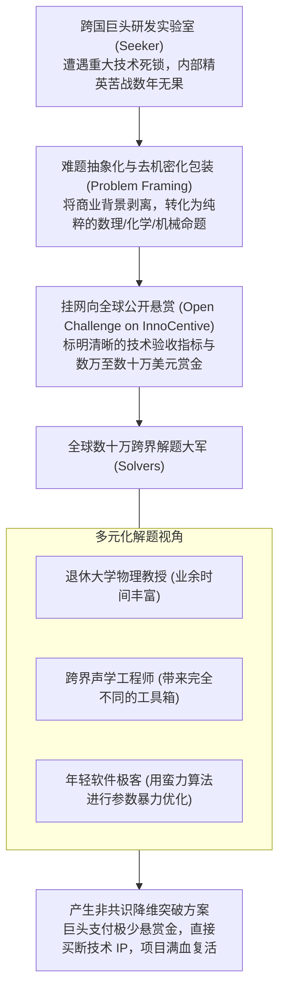

# Lec 11 众包机制与集体智慧：分布式解决技术难题 (Crowdsourcing and Collective Intelligence)

> 授课教师：Prof. Eric von Hippel · MIT Sloan School of Management

## TL;DR

- 众包（Crowdsourcing）将原本由企业内部承担的技术难题向全球不特定公众悬赏开放。
- InnoCentive 案例表明超过三分之一的长期困扰跨国巨头的科学死锁被外部跨界外行攻克。
- 竞赛型锦标赛模型（Tournament Model）与协作型模型的机制设计与激励权衡。
- 构建高效众包平台必须克服信噪比极低、知识产权确权复杂与商业机密泄露风险。

## 乔伊法则的冷酷审视：最聪明的人永远在为你以外的机构工作

无论一家企业的研发预算有多么雄厚，无论是微软、谷歌、辉瑞还是波音，都无法逃避太阳微系统公司（Sun Microsystems）联合创始人比尔·乔伊（Bill Joy）提出的残酷公理——**“乔伊法则（Joy's Law）”**：

> **“不论你是谁，世界上最聪明的人绝大多数都在为其他人工作（No matter who you are, most of the smartest people work for someone else）。”**

一家跨国巨头哪怕在中央实验室招聘了 5,000 名世界一流的博士科学家，这 5,000 人与全球数千万受过高等教育的科学家和工程师相比，依然只是沧海一粟。当企业在研发中遭遇极其棘手的底层技术死锁时，单纯依靠内部团队闭门苦战，往往在消耗了数亿美元后依然一无所获。

麻省理工学院本讲通过对全球开放式创新殿堂级案例——**InnoCentive 科学悬赏平台**与 **Threadless 众创社区**的深度实证解构，系统拆解如何运用**众包（Crowdsourcing）与集体智慧（Collective Intelligence）**调动全球跨界大脑解决企业级攻坚难题。

::: definition 众包机制 (Crowdsourcing)
由杰夫·豪（Jeff Howe）在《连线》杂志正式定义的商业模式：一家机构把过去由员工执行的工作任务，以公开征集（Open Call）的形式，外包给由不特定大众构成的庞大网络群体。参与者通常包含业余爱好者、外部专家与跨界学者，通过锦标赛竞争或协同协作获得赏金或精神认可。
:::

## 经典案例诊断：InnoCentive 与跨界科学破局奇迹

### 1. 诞生于制药巨头内部的绝望尝试
在 2000 年初，全球制药霸主礼来公司（Eli Lilly）的高级研发副总裁阿尔菲·宾厄姆（Alpheus Bingham）面临巨大的研发危机：礼来实验室里数百位顶尖有机化学家，卡在了一系列复杂分子合成步骤上长达数年，导致多个重大新药项目停滞。
- 宾厄姆大胆决定尝试一种在当时被视为疯癫的做法：建立一个名为 **InnoCentive** 的网络悬赏网站；
- 礼来将这些困扰顶尖化学家数年的绝密技术难题，进行去敏感化抽象包装后挂在网站上，向全球所有网民公开设立 1 万至 10 万美元不等的现金悬赏。

### 2. 震撼科学界的统计数据：外行的降维打击

礼来公司 InnoCentive 平台运行前期的实证数据，对整个现代企业研发管理哲学构成了前所未有的剧烈冲击。在传统的认知中，跨国制药巨头拥有全美薪酬最高、发表顶刊论文最多的终身有机化学科学家，如果这批精英苦战三年都无法合成某种复杂分子，理所当然会被归结为“以现有的人类科学水平该问题在理论上无法解决”。

然而，拉哈尼教授对数十万次跨界尝试的量化追踪表明，知识的专业化分工往往构筑了一道道高耸的专业壁垒。某一个领域被视为无法攻克的“世纪死锁”，在相邻领域可能只是大一本科生都会做的基础经典习题。由于各学科之间学术期刊、专业术语与社交圈层的严重割裂，内行专家往往在自己学科的死胡同里撞得头破血流，而外行凭借完全不同的公理体系与隐喻联想，能够轻松实现降维突破。
哈佛商学院卡里姆·拉哈尼（Karim Lakhani）教授对 InnoCentive 前期数百个复杂科学悬赏项目的真实结案数据进行了极其严密的量化追踪，得出了一个颠覆性的科学结论：
- **超过 30% 困扰跨国巨头数年的世纪技术难题被成功攻克！**
- 更令人瞠目结舌的是：**最终成功领走巨额赏金的解题者（Solvers），其本专业领域绝大多数根本不是该难题所属的领域！**
- 一个困扰全美顶尖地质勘探学家的地震波降噪算法，最终被一位在中学教纯数学的普通教师用傅里叶变换变种在周末搞定；一个困扰化工巨头的黏性液体快速罐装难题，被一位无线电物理学家用高频共振原理彻底化解。

## 众包机制的两大经典范式：锦标赛模型 vs 协同沉淀模型

麻省理工组织行为学研究指出，众包机制的设计必须严格匹配问题的底层数学特性：

| 众包组织机制 | 锦标赛竞赛模型 (Tournament Model) | 协作共创模型 (Collaborative Model) |
| :--- | :--- | :--- |
| **典型代表平台** | InnoCentive、Kaggle 算法大赛、XPRIZE | 维基百科 (Wikipedia)、Linux 开源社区、Threadless |
| **底层任务特性** | **“极端值问题（Extreme Value Problems）”**：只需要一个最优的突破性方案，99% 的平庸方案毫无价值 | **“累加性问题（Additive Problems）”**：需要成千上万个微小的知识碎片像拼积木一样共同垒砌成庞大系统 |
| **参与者互动关系** | 绝对彼此隔离竞争，互不通气，各自交卷 | 高度透明协作，站在前人的修改基础上持续迭代叠加 |
| **激励分配机制** | 赢家通吃（Winner-Takes-All），仅第一名拿走全部赏金 | 共享崇高的公共声誉与全人类通用的知识公地 |

::: insight
为什么外行往往能攻克内行苦战无果的科学难题？因为**专业知识本身就是一座坚固的“思维监狱”**。当一个人在某一个领域成为殿堂级权威时，他的大脑里装满了“这个方向走不通”、“那个参数是不可违背的物理极限”等成见。而一个来自相邻领域的跨界外行，根本不知道你们这帮专家的潜规则，他直接带着自己领域成熟的工具箱大步跨进现场，反而能以孩童般的纯粹视角撕开一道生路。
:::

## 成功落地企业级众包的四大关键护栏

1. **掌握高超的“难题抽象与框架化能力（Problem Framing）”**：绝不要把未经验证的复杂商业宏大问题直接扔给大众（如“请帮我们设计一款好卖的手机”）。必须由资深科学家将其拆解为极其具体的单一科学命题（例如“如何用食品级安全材料在摄氏 40 度常温下保持高分子凝胶抗剪切强度超过 15 MPa”），标明明确可被客观仪器复算的验收基准。
2. **严防“信噪比灾难（Signal-to-Noise Disaster）”**：面向公众开放悬赏必然会引来海量的劣质投稿与垃圾方案。建立严密的自动化初筛机制（如算法跑分测试集、形式化验证脚本），切忌让人类核心架构师整天耗费精力去肉眼阅读数千份毫无价值的民科投稿。
3. **建立坚如磐石的知识产权确权闭环**：在参赛者提交方案前，强制签署具有法律效力的知识产权让渡与原创性保证协议（IP Assignment Agreement），严防外部方案混入他人未经授权的专利代码，导致主办方在后续商业化时面临侵权连带追责。

::: pitfall
绝不要试图把众包当成“白嫖外部廉价劳动力”的剥削工具！如果在悬赏规则中含糊其辞、甚至在看到优秀的方案后找借口宣布“无人达到标准”从而私下偷窃创意，这种不诚实的行为会在极客社交网络上引发毁灭性的公关反噬，导致企业被全球所有严肃的科研人员永久列入黑名单。
:::
