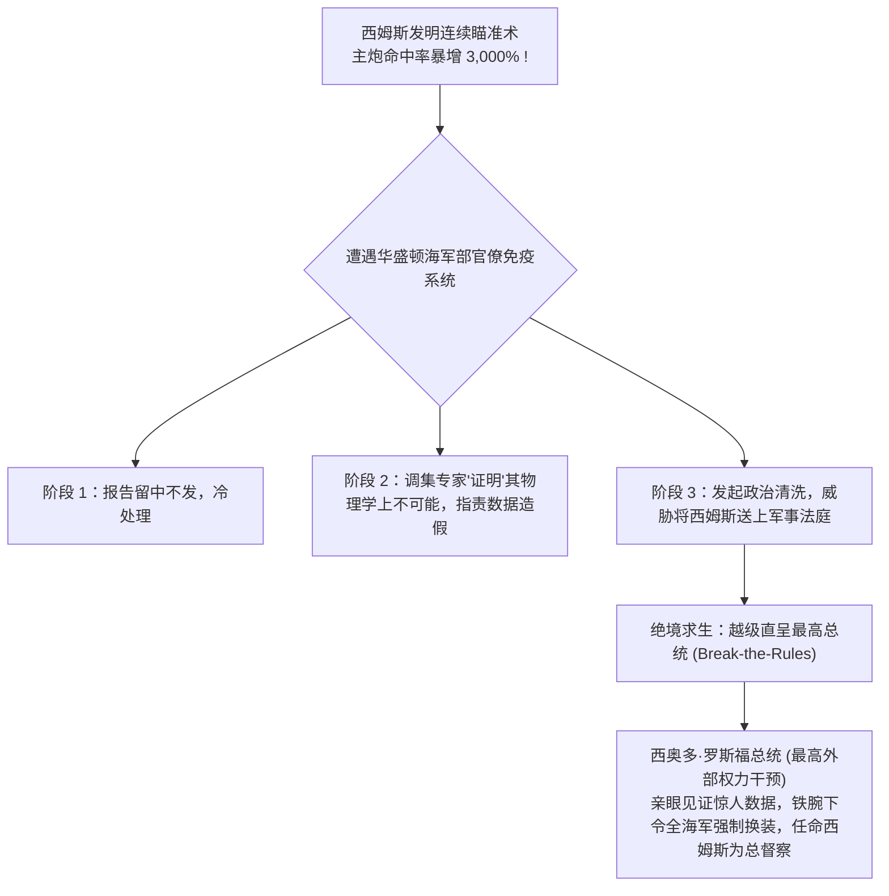

# Lec 12 全课程综合复盘：规避大企业免疫抗体与推进行动 (Synthesizing Breakthrough Methods)

> 授课教师：Prof. Eric von Hippel · MIT Sloan School of Management

## TL;DR

- 埃尔廷·莫里森经典历史巨著《海上炮火》深刻揭示了大企业对抗突破创新的免疫系统。
- 珀西·斯科特与西姆斯海军上将改革表明：突破性创新天然破坏既得利益与社会阶层。
- 系统收敛全学期十二讲：在领先用户、开源社区、移情设计与众包之间精准决策。
- 构建保护突破性幼苗的“组织特遣队”，为技术创新者确立终身推进行动指引。

## 终极谜题：为什么卓越的大企业总是扼杀真正伟大的发明？

在学期的最初，我们可能会天真地以为：企业之所以无法实现颠覆性创新，仅仅是因为缺乏优秀的创意生成方法论（Idea Generation Methods）。然而，在系统学习了领先用户、开源社区、移情设计、工具包与众包机制之后，一个更为残酷、更为隐秘的深层制度性真相逐渐浮出水面：**真正的阻碍往往不是“缺少好想法”，而是当一个真正具备颠覆力量的伟大突破出现时，成熟企业那套庞大而严密的“组织免疫系统（Corporate Immune System）”，会在第一时间自发释放出成千上万个致命抗体，将这株幼苗残酷扼杀在摇篮之中！**

麻省理工学院历史学泰斗**埃尔廷·莫里森（Elting E. Morison）**在其传世经典著作《人、机器与现代时代》（Men, Machines and Modern Times）的第二章《海上炮火》（Gunfire at Sea）中，通过对 19 世纪末美英皇家海军一场关于“连续瞄准射击术（Continuous-Aim Firing）”的技术革命历史复盘，为全课程的结课提供了最震撼人心的反思镜鉴。

::: definition 组织免疫系统 (The Corporate Immune System)
成熟企业内部由既得利益阶层、陈旧晋升机制、传统风险控制流程与既定文化信条构成的潜意识防御网络。它本能地将一切破坏现有权力平衡、颠覆现有盈利模式或挑战既有技术权威的重大突破性创新，视为必须予以排斥、压制与消灭的“外来有害病菌”。
:::

## 经典历史解剖：西姆斯上校与《海上炮火》的血泪抗争

### 1. 传统海军炮术的命中率灾难
在 1890 年代，全球各国海军主力战列舰在实弹射击演习中的主炮命中率惨不忍睹：在海浪颠簸的实战环境下，万吨巨舰向数公里外的靶船齐射数百发炮弹，命中率通常只有 **1% 至 2%**！
- 原因是当时的舰炮是刚性固定在舰体上的。炮手必须在甲板随着风浪起伏摇摆的一瞬间，凭借肉眼和第六感，在炮口恰好划过海平面的千分之一秒内拉动击发绳；
- 整个海军将校军官群体对此习以为常，并将其包装为一种只有贵族军官凭借“高超的绅士直觉与英勇品格”才能掌握的玄学艺术。

### 2. 珀西·斯科特与西姆斯的颠覆性发明
英国皇家海军珀西·斯科特（Percy Scott）与美国年轻海军军官威廉·西姆斯（William S. Sims）在东方舰队服役时，利用极其简单的齿轮机械改装，发明了**“连续瞄准射击术”**：
- 他们将高倍望远镜瞄准镜与机械补偿齿轮直接安装在炮身耳轴上，使炮手能够单手转动旋钮，无论军舰如何剧烈颠簸，炮管都能在物理上**永远锁定在敌舰靶心之上**！
- 在随后的演习中，西姆斯手下的普通炮手创造了前所未有的奇迹：在短短数分钟内连续打出数十发全中，**命中率不可思议地飙升了 3,000%（提高 30 倍）！**

### 3. 海军总部的冷血围剿与政治反扑
如果按照理性的商业逻辑，美国海军部应当立即给西姆斯颁发勋章并在全舰队推广这一神技。然而，西姆斯的报告送到华盛顿海军军械局后，遭遇了教科书级的官僚扼杀：
- **第一阶段：隐瞒与视而不见**。官僚们直接将报告塞进抽屉，假装什么都没发生；
- **第二阶段：用伪科学理论证明其不可能**。军械局高层调集了华盛顿的弹道学专家撰写长篇反驳报告，言之凿凿地“证明”在物理学上海浪颠簸时人类不可能连续调整准星，污蔑西姆斯的演习数据是弄虚作假的骗局；
- **第三阶段：人身攻击与政治迫害**。指责西姆斯年轻气盛、蔑视海军传统、目无尊长，威胁要将其送上军事法庭并开除军籍！

最终，走投无路的西姆斯冒着掉脑袋的叛国风险，越级给狂热热爱海军的**西奥多·罗斯福总统（Theodore Roosevelt）**写了一封密信。罗斯福总统亲自过问并命令进行实弹比对，真相大白。罗斯福随即任命西姆斯为全海军射击总督察，彻底改写了世界海战史。

## 为什么突破性创新必然会遭遇惨烈抵抗？

莫里森教授给出了全课程最深刻的哲学总结：**一项技术从来不是单纯的一堆齿轮或几行代码，一项成熟技术与现存社会的权力结构、既得利益与阶层荣誉深度共生**。

| 组织维度 | 传统技术的社会共生网络 | 突破性新技术降临带来的毁灭性冲击 |
| :--- | :--- | :--- |
| **社会地位与尊严** | 依靠数十年熬资历掌握玄学手艺的老军官享有至高无上的权威 | 新技术把射击变成流水线傻瓜操作，老军官一辈子的经验在一夜之间贬值为零 |
| **资本沉没与产线** | 庞大的造船厂与军械局围绕老炮管签订了数亿美元的长期供应合同 | 新技术意味着既有产线必须全部报废拆除，触动了军火垄断集团的核心奶酪 |
| **企业文化信条** | “我们海军之所以强大，是因为拥有不怕死的贵族绅士精神” | 新技术宣示：战争的胜负取决于冰冷的机械齿轮补偿精度，彻底粉碎了贵族神话 |

::: insight
“当你试图推进一项渐进式微创新时，所有人都是你的朋友；而当你试图推进一项真正的突破性创新时，你是在向现存组织的整个社会阶层宣战”。埃里克·冯·希佩尔在结课时严肃告诫所有麻省理工学子：**如果你发明了一个能把公司效率提升 10 倍的原型，却在管理层会议上遭遇了冷嘲热讽与重重阻力，不要感到惊讶与沮丧，这恰恰证明你击中了时代的核心命脉**。平庸的想法才会获得全场热烈的掌声，颠覆性的真理永远在诞生之初被视为离经叛道的异端。
:::

## 15.356 全课程创新方法论决策全景罗盘

在学期的终章，冯·希佩尔教授为全班构建了一张覆盖全谱系的突破性创新方法论决策矩阵：

| 商业与技术情境 | 最佳匹配的创新方法论 | 核心实施要点与避坑指南 |
| :--- | :--- | :--- |
| **面对复杂前沿趋势，主流客户缺乏远见** | **领先用户方法论 (Lead User Method, Lec 02)** | 坚决走出舒适区，运用金字塔搜寻法跨界到极端相似市场（Analogous Markets）寻找神人 |
| **用户存在难以言说的深层习惯化痛点** | **移情式设计 (Empathic Design, Lec 06)** | 让核心工程师亲自下放田野，闭上嘴巴，用摄像机捕捉用户的微表情与自发魔改补偿动作 |
| **互联网海量潜客面临碎片化个性化诉求** | **在线倾听需求重组 (Listening In, Lec 05)** | 搭建虚拟导购沙盒，用贝叶斯引擎抓取自然语言对话中的非共识极端异常值（Outliers） |
| **遭遇跨学科硬核科学死锁，内部苦战无果** | **锦标赛众包机制 (Crowdsourcing, Lec 11)** | 将难题去机密化抽象包装，向全球跨界外行设立公开悬赏，寻找降维打击的解题者 |
| **客户个性化定制需求庞大，传统拉锯成本高** | **用户创新工具包 (User Toolkits, Lec 10)** | 把制造公差边界封装进软件，将试错迭代彻底交给用户，数据直连柔性流水线自动量产 |
| **用户群体自发自愿协同推进大型复杂系统** | **开源与创新社区治理 (Communities, Lec 04, 08)** | 采取选择性开放架构；充当社区的基础设施服务者，尊重技术优秀主义，绝不搞官僚越权 |

## 突破性技术领袖的终身推进行动指引

如果你在未来的人生中怀揣着一项可能改变世界的突破性原型，请恪守西姆斯上校用生命换来的三条军规：
1. **构建“组织特区（Skunkworks）”保护幼苗**：在原型尚未具备强大自我造血能力之前，必须由最高层领导者出面为其设立一道制度防火墙，将其物理隔离于主流官僚审计流程之外，绝不让成熟部门的短期财务 KPI 压死探索的萌芽。
2. **寻找拥有独立裁决权的“外部最高盟友”**：当内部官僚阻力积重难返时，学会在更高维度的外部生态寻找盟友（如最具声望的行业客户、具有远见的顶级风险投资人或董事会独立董事）。用外部不可抗拒的商业现实，倒逼内部组织被动进化。
3. **永远用“无可辩驳的极端演示（Demo）”说话**：停止在幻灯片上与保守派争吵。拉上他们走进现场，当着所有人的面按下开关，让机器跑出震撼人心的客观数据。事实是摧毁一切教条最锋利的开山战斧。

::: pitfall
绝不要盲目发起毫无准备的正面自杀式冲锋！许多优秀的年轻工程师在发现新技术后，以傲慢愤怒的姿态在公开场合公然嘲弄老领导与传统业务，结果往往是在产品上线前夜就被官僚系统以违反流程为由彻底清洗出局。改革是一门高超的政治艺术，保持坚韧的耐心、寻找同盟者并懂得在非原则问题上妥协，才能最终护送伟大的技术跨越死亡之谷。
:::
