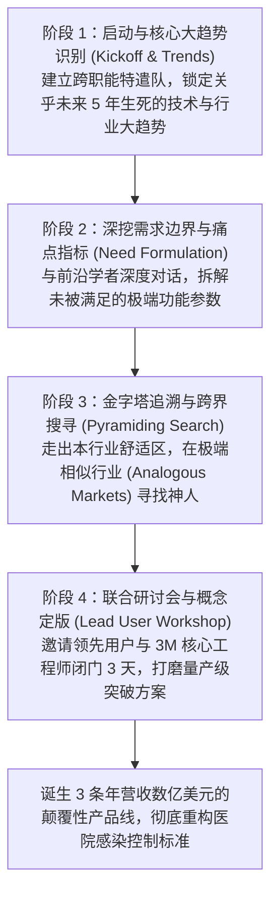
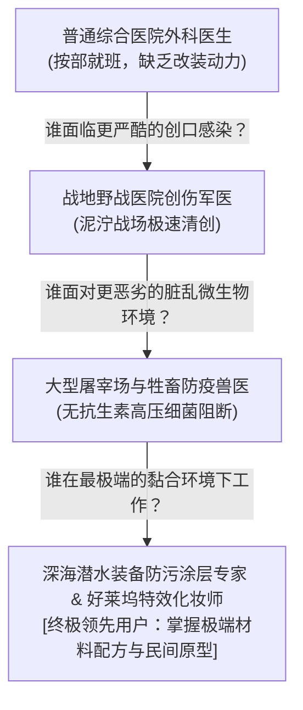

# Lec 02 领先用户方法论：3M 突破性创新四步法 (The Lead User Method & Breakthroughs at 3M)

> 授课教师：Prof. Eric von Hippel · MIT Sloan School of Management

## TL;DR

- 领先用户（Lead Users）具备走在市场大趋势前沿与迫切自主解决痛点两大特征。
- 3M 医疗外科事业部应用领先用户方法论成功扭转了渐进式微创新的增长泥潭。",
- 四步实操流程：启动与趋势识别、确定需求边界、金字塔追溯滚雪球、研讨会概念定型。
- 在非目标相似行业（Analogous Markets）寻找领先用户能带来最大的跨界突破。

## 寻找来自未来的信使：什么是领先用户？

在商业竞争中，预测未来往往是极其昂贵且充满误判的占卜行为。然而，埃里克·冯·希佩尔教授指出：**未来其实早已降临，只是分布得极不均匀（The future is already here, it's just unevenly distributed）**。在任何一个行业的大多数普通大众感知到某种需求之前数年甚至数十年，总有极少数生活在极端环境下的个体，已经提前撞上了这一未来的墙壁。

这批跑在历史时间轴最前端的人群，就是**领先用户（Lead Users）**。

::: definition 领先用户两大公理特征 (Two Defining Characteristics of Lead Users)
1. **走在重要市场大趋势的最前沿 (At the Leading Edge of Trends)**：他们所面临的极端痛点与严苛技术需求，在今天看似小众甚至怪异，但将在未来数年后成为主流普通大众普遍面临的刚需；
2. **拥有极高的自主解决利益诉求 (High Benefit Expected)**：由于现有市场上的商业厂商无法满足其极端标准，现有产品的缺陷对其构成了不可承受的巨大痛苦或损失，迫使他们**必须亲自动手发明解决方案**。
:::

## 经典案例诊断：3M 医疗外科事业部的自我革命

在 1990 年代末，以创新著称的百年巨头 **3M 公司**遭遇了严重的增长瓶颈。以手术敷料、胶带与手术巾为核心的医疗外科事业部（Medical-Surgical Division），年营收增长率跌落至平庸的微弱个位数。
- 事业部每年耗费数千万美元，产出的尽是一些“加宽 2 毫米胶带”、“换个粉色包装”等毫无商业价值的微小渐进式微创新；
- 3M 资深创新专家玛丽·桑纳克（Mary Sonnack）联合冯·希佩尔教授，在医疗事业部启动了一场彻底打破传统的“领先用户方法论实验”。

## 领先用户方法论的四步标准实操引擎

冯·希佩尔与桑纳克构建的领先用户研究法，是一项高度工程化、可复制的四阶段探索闭环：

### 1. 第一步：锁定大趋势（Identify Trends）
团队不再讨论胶带粘性，而是站在全球流行病学前沿进行研讨。他们识别出一个不可逆转的致命趋势：**院内交叉感染（Hospital-Acquired Infections, HAIs）正因抗生素滥用而急剧恶化**。医院需要能够从源头上阻断细菌滋生的全新物理与生物化学屏障，而不是在切口化脓后换胶带。

### 2. 第二步：定义极端需求参数
团队将目标设定为：研发一种能够在手术室无菌环境中、即使遭遇大量血液与体液浸润也能持久抑菌、且紧密贴合人体皮肤长达数天的革命性材料。

### 3. 第三步：金字塔搜寻法（Pyramiding）与相似市场（Analogous Markets）
这是领先用户方法论最具魔力、也最富技术含量的一步。如果只在传统手术室里找医生，只能找到习惯了现有规矩的保守派。3M 团队采用了**金字塔搜寻（Pyramiding Search）**：
- 询问一位普通外科专家：“在这个领域里，谁的技术比你精湛 10 倍？”专家推荐了战地军医；
- 询问战地军医：“谁面对的感染控制环境比战场野战医院更加恶劣 10 倍？”军医推荐了兽医与牲畜防疫专家；
- **终极突破发生在相似市场**：团队最终在好莱坞好莱坞顶级特效化妆师（需要让黏合剂在演员高温暴汗下保持数十小时不脱落）以及潜水员深海抗污损涂层专家身上，找到了惊为天人的解决方案！

### 4. 第四步：领先用户研讨会与量产概念定型
3M 并没有偷偷抄袭这些技术，而是将这些来自截然不同领域的极端领先用户邀请至明尼苏达总部。经过为期三天的头脑风暴与工程碰撞，诞生了三款革命性的感染控制产品线，其商业回报率比传统项目高出 **8 倍以上**！

## 传统市场研究 vs 领先用户方法论的终极对照

| 评估维度 | 传统厂商主导的调研 (焦点小组/问卷调查) | 冯·希佩尔领先用户研究法 (Lead User Method) |
| :--- | :--- | :--- |
| **搜寻目标人群** | 处于正态分布钟形曲线中央的主流典型大众 | 处于正态分布极端边缘 1% 的狂热用户与偏执极客 |
| **调研核心内容** | 询问用户“你还需要什么现有产品功能？” | 寻找用户“你已经在车库里动手改装出了什么？” |
| **发现的创新级别** | 90% 以上为渐进式微调（Incremental Improvements） | 70% 以上为颠覆性突破（Breakthrough Concepts） |
| **跨界知识迁移** | 局限于本行业已知的存量概念 | 跨越至完全无关的相似市场（Analogous Markets）降维打击 |
| **研发周期与成本** | 厂商必须从零开始进行昂贵的试错研发 | 直接复用领先用户已在极端环境中验证过的成熟原型 |

::: insight
为什么寻找“相似市场（Analogous Markets）”如此重要？因为如果你在自己的行业里寻找领先用户，你的竞争对手也看得见他们，甚至行业法规和惯性已经锁死了他们的思维。而当你跨界到另一个行业时，那里的专家已经为了解决他们自己的生死痛点苦苦钻研了二十年。将另一个行业里成熟的“常识”搬运到你的行业，在你的客户眼里就是惊天动地的“降维奇迹”。
:::

## 落地领先用户搜寻的四项行动心法

1. **掌握金字塔追溯提问句式**：在拜访任何专家时，永远不要把访谈终结于其个人见解。在结束前必须追问：“在您认识的所有人中，谁在处理这个极端问题上被公认为最疯狂、技术最顶尖的怪才？”沿着这条链条连续追踪 4 到 5 次，你一定会触碰到金字塔顶端的神人。
2. **严防“把大客户采购当成领先用户”**：大企业的大客户采购往往是最保守的官僚，他们极度厌恶风险。真正的领先用户往往隐藏在车间一线、暗黑实验室或民间发烧友论坛中，他们可能脾气古怪、甚至满嘴脏话，但他们的双手沾满了机油与代码。
3. **用共创取代傲慢的买断**：在召开领先用户研讨会时，以平等的合伙人姿态对待外部极客。提供有竞争力的咨询报酬、联合专利署名权与未来产品的优先使用权，建立长期的技术共生网络。

::: pitfall
绝不要试图让主流业务销售代表去负责搜寻领先用户！销售代表的本能是达成当季度的销售指标，他们本能地只愿意拜访那些愿意立即下大单的传统老客户。搜寻领先用户必须组建一支独立的、由资深研发架构师与前瞻战略官构成的特遣队。
:::
