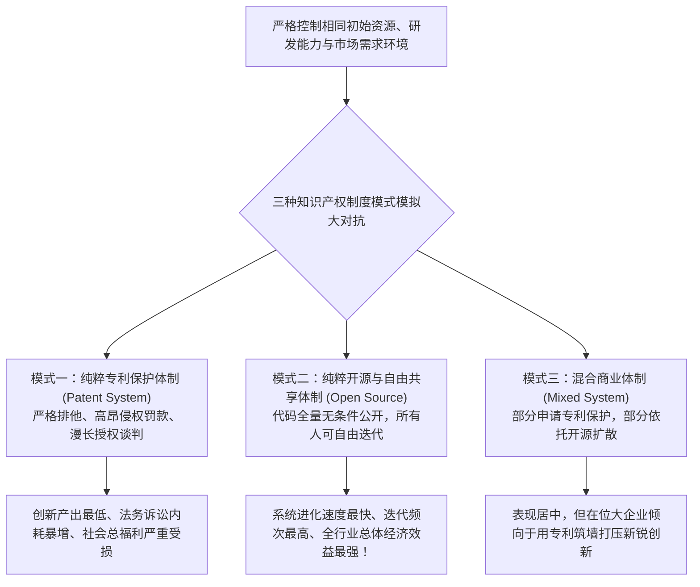

# Lec 03 专利悖论与创新阻碍：知识产权的双刃剑 (Patent Holdup & The Paradox of IP)

> 授课教师：Prof. Eric von Hippel · MIT Sloan School of Management

## TL;DR

- 安德鲁·托伦斯教授实证揭示：现代严苛的专利体系往往阻碍而非促进了技术创新。
- 专利丛林（Patent Thickets）与专利流氓（Patent Trolls）大幅抬高了初创研发成本。
- 模拟实验表明完全开放模式下的创新产出与社会福利显著优于强专利保护模式。
- 企业战略必须从被动的防御性囤积专利转向积极的跨界技术共享与交叉授权。

## 制度设计的初衷与现实背离：专利真的在保护创新吗？

在现代法学与微观经济学基准理论中，专利制度（Patent System）被描绘为推动人类技术进步的最神圣制度发明：国家通过赋予发明人长达 20 年的排他性法定垄断权，以换取其将发明细节公开，从而激励研发资本的大胆投入。正如亚伯拉罕·林肯所言：“专利制度是给天才的创造之火浇上了利益的柴油。”

然而，堪萨斯大学法学院教授兼麻省理工客座研究员**安德鲁·托伦斯（Andrew Torrance）**在与冯·希佩尔教授的长期联合实证研究《专利与有用技艺的倒退》（Patents and the Regress of Useful Arts）中，抛出了震撼学术界与产业界的逆向结论：**在数字化软件、生物医药与复杂系统时代，过度膨胀且模糊的专利制度，不仅没有促进技术创新，反而正在蜕化为扼杀前沿探索、阻碍民间发明流通的最大制度性路障！**

::: definition 专利丛林与敲竹杠 (Patent Thickets & Holdup)
在复杂高科技产品（如智能手机或基因测序）中，重叠交叉着数十万项由不同主体持有的微小专利网络（专利丛林）。任何新进入者哪怕发明了突破性技术，也无法绕开由模糊权利要求书构筑的法律雷区，极易被持有陈旧专利但缺乏实际业务的投机实体（专利流氓 NPEs）发起勒索性诉讼打压。
:::

## 托伦斯与托姆林森的开创性多智能体模拟实验

为了彻底剥离现实世界中复杂的政治游说、历史路径依赖与宏观经济波动对研究结论的干扰，托伦斯教授与托姆林森设计了一套极其精密的封闭系统计算机模拟环境。在这个虚拟沙盒中，数百个独立的虚拟企业智能体在相同的时间步长内进行技术研发、代码共享、专利申请与市场销售竞争。

模拟实验对每一行代码的产生、每一次专利申请的法律开支、每一次技术交叉授权的谈判摩擦以及由于专利禁令导致的停工期进行了精确到纳秒的统计。实验结果以无可辩驳的量化证据证明：强排他性的专利制度不仅大幅增加了系统内部的摩擦阻力，更诱导智能体将宝贵的研发资本转移到法务诉讼与防御性专利墙的修筑上，从而在宏观上显著拖慢了整个虚拟生态的技术演化速度。

为了科学检验专利制度对创新的真实因果影响，托伦斯教授与比尔·托姆林森（Bill Tomlinson）构建了一个革命性的计算机化多智能体商业实验系统：

实验数据给出了冷酷的客观证据：
- 在纯粹开源共享的环境下，智能体能够站在彼此的代码基础上快速递进叠加，技术迭代频率是强专利模式的 **3 倍以上**；
- 在强专利保护环境下，大量的资本和智力资源被浪费在撰写含糊不清的法律专利文书、规避重叠专利以及相互发起无休止的禁令诉讼中，全行业总产出显著萎缩。

## 专利制度异化的三大核心机制

麻省理工课堂深入解剖了现代专利丛林为何会蜕变为创新的阻碍机制：

| 异化机制 | 现实运作表征 | 对真实研发者的毁灭性打击 |
| :--- | :--- | :--- |
| **反公地悲剧 (Tragedy of the Anticommons)** | 一项新药研发需要向 50 家不同的大学与实验室分别购买基因片段授权 | 只要其中一家漫天要价或拒绝谈判，整项救命药物的商业化立即胎死腹中 |
| **模糊权利要求书武器化 (Weaponized Claims)** | 专利流氓申请故意含糊其辞的宽泛概念专利（如“在网络上更新软件的方法”） | 初创公司刚刚上线新 App，立即遭遇勒索，巨额应诉法务费直接导致团队破产 |
| **防御性专利囤积军备竞赛 (Patent Arms Race)** | 科技巨头每年耗费数十亿美元申请数万项平庸垃圾专利 | 目的不是为了投入生产，而是为了在被对手起诉时拥有相互保证毁灭（MAD）的筹码 |

::: insight
许多发明人沉醉于拿到红彤彤的专利证书，误以为有了专利就等于有了财富。这是一种极度危险的幼稚病。在当代高科技商战中，**专利不是进攻的利剑，专利往往是拖垮初创企业的负债**。维持一项国际专利 20 年的年费与代理费高达数十万美元，而一旦卷入一场真正的专利诉讼，第一轮证据开示（Discovery）的律师费就能烧光一家 A 轮公司的全部现金。
:::

## 技术创业者应对知识产权陷阱的实操战略

在专利制度彻底重构之前，技术创业团队必须建立高度务实的 IP 防御生存哲学：
1. **用“商业秘密（Trade Secrets）与极速迭代”替代浅层专利**：对于核心算法、材料配方与制造工艺诀窍，最好的保护方式是严密的物理与软件访问隔离，而不是在专利局公开细节。你的最高壁垒是：当抄袭者看懂你的老版本时，你已经上线了快三倍的新一代架构。
2. **参与“专利防御联盟（Defensive Patent Pools）”**：加入开放发明网络（Open Invention Network, OIN）或 LOT Network 等非营利性交叉授权联盟，与其他数千家科技企业签署互不侵犯协议，用集体契约对冲流氓实体的袭击。
3. **策略性“公开披露（Defensive Publication）”阻击对手**：如果你发现了一项关键技术，但自己不想申请昂贵专利，也不希望竞争对手将其据为己有：立即在权威技术论坛或论文中将其公开！一旦成为公知技术，任何竞争对手便永远无法就该技术申请有效专利。

::: pitfall
绝不要试图在没有资深独立知识产权律师把关的前提下，向潜在的大企业买家或大客户展示未经保护的核心未公开技术细节！商业史上充满了大公司以“尽职调查合作”为名套取初创公司图纸，随后调集自身法务团队微调参数自行申请专利将初创公司挤出市场的残酷惨案。
:::
