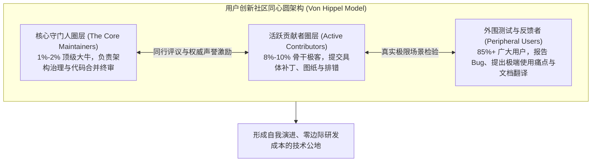

# Lec 04 用户创新社区与开放平台协作 (User Innovation Communities & Open Platforms)

> 授课教师：Prof. Eric von Hippel · MIT Sloan School of Management

## TL;DR

- 用户创新往往不是孤立的个体行为，而是以分布式社区形态自发协同演进。
- 开源软件社区的成功为实体硬件与复杂产品设计提供了去中心化治理典范。
- 生产厂商必须学会从封闭主导者转变为用户创新社区的服务者与基础设施构建者。
- 健康的创新社区需要清晰的声誉激励、极低的贡献门槛与透明的代码合并准则。

## 孤岛的联结：分布式协同创新的崛起

在前三讲中，我们探讨了个体领先用户如何在车库或一线现场自行制造原型以满足自身极端需求。然而，单兵作战的用户创新者往往面临着严重的资源瓶颈：一个人可能擅长机械结构设计，但不懂电气控制算法；另一个人精通底层固件编写，却缺乏高精度机加工车床。

在传统工业时代，只有资产雄厚的大型企业才有能力在同一屋檐下集结如此多维度的工程人才。然而，互联网的诞生打破了物理空间的禁锢，催生了一种全新的社会化协作形态——**用户创新社区（User Innovation Communities）**。成千上万名原本互不相识的民间极客、专业学者与业余发烧友，围绕共同的技术理想或产品爱好，在网络论坛与开源平台上实现了无摩擦的自发大规模协同。

麻省理工学院本讲基于埃里克·冯·希佩尔教授发表在《斯隆管理评论》的里程碑论文《学习自开源软件的用户社区创新》（Innovation by User Communities），解构去中心化创新社区的组织机制及其对现代企业的颠覆性启示。

::: definition 用户创新社区 (User Innovation Communities)
由志愿参与的最终使用者构成的分布式自组织网络。社区成员自发分享彼此改装产品的代码、CAD 图纸与实验数据，遵循开源共享与同行评议准则，共同推进复杂产品系统的持续演进，且不依赖任何单一中心化商业实体的行政命令雇佣关系。
:::

## 开源协作模型的拓扑结构与动力学

冯·希佩尔指出，无论是在 Linux 开源操作系统、乐高 Mindstorms 机器人极客论坛，还是在极限风筝冲浪发烧友社群中，健康的创新社区都呈现出高度一致的同心圆治理架构：

### 1. 为什么极客愿意“无偿贡献”？
主流经济学往往假设人是自私贪婪的，不发工资绝不干活。然而，创新社区的微观研究揭示了个体的深层心理动机：
- **互惠利他（Reciprocity）**：我今天修复了一个微小 Bug 贡献给社区，明天我就能免费享受全球上万人共同维护的强大系统；
- **同侪声誉（Peer Recognition）**：在极客圈子里，被公认为“写出最优雅算法的大神”所带来的心理满足感与职业身价提升，远超公司内部主管发的一点微薄奖金；
- **纯粹的创造乐趣（Joy of Problem Solving）**：人类大脑在克服硬核智力挑战时，会自发分泌多巴胺，进入深度的心流沉浸。

## 商业企业如何与用户社区共生？四大策略演进

面对蓬勃发展的外部用户社区，传统企业的态度经历了从“敌视围剿”到“共生赋能”的深刻蜕变：

| 厂商策略阶段 | 企业典型行为特征 | 代表案例与组织后果 |
| :--- | :--- | :--- |
| **第一阶段：敌视与法律扼杀** | 发送律师函警告、封杀改装接口、以侵犯知识产权相威胁 | 乐高早年威胁起诉破解其机器人固件的极客，引发全球抵制 |
| **第二阶段：冷眼旁观与私下抄袭** | 默许社区存在，暗中窃取社区的创意量产售卖，却不反哺 | 某些传统仪器厂商抄袭科学家论坛的设计，遭到社区集体抛弃 |
| **第三阶段：提供官方平台与工具箱** | 主动开放产品 API 与总线协议，设立官方开源平台赋能社区 | 乐高逆转战略，聘请极客参与下一代开发，销量飙升数倍 |
| **第四阶段：构建双边商业生态** | 围绕社区构建应用商店与认证分成机制，实现价值共赢 | 红帽对 Linux 社区的贡献回流、苹果 App Store 开发者生态 |

::: insight
传统企业高管最常问的一个愚蠢问题是：“我们如何‘管理（Manage）’这个外部开源社区？”冯·希佩尔的回答是：**你永远无法‘管理’一个自由的社区，你只能‘服务（Serve）’它**。一旦你试图用大公司的官僚考核指标去强行指挥社区开发者，极客们会立即在 24 小时内建立一个新的论坛，发起代码分叉并将你扫地出门。企业唯一的合法性，在于充当社区的基础设施铺设者与后勤保障军。
:::

## 企业培育与融入用户创新社区的四大行动指南

1. **大幅降低“初次贡献的认知门槛（Frictionless Onboarding）”**：为社区提供极其详尽的入门指南、清晰的模块化架构拆解与标准化的提交流程。确保一个充满热情的新人可以在 30 分钟内完成环境搭建并提交自己的第一个微小修改。
2. **设立绝对透明的“代码合并治理规范”**：坚决杜绝暗箱操作。每一次合并（Merge）或拒绝（Reject）外部贡献的代码，核心维护者都必须给出令人信服的技术因果理由，坚决维护社区基于“技术优秀主义（Meritocracy）”的公平基石。
3. **保护社区的“非商业化圣域感”**：切忌在原生极客社区中充斥露骨的商业广告与硬广推销。尊重社区的非正式文化黑话与极客仪式，让商业收益自然从外围的企业级服务中产生。

::: pitfall
绝不要试图“伪造虚假草根社区（Astroturfing）”！许多公关部门自作聪明，雇佣水军在论坛上冒充真实发烧友发帖捧场。在当代高度敏锐的极客社群中，这种弄虚作假会在几天内被识破并被公开扒皮，给企业的品牌信誉造成长达数年的毁灭性污点。
:::
