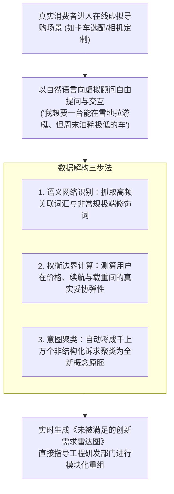

# Lec 05 倾听式需求挖掘：格伦·厄本的动态在线需求重组 (Exploring Customer Needs: The "Listening In" Methodology)

> 授课教师：Prof. Eric von Hippel · MIT Sloan School of Management

## TL;DR

- 麻省理工格伦·厄本教授开创了“在线倾听（Listening In）”动态需求挖掘方法论。
- 传统问卷调查存在表层化、引导偏见与无法感知非预期需求的致命缺陷。
- 通过语义网络与虚拟顾问对话，实时重构消费者在大规模探索中的偏好组合。
- 将自然语言挖掘与交互式偏好优化相结合，极大压缩了新概念的验证周期。

## 需求挖掘的盲人摸象：传统市场调研的终结

在工业制造与消费品研发中，产品团队最常挂在嘴边的词汇就是“以用户为中心”。为了探寻用户的真实心声，企业每年耗费数亿美元雇佣市场调研机构：他们在超市门口拦截路人填写冗长的打钩问卷，或者把八个互不相识的消费者关在装有单向透视玻璃的焦点小组会议室里，由主持人拿出一张张概念图发问。

然而，麻省理工学院斯隆管理学院前院长兼营销学泰斗**格伦·厄本（Glen L. Urban）**与约翰·豪瑟（John R. Hauser）在发表于《营销科学》（Marketing Science）的里程碑论文《在线倾听以发现和探索客户需求的新组合》（Listening In to Find and Explore New Combinations of Customer Needs）中指出：**这种传统的静态调研方式在信息时代已经彻底沦为形式主义的数字垃圾**。

当用户面对一张印好的问卷时，他们是在被动接受调查员预设的思维框架；人们在问卷上勾选的意愿，与他们在真实购买场景中掏出信用卡时的决策行为存在巨大的虚伪断层。

::: definition 倾听式需求挖掘 (The "Listening In" Methodology)
由格伦·厄本教授开创的一套交互式动态在线洞察系统：通过在网络前端构建一个高度拟真的“智能虚拟顾问（Virtual Advisor）”，允许成千上万名真实潜客以自然语言自由提问、比对配置并探索不同功能组合。系统在后台通过贝叶斯网络与自然语言算法，非侵入式地实时捕捉用户在探索过程中自发流露出的隐性痛点与未被满足的全新需求组合。
:::

## “在线倾听（Listening In）”的算法与工程流水线

厄本教授在课堂上系统展示了“在线倾听”系统如何将原本模糊的非结构化用户对话，转化为高度精准的产品研发参数：

### 1. 消除提问引导偏见（Interviewer Bias）
传统问卷的问题本身就充满了设计者的主观偏见（例如问：“你觉得这个红色好看吗？”）。而在“在线倾听”系统中，完全由消费者基于自身实际生活痛点主动发起探索，系统充当无偏见的中立倾听者。

### 2. 捕捉“非共识组合（Unexpected Combinations）”
真正的突破性创新往往隐藏在看似矛盾的跨界需求组合中。例如在商用卡车案例中，系统通过倾听上万条真实对话，意外发现了一群原本被主流配置忽略的微型农场主群体：他们既需要重型卡车的强悍越野悬挂，又强烈要求具备高档轿车的豪华皮质静音座舱。正是这种未被传统调研捕获的跨界组合，催生了年利数亿美元的高端跨界皮卡爆款。

## 传统调研 vs 在线倾听方法论对比矩阵

| 对比维度 | 传统焦点小组与静态问卷 (Focus Groups & Surveys) | 厄本“在线倾听”动态系统 (Listening In Methodology) |
| :--- | :--- | :--- |
| **样本规模与成本** | 样本量极其有限（通常几十至几百人），人均调研成本高达数千美元 | 依托互联网瞬时覆盖数万人，边际边际调研成本趋近于零 |
| **数据真实性与情境感** | 用户在人工模拟的人造环境下答题，讨好调查员，虚假承诺严重 | 用户在真实的选配与消费决策心流中自发提问，数据极度真实 |
| **需求边界发现能力** | 只能验证企业已经想到的既有假设，无法发现“未知的未知” | 能够自动挖掘出设计者从未想象过的冷门组合与极端应用场景 |
| **与研发交付的集成度** | 输出为厚重且往往脱离工程实际的抽象 PPT 市场报告 | 直接输出与 CAD 零部件和配置开关一一对应的量化工程参数 |

::: insight
传统市场研究人员最大的执念就是追求“可量化的百分比”（例如：85% 的人喜欢这个设计）。然而，格伦·厄本告诫我们：**在突破性创新领域，百分比毫无意义，真正有价值的是‘极端异常值（Outliers）’**。如果 10,000 个人里面有 9,900 个人的诉求是平庸的，但有 100 个人在反复询问一种看似离奇但逻辑自洽的新功能组合，这 100 个异常值就是通往下一代蓝海市场的黄金金矿。
:::

## 现代产品团队构建“持续倾听雷达”的行动准则

1. **打通客服与研发的数据隔阂**：绝不要把客服热线、售后报修工单与社交媒体投诉视为单纯的售后负担。建立自动化的文本挖掘流水线，每天自动清洗并聚类客户在报错与抱怨时流露出的高频隐性诉求，直接推送到产品经理的工作台。
2. **构建“虚拟试配沙盒（Virtual Configurator）”**：在官网或 App 中为用户提供高自由度的概念定制工具。即使某项前沿功能目前尚未量产，也可以作为“探索性开关”放在沙盒中，静默统计有多少真实用户主动勾选了该选项。
3. **在对话中测量“妥协弹性（Trade-Off Elasticity）”**：当用户提出既要极致性能、又要极低价格的不可能诉求时，通过虚拟顾问进行针对性试探：“如果为了保证这项极限性能，产品重量需要增加 15%，您是否依然愿意接受？”通过这种动态博弈，摸清真实的用户价值支付底线。

::: pitfall
绝不要把“在线倾听”退化为单纯的“舆情监控发帖爬虫”！许多企业采购了昂贵的网络舆情软件，每天只看品牌被提到了多少次、正面评价占百分之几。这种宏观情绪监控对于产品功能定义没有任何实质价值。真正的倾听必须死死聚焦于“具体使用场景下的微观功能冲突与未被满足的任务”。
:::
