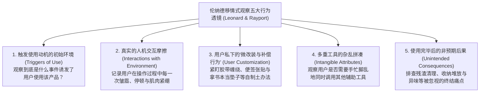

# Lec 06 移情式设计与人种学观察：多萝西·伦纳德框架 (Empathic Design & Ethnographic Need Discovery)

> 授课教师：Prof. Eric von Hippel · MIT Sloan School of Management

## TL;DR

- 哈佛商学院多萝西·伦纳德教授开创了基于人种学观察的“移情式设计（Empathic Design）”。
- 消费者由于习惯化与认知盲区，往往“无法说出自己真正需要什么”。
- 五步观察法则：寻找触发点、使用交互、环境配合、用户微改造与非预期后果。
- 工程师与设计师深入一线田野调查是消融专家傲慢、激发颠覆性灵感的熔炉。

## 无法言说的秘密：为什么用户无法用语言表达需求？

在很多时候，阻碍创新的最大障碍不仅在于厂商的傲慢，还在于**人类个体自身的认知生理局限**。人类的大脑具有极强的适应性与“习惯化（Habituation）”本能：当我们长期身处一个充满缺陷、设计反人类的环境中时，我们的大脑会自发建立补偿机制（Compensatory Behaviors），对身边的痛苦习以为常甚至视而不见。

如果你在 1970 年代走到厨房问一位家庭主妇：“你觉得现有的金属削皮刀好用吗？”她一定会微笑着回答：“非常好用，没有任何问题。”因为她已经习惯了握着冰冷坚硬的金属刀柄削土豆削到手指关节发红肿痛，她压根想象不出世界上还可以存在一种柔软、防滑、符合人体工程学的高弹橡胶手柄（如后来风靡全球的 OXO Good Grips）。

麻省理工学院本讲联合哈佛商学院著名管理学教授**多萝西·伦纳德（Dorothy Leonard）**与杰弗里·雷波特（Jeffrey F. Rayport）在《哈佛商业评论》发表的殿堂级论文《通过移情式设计激发创新》（Spark Innovation Through Empathic Design），解构如何运用人类学家的田野调查方法，捕获深锁在用户无意识行为中的“隐性需求（Latent Needs）”。

::: definition 移情式设计 (Empathic Design)
研发团队（包括核心工程师、人机交互专家与设计师）亲自走进用户的真实生活或工作自然情境之中，不带任何预设立场，像人类学家观察原始部落一样，用眼睛、摄像机与高度同理心细致观察用户在与现有产品交互时的一举一动，从而挖掘出连用户自己都无法用语言表述的深层隐性需求的创新方法论。
:::

## 移情式观察的五大关键行为透镜

伦纳德教授指出，优秀的观察者不是在现场漫无目的地闲逛，而是配备了五只极其敏锐的“行为探测透镜”：

### 1. 紧盯用户的“民间土办法与补偿动作”
这是最具含金量的突破性信号！当你在现场看到一位护士用橡皮筋把两个输液管绑在一起防止滑落，或者看到一个程序员把一本日记本垫在键盘手腕下方时，请立即警醒：**这里存在一个价值数亿美元的未被满足的商业机会！** 用户的民间土办法，正是现有商业产品设计残缺的最直观控诉。

### 2. 捕捉使用后的“尴尬终结瞬间”
许多产品在工作时表现良好，但在收尾阶段却是一场灾难。例如传统料理机打果汁只需 30 秒，但事后拆洗刀头和滤网却需要耗费整整 20 分钟，甚至极易划伤手指。观察到这一痛点的工程师发明了可整体丢入洗碗机或刀头一键反冲洗的设计，瞬间击穿市场。

## 移情式设计五步完整推进流程

伦纳德教授构建了标准化的移情式设计推进链路，强调跨学科团队的现场沉浸：

| 推进阶段 | 核心任务与具体动作 | 常见致命错误 (严禁触犯) |
| :--- | :--- | :--- |
| **实地观察 (Observation)** | 工程师必须亲自去现场，严禁外包给中介调研公司；保持安静，绝不打断用户的自然操作 | 忍不住当场教导用户：“你这个操作不对，我们说明书上明明写了……” |
| **视频复盘 (Analysis)** | 将录像带回实验室，跨职能团队共同观看并逐秒慢放，记录操作过程中的异常停顿 | 各执一词，脱离现场录像进行纯主观的哲学辩论 |
| **原型验证 (Prototyping)** | 用硬纸板、黏土与胶带在数小时内拼出最粗糙的实体模型，交还给用户上手体验 | 耗费数月时间做昂贵的高保真模具，结果发现方向彻底跑偏 |

::: insight
“不要听用户说了什么，要看用户做了什么”。移情式设计最核心的人性洞察在于：**语言是经过大脑高度理性粉饰与修辞掩饰的谎言，而人体的肌肉动作与微表情永远诚实**。当一个用户嘴上说着“这台机器挺好的”，但他每次按下开关时手指都会微微颤抖、下意识地往后退一步，这种微妙的本能动作就毫无保留地出卖了他的恐惧。卓越的产品经理必须学会用眼睛去“听”。
:::

## 落地移情式设计的四项组织铁律

1. **强制“核心工程师下放田野”**：严禁把用户画像建立在二手报告之上。强制要求主架构师和硬件负责人，每年必须抽出至少两周时间深入一线客户现场（如跟随重型货车司机长途跟车、在急诊室通宵驻留）。唯有亲眼目睹用户的泥泞，代码才会产生灵魂。
2. **消灭“专家傲慢（Curse of Knowledge）”**：研发人员由于对自己的系统了如指掌，本能地认为“连个密码重置都不会的客户简直是不可理喻”。走进田野的最大价值，就在于打破这种精英偏见，深刻体认到在现实复杂高压环境下，人类的认知带宽是多么脆弱。
3. **寻找“行为与说明书的背离”**：如果发现 80% 的用户都在以一种完全违反官方操作手册的方式使用产品，不要去起诉或训斥用户！立即反思：手册是愚蠢的，用户的违规操作背后蕴藏着他们对最高效使用路径的本能选择。顺应这种违规，往往就能诞生产业新标准。

::: pitfall
绝不要把移情式设计搞成一场“大阵仗的公关走秀”！如果管理层带着十几个西装革履的助理、架起长枪短炮的专业灯光去用户家里“做客”，用户会彻底处于表演状态，你得到的只会是一场精心编排的虚假样板戏。真正的观察必须追求隐蔽、无侵入与绝对的自然常态。
:::
