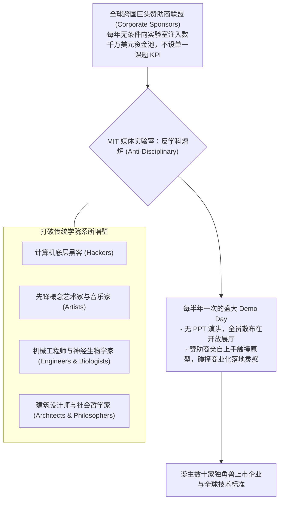

# Lec 07 MIT 媒体实验室范式：从构想直接跃迁至极端原型 (The MIT Media Lab Approach: "Demo or Die")

> 授课教师：Prof. Eric von Hippel · MIT Sloan School of Management

## TL;DR

- MIT 媒体实验室开创了颠覆传统学术象牙塔的“要么演示，要么滚蛋（Demo or Die）”信条。
- 拒绝冗长的理论可行性论证，通过构建高度可感知的实体极端交互原型打动赞助商。
- 跨学科极客融合（计算机、建筑、脑科学与艺术）激发了超越技术维度的全新人机界面。
- 极端原型能够将未来模糊的技术图景具象化，作为全行业建立认知共识的实体锚点。

## 反叛学术传统：不做学术纸上谈兵，只做震撼演示

在传统世界级研究型大学中，学术研究的标准考核路径是神圣而僵化的：教授带领博士生阅读数千篇前人文献，建立抽象的数学推导模型，撰写长达几十页的严谨同行评议论文（Paper），并在专业学术会议上宣讲。在这一传统范式下，一项研究从提出构想到最终发表往往历时数年，绝大多数论文发表后便被束之高阁，一生只有几十位同行阅读，对现实商业与工业世界的改造极其缓慢。

1985 年，麻省理工学院传奇学者**尼古拉斯·尼葛洛庞帝（Nicholas Negroponte）**与杰罗姆·威斯纳（Jerome Wiesner）创立了享誉全球的**MIT 媒体实验室（The MIT Media Lab）**。媒体实验室彻底打破了学术象牙塔的陈规陋习，确立了响彻全球科技界的铁血校训——**“要么演示，要么滚蛋！（Demo or Die！）”**（后在伊藤穰一时期演进为“Deploy or Die 发布部署或去死”）。

媒体实验室不考核论文篇数，不搞繁文缛节的开题答辩；实验室唯一的最高硬通货，就是你能否在开放展厅里，拿出一个让全球 500 强高管和普通大众当场目瞪口呆、惊掉下巴的**实体可交互原型（Working Prototype）**！

::: definition 体验式极端原型 (Experiential Radical Prototyping)
越过中间漫长的文字立项、PPT 汇报与可行性论证流程，直接将最前沿的颠覆性技术概念具象化为具备真实视听、触觉与空间交互反馈的实体装置。通过让决策者与用户“亲身体验未来”，消融抽象概念的沟通鸿沟。
:::

## 媒体实验室独特的组织生态与反学科熔炉

媒体实验室之所以能持续催生出电子墨水屏（E-Ink）、乐高可编程机器人、可穿戴计算、立体全息投影与情感计算等改变人类历史的重大发明，核心在于其反常规的组织机制：

### 1. 资金模式的奇迹：无限制探索资金池
传统企业赞助大学课题，往往要求签署极其严苛的阶段性交付合同与竞业限制条款。媒体实验室开创了独特的“赞助商联盟会员制（Consortium Model）”：
- 全球数十家财富 500 强企业（涵盖汽车、电信、消费电子、媒体、消费品）每年缴纳固定会费（数十万至数百万美元）；
- 所有资金汇入统一资金池，赞助商**放弃指定具体研发方向的权力**，全权交由实验室师生自由探索最离经叛道的前沿想法；
- 作为回报，所有赞助商共享实验室产生的所有专利免版税非独家使用权，并享有每半年与极客学生面对面闭门触摸所有最新原型的特权。

### 2. 反学科哲学（Anti-Disciplinary Philosophy）
在传统大学里，计算机系与艺术学院水火不容。媒体实验室坚信，最重大的颠覆性创新恰恰发生在两个成熟学科之间那片“无人看管的荒野地带”。一个研究歌剧的音乐家与一个研究量子计算的物理学家同桌办公，正是这种不可预知的认知碰撞，诞生了让盲人“看见”音乐的可穿戴触觉背心。

## 极端原型的四大战略力量

在麻省理工课堂上，教授系统归纳了为什么“做原型”永远比“写论证报告”强大一百倍：

| 原型战略维度 | 传统商业立项汇报 (PPT & Business Plan) | 媒体实验室极端实体原型 (Radical Prototype) |
| :--- | :--- | :--- |
| **沟通摩擦系数** | 依赖抽象词汇与行话，听众根据各自偏见脑补，极易产生严重误解 | 实体装置摆在面前，10 秒钟内无需任何语言解释即可达成认知同频 |
| **未知隐患暴露** | 电子表格能把所有数据粉饰得完美无缺，掩盖致命物理与人机硬伤 | 原型一旦上手，机械共振、散热不良与操作别扭会在瞬间原形毕露 |
| **情感冲击力** | 理性逻辑推演，听众反应冷静克制，很难激发深层的投资冲动 | 极具未来感的震撼体验引发强烈的情感多巴胺共鸣，促使高管当场拍板 |
| **技术辐射边界** | 仅能在既定的特定产品形态内做局部优化 | 原型常常作为一种通用的交互范式，横向辐射到数十个完全不同的行业 |

::: insight
“如果你无法向一个八岁的小孩演示你的发明，你的发明就根本不存在”。媒体实验室哲学给所有创业者最深刻的耳光在于：**PPT 是世界上最廉价的自欺欺人工具**。许多创业团队耗费半年时间写出一份 100 页、充满宏大愿景的商业计划书，其实只是为了掩盖自己根本捏不出一个能跑通的粗糙原型。不要解释，拿出来跑给大家看；代码和马达跑起来的声音，胜过一万张幻灯片。
:::

## 现代企业如何引入“媒体实验室范式”

1. **确立“原型先于决策”的组织特权**：在企业内部推行一条新规矩：凡是申请战略创新预算的团队，禁止提交超过 5 页的纯文本报告；必须携带能在会议桌上实际操作体验的粗糙物理或软件原型进场展示。
2. **构建“反学科游击队”**：挑选来自不同背景的怪才（例如把一个资深游戏关卡设计师塞进一个严肃的企业级数据库优化团队），赋予他们三个月免除日常 KPI 考核的特权，命令他们去搞出一个从未存在过的概念原型。
3. **把发布会变成“可触摸的互动工坊”**：停止在舞台上由 CEO 一个人拿着提词器吹嘘参数。在展厅设立多个无障碍交互展台，让媒体、投资人与普通用户亲自上手折腾、甚至故意玩坏你的原型，用最真实的碰撞检验技术的成熟度。

::: pitfall
绝不要把“做原型”等同于“搞面子工程的灯光秀”！媒体实验室的原型虽然极具概念张力，但底层全部依托扎实的工程代码、传感器阵列与数学算法。如果一个原型只是外观光鲜、内在却需要三个工程师在后台偷偷拿遥控器人工操作的“机械假人（Mechanical Turk）”，这种欺骗不仅无法推动技术进步，最终必将在量产验证中彻底崩塌。
:::
