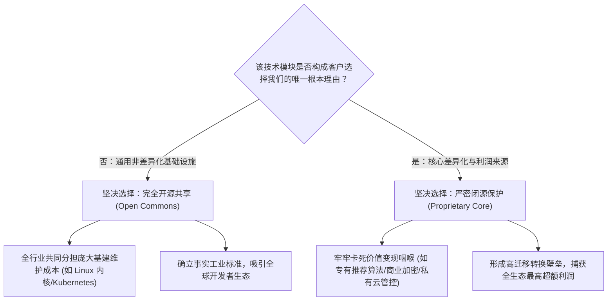

# Lec 08 选择性开放：部分闭源与部分开放的平衡治理 (Selective Openness: Balancing Proprietary & Open IP)

> 授课教师：Prof. Eric von Hippel · MIT Sloan School of Management

## TL;DR

- 克里斯蒂娜·拉什教授提出高科技企业必须采取“选择性开放（Selective Openness）”战略。
- 在底层非差异化基础设施上彻底拥抱开源，降低全行业研发成本并做大生态生态。
- 在顶层差异化核心算法、用户数据与高价值私有功能上严密闭源以捕获超额利润。
- 动态权衡矩阵：评估开放对互补资产繁荣的促进与核心竞争壁垒侵蚀之间的临界点。

## 零和博弈的终结：非黑即白的开放迷思

在现代商业竞争中，关于知识产权（IP）的争论往往陷入两极分化的意识形态陷阱：传统的保守派企业主张“绝对的完全闭源（Full Proprietary）”，将每一行代码与硬件图纸用密不透风的保密协议和专利大网牢牢锁死；而激进的开源纯洁主义者则主张“彻底的完全开放（Full Open）”，认为任何私有化商业行为都是对知识自由的背叛。

然而，欧洲著名创新学者**克里斯蒂娜·拉什（Christina Raasch）**与埃里克·冯·希佩尔教授在联合研究《用户创新动力学：驱动与阻碍机制》（The Dynamics of User Innovation）中指出：在当今复杂的商业生态中，无论是极端闭源还是极端开源，往往都会走向平庸与死亡。

当今商业界最成功的高科技巨头（从 IBM、谷歌安卓到特斯拉），其核心秘密武器都在于掌握了一门精密的战略平衡艺术——**“选择性开放（Selective Openness）”**。

::: definition 选择性开放战略 (Selective Openness Strategy)
企业在系统架构的不同分层上，经过审慎的战略计算，有目的地将特定非核心、通用或网络效应强烈的技术模块进行完全开源共享，以吸引外部开发者繁荣生态；同时将决定企业最终商业盈利与客户留存壁垒的核心差异化模块进行绝对闭源控制的混合知识产权治理战略。
:::

## 模块化解耦：什么该开放？什么该保护？

拉什与冯·希佩尔构建了著名的“选择性开放决策四象限模型”，为企业划定了清晰的开放边界：

### 1. 底层平台开源：把地基变成免费的公地
如果一项技术属于通用的底层管道（例如操作系统的设备驱动层、分布式通信协议或基础机器学习框架），单凭一家公司去独自维护需要耗费数千名工程师的精力。将其开源，可以联合包括竞争对手在内的全行业力量共同分摊维护成本，同时彻底打消客户对于被单一厂商私有协议绑架的深层恐惧。

### 2. 顶层应用闭源：在公地上建造收费的高楼
在开源的地基之上，企业必须拥有不可替代的私有组件：例如海量专有训练数据、高可用企业级容灾插件、专利级硬件交互传感器或私有算法。

## 经典跨行业实证案例：谷歌安卓与 IBM 的选择性开放神话

麻省理工课堂深度剖析了商业史上两个最成功的混合开放典范：

| 企业与平台案例 | 完全对外开源的模块 (The Open Layer) | 严密闭源保护的商业核心 (The Proprietary Layer) | 最终获取的战略战果 |
| :--- | :--- | :--- | :--- |
| **谷歌安卓系统 (Google Android)** | Android 开源项目（AOSP）：开源操作系统底层代码与基础 UI 框架，免费向全球手机厂商开放 | 谷歌移动服务（GMS）：闭源核心（Google Play 商店、谷歌地图、搜索与推送框架），必须经谷歌认证授权 | 击溃封闭的诺基亚塞班与微软 Windows Mobile，占据全球 80% 移动操作系统市场，牢牢统治移动搜索与广告收益 |
| **IBM 拥抱 Linux 战略** | 投资 10 亿美元全力支持开源 Linux 社区，开放大量底层服务器专利 | 闭源其高毛利的 WebSphere 企业级中间件、高端硬件大型机与全球 IT 咨询交付服务 | 成功摧毁了老对手 Sun Microsystems 的 Unix 软件霸权，盘活了全公司数百亿美元的服务与硬件销售 |
| **特斯拉专利开源策略** | 公开所有电动汽车的核心电池热管理与充电接口专利，允许同行免费使用 | 严密封锁其自动驾驶神经网络权重（FSD）、超算集群芯片架构与全球海量行车真实路测数据 | 推动全球加速向电动化转型、确立北美充电标准（NACS），同时在自动驾驶数据壁垒上保持绝对领跑 |

::: insight
许多平庸的管理者在谈到开放时，内心充满恐惧，总觉得“把技术开放出去，别人抄袭我怎么办？”拉什教授的洞见在于：**开放不是做慈善，开放是最高阶的商业借力**。当你主动开放底层协议时，你是在把全球数以万计不拿你工资的外部工程师，转化为你的义务地基维护工。只要你能牢牢守住生态中最赚钱的那个“收费关卡（Toll Gate）”，地基越广阔，你的关卡就能收到越惊人的财富。
:::

## 制定选择性开放战略的四大治理法则

1. **动态重估“差异化边界（Shifting Frontier）”**：技术的差异化属性不是一成不变的。今天极具商业壁垒的高级特性，三年后可能就退化为无人关心的通用大路货。企业管理层必须每半年进行一次技术架构审计，果断将那些已经商品化的老模块推入开源社区，腾出研发精力去攻坚更上一层的全新闭源制高点。
2. **严防“特洛伊木马式假开源”**：如果一个企业宣称开源，但核心代码充斥着无法编译的断头接口、文档故意残缺不全、或者把最基础的功能都锁死在收费模块中，这种虚伪的开放会瞬间被开源社区识破并招致集体反噬。开源的部分必须是一个**自成体系、优雅好用的完整闭环**。
3. **建立与社区平等的对话机制**：当把底层技术开源后，企业自身的工程师在社区里只能凭借技术实力和架构水平赢得同行的尊重，绝不能以“我是版权所有方公司的代表”自居在社区里指手画脚。尊重社区自治规则，是维系混合开放生态的政治前提。

::: pitfall
绝不要在没有任何“互补性资产（Complementary Assets）”的前提下盲目搞完全开源！如果一家初创公司既没有海量专有数据，也没有品牌声誉，更没有强大的企业级销售渠道，仅仅把核心代码 100% 免费公开，其结果往往是为他人做嫁衣：资金雄厚的大厂可以在几天内抓取你的开源代码直接上线服务，在商业上将你彻底抹杀。
:::
