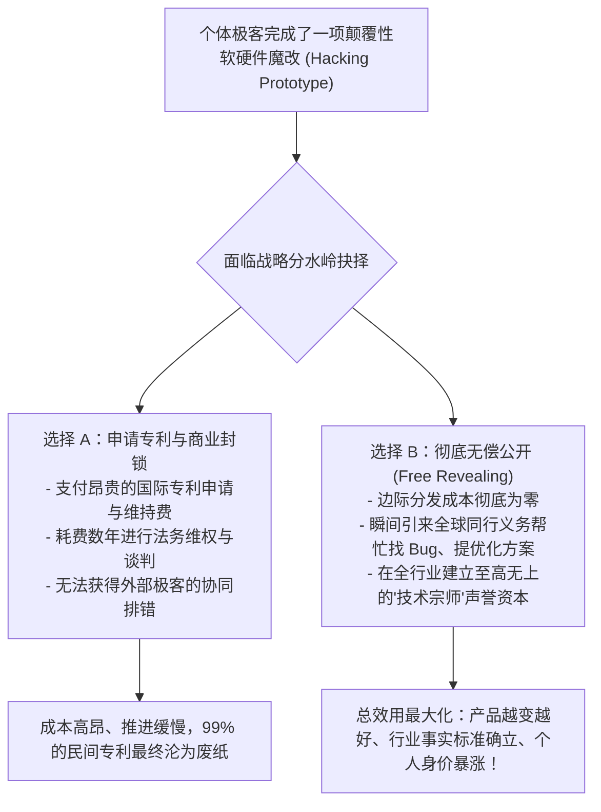

# Lec 09 用户魔改与黑客文化：无偿公开背后的商业逻辑 (User Hacking & Economics of Free Revealing)

> 授课教师：Prof. Eric von Hippel · MIT Sloan School of Management

## TL;DR

- 冯·希佩尔教授系统解构了用户创新中“无偿公开（Free Revealing）”的经济学逻辑。
- 用户无偿分享改装代码与图纸能够获得同行协同改进、声誉资本与网络外部性溢出。
- 分析“黑客改装（Hacking）”从早期灰色边缘产业走向现代商业创新摇篮的跃迁。
- 企业应当设立“黑客友好”机制，将民间魔改文化转化为公司前瞻创新的免费风向标。

## 经济学的大悖论：为什么有人会白白公开自己的发明？

在标准产权经济学理论中，“白白把自己的劳动成果送给别人（Free Revealing）”被视为不可理喻的非理性行为。按照传统逻辑，如果一个人耗费了数月时间、投入数千美元研发出一种全新的无人机飞控算法或一种极其高效的汽车改装涡轮，他理所应当去申请专利进行垄断，或者作为商业秘密严密封锁以谋取商业暴利。

然而，在现实世界中，一种完全颠覆传统理论的现象正在互联网的每一个角落爆发：**数以百万计的技术极客、医生、科研学者与硬件发烧友，在完成了惊艳世界的魔改（Hacking）之后，第一反应竟然是把详尽的电路原理图、3D 打印切片文件与底层源代码，免费、毫无保留地上传到 GitHub、Thingiverse 或技术论坛供全人类免费下载！**

埃里克·冯·希佩尔教授在《创新的民主化》核心章节中，为这一看似不可思议的利他行为构建了极其严密的微观经济学解释：**“无偿公开（Free Revealing）”从来不是非理性的圣人狂热，而是一种在特定约束条件下极度精明、追求个体总效用最大化的理性商业决策！**

::: definition 无偿公开 (Free Revealing)
创新者自发放弃对其所研发的新产品、软件或工艺诀窍的排他性知识产权主张，将所有技术细节完全、公开地向所有潜在竞争对手与公众披露，且不向任何索取者收取许可费用的行为。
:::

## 极客经济学模型：为什么“公开”比“保密”更合算？

冯·希佩尔教授通过数学模型证明：对于个体用户创新者而言，保守秘密与申请专利的成本，往往远超无偿公开所带来的综合收益：

### 1. 极低的分发成本 vs 极高的保密维权成本
在互联网时代，将一份图纸上传到网络的边际成本为零。相反，如果一个独立极客试图通过法律手段保密，他必须耗费数万美元去申请专利，并在发现侵权时耗费数百万元去打跨国官司，这对于个体而言在财务上完全是自杀行为。

### 2. 免费获得全球最顶尖的“义务工程队”
单靠一个极客的业余时间，很难把一个原型打磨到完美。一旦将其公开，全球数以百计面临同样痛点的同行会在几天内涌入：有人帮忙重写低效率的算法，有人帮忙优化机械散热结构。发明人不用支付一分钱薪酬，自己的工具便以惊人的速度迭代进化。

### 3. 网络外部性与声誉资产变现
通过无偿公开，发明人的名字永远被镌刻在该技术的最底层注释中。在行业圈子里，他获得了无可置疑的顶级声望与权威地位。这种“声誉资本（Reputational Capital）”能够轻易转化为顶级大学终身教职、跨国巨头争抢的首席科学家职位、或是未来成立商业公司时顶级风投的疯狂追捧。

## 经典实证案例：从汽车改装到医疗胰岛素泵黑客

冯·希佩尔在课堂上剖析了一系列极具震撼力的现代魔改传奇：

| 行业领域 | 传统厂商的封闭立场与禁令 | 民间极客的无偿魔改运动 (User Hacking) | 最终倒逼的产业进化 |
| :--- | :--- | :--- | :--- |
| **开源人工胰腺系统 (#OpenAPS)** | 传统医疗器械巨头由于合规风险，迟迟不愿推出全自动闭环胰岛素注射算法 | 1 型糖尿病患者与极客程序员联手，破解现有连续血糖仪与胰岛素泵的射频协议，编写闭环算法并在 GitHub 开源 | 挽救了数万名患者的生命，最终迫使美国 FDA 加速批准商业化闭环人工胰腺上市 |
| **索尼 PlayStation 越狱与 Linux 移植** | 索尼在固件更新中强行封杀玩家在 PS3 上安装 Linux 系统的权限，以维护其封闭生态 | 传奇黑客 GeoHot 破解底层安全微码，将全部越狱漏洞细节与加载器代码免费公开发布 | 揭露了主机硬件架构的底层安全缺陷，催生了整个游戏主机安全攻防与开放计算新范式 |
| **开源无人机飞控 (ArduPilot / PX4)** | 传统军工无人机系统单套售价数万美元，代码极其封闭，普通创客根本无法触碰 | 极客社群围绕廉价 Arduino 单片机编写开源自动驾驶仪代码，开源全部硬件传感器接口 | 催生了全球整个消费级民用无人机与农用植保无人机产业大爆发（包括大疆的早期生态） |

::: insight
传统企业的法务部门最擅长做的事情就是给民间黑客发“停止并终止（Cease & Desist）”律师函，指责用户的魔改侵犯了版权、违反了使用条款。这种做法是极端愚蠢的。**每一个自费花时间黑进你系统、魔改你硬件的用户，都是上天赐予你的最高级别的‘免费研发天才’**。他们之所以魔改，是因为他们深深爱着这项技术，但你们官方的产品让他们感到失望。扼杀他们，就是扼杀企业前沿的生命线。
:::

## 企业拥抱黑客文化的四大实战戒律

1. **推行“黑客友好（Hacker-Friendly）”保修政策**：打破“一旦拆机撕开贴纸即彻底失去保修”的陈腐条款。向用户明确宣导：只要不是故意人为恶意破坏物理器件，企业鼓励并在社区官方支持用户的非侵入式改装与固件刷机。
2. **设立“官方漏洞与魔改赏金计划”**：与其等黑客把漏洞公布在网上让企业陷入公关被动，不如主动设立高额奖金池。对那些发现深层架构缺陷、甚至为官方产品贡献出惊艳改装方案的民间极客，给予公开表彰与丰厚奖赏。
3. **把民间最强黑客直接收编进先期研发部**：许多黑客之所以在论坛上公开破解你的系统，本质上是在向全世界展示他的卓越肌肉。与其在法庭上与他们撕扯，不如直接派出工程副总裁奉上顶薪 Offer，让他们在合规的架构里带领团队开疆拓土。

::: pitfall
绝不要把“抄袭民间黑客成果”视为理所应当！许多无良厂商偷偷从开源论坛抓取极客花费数年心血打磨的魔改图纸，去掉了极客的名字直接申请为公司的专有专利进行量产。这种卑劣的盗窃行为一旦在社交网络上被曝光，会彻底激怒整个全球开发者社群，引发海啸级的抵制与黑客网络反制，让企业的品牌在极客心智中永久臭名昭著。
:::
