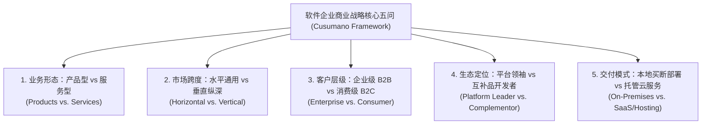

# Lec 01 软件商业战略概论与行业图景 (Course Overview and Strategy for Software Companies)

> 授课教师：Prof. Michael A. Cusumano · MIT Sloan School of Management

## TL;DR

- 软件商业具有零边际复制成本、高固定研发投入与强网络效应的根本特性。
- 库苏马诺教授指出软件战略的核心在于产品化与服务化的动态平衡选择。
- 技术标准与生态兼容性决定了软件企业能否构筑长期的竞争护城河。
- 软件企业必须在水平通用平台与垂直行业深耕之间明确战略切入点。

## 软件产业的独特性：超越传统制造业的商业经济学

在现代商业世界中，软件已经彻底渗透并重塑了金融、医疗、制造与消费等每一个传统行业，正如马克·安德森（Marc Andreessen）所言：“软件正在吞噬世界（Software is Eating the World）”。然而，软件企业本身的商业逻辑与传统硬件制造或实物零售存在根本性的物理与经济学鸿沟。

麻省理工学院斯隆管理学院杰出教授**迈克尔·库苏马诺（Michael A. Cusumano）**在里程碑著作《软件商业》（The Business of Software）中指出：软件是一门极度迷人却又充满险滩的行业。其核心经济学特征表现为“高沉没研发成本（High Sunk R&D Cost）”与“接近于零的边际复制成本（Near-Zero Marginal Replication Cost）”。这种成本结构赋予了软件企业巨大的经营杠杆，但也同时带来了极高死亡率与赢者通吃的寡头垄断格局。

::: definition 软件经营杠杆 (Software Operating Leverage)
当首份软件代码开发完成并消除关键缺陷后，将软件分发给第 100 个客户与分发给第 100 万个客户所增加的直接制造成本近乎为零。伴随用户规模的膨胀，研发固定成本被无限摊薄，企业的毛利率通常高达 80% 至 90% 以上。
:::

## 软件企业的五大核心战略抉择

对于软件企业的战略制定者而言，这五大核心抉择并非孤立的技术偏好，而是彼此深度耦合、直接决定企业资本结构与商业命运的底层支柱。绝大多数平庸的软件企业之所以陷入增长停滞与亏损泥潭，根本原因就在于管理层在这些核心维度上缺乏清晰的决断力，企图在所有方向上左右逢源。

例如，如果你选择服务大型金融机构（企业级客户），你就必须接受长达数月的安全合规审计与采购委员会博弈；如果你试图兼顾通用平台（水平市场）与特定医疗定制（垂直市场），你的工程团队就会在通用抽象与私有补丁之间精神分裂。清晰的战略不在于决定做什么，更在于坚决放弃什么。

库苏马诺教授指出，任何一家软件企业的管理层在制定战略路线图时，都必须对以下五个核心维度做出清晰而清醒的决断：

在上述五大维度中，最致命的战略陷阱往往发生在“产品型”与“服务型”的混淆上。许多初创公司自称是高科技软件产品公司，但在实际运营中，由于缺乏标准化产品定义能力，沦为整日为几个大客户打补丁、写定制化代码的纯粹外包外派服务商。

## 产品型公司 vs 服务型公司：商业模式的终极分野

理解软件产业的财务模型，必须建立对“纯产品（Pure Products）”与“纯服务（Pure Services）”的严格区分：

| 商业维度 | 纯产品型软件企业 (如 早期微软/甲骨文) | 纯服务型集成商 (如 埃森哲/印孚瑟斯) | 混合型商业体 (如 现代 SaaS 巨头) |
| :--- | :--- | :--- | :--- |
| **收入确认模式** | 软件许可证买断授权费（License）+ 每年 15-20% 维护年费 | 依据咨询顾问与程序员的计费工时（Time & Materials）或总包项目款 | 订阅制年费/月费（ARR/MRR）+ 实施落地专业服务费 |
| **毛利率表现** | 极高（80% - 95%） | 中等（30% - 45%） | 较高（70% - 85%） |
| **人效与规模杠杆** | 人均产值极高，规模扩张不需要线性增加研发人员 | 人均产值受限于咨询师生理极限，营收增长必须同步招募新人 | 依靠标准化平台获取杠杆，专业服务团队负责大客户陪跑 |
| **现金流与初期风险** | 初期面临漫长的无收入开发期，必须承受高研发风险 | 签约即有预付款，现金流极度平稳，破产风险较低 | 早期获客成本（CAC）高企，依赖高续费率与留存率（NRR）回本 |

::: insight
许多初创技术团队之所以在融资时处处碰壁，核心原因在于他们拿着“服务型公司的财报”，却试图向投资人要“产品型公司的估值倍数”。华尔街和顶级 VC 给予产品型公司 10 至 20 倍市销率（P/S），是因为代码具备无边际扩张杠杆；而给予外包定制服务公司通常只有 1 至 2 倍市销率。如果你的每一行新代码只能为一个客户使用，你本质上就是一家靠卖人头谋生的建筑包工队。
:::

## 软件商业的宏观周期演进规律

软件行业的竞争格局遵循清晰的技术周期迭代律。从 1960 年代大型机（Mainframe）软硬件一体化捆绑，到 1980 年代个人电脑（PC）操作系统的解耦与分层，再到互联网时代的分布式 Web 应用与当前的云计算 SaaS 平台，每一次底层计算架构的迁移都伴随着老牌巨头的衰落与全新商业模式的兴起。

软件战略家必须保持前瞻的技术雷达，深刻理解摩尔定律、网络带宽爆炸与开源生态对软件交付形态的深刻塑造，在底层架构技术更迭的前夜完成第二曲线的跨越布局。

::: pitfall
绝不要试图在第一天就去打造一个通用的“大而全水平操作系统平台”。历史上所有成功的平台巨头（从微软件的 Windows 到苹果的 iOS），都是先在一个极其具体的杀手级垂直应用（Killer App）上夺得压倒性市场份额，随后才逐步开放 API 演化为水平平台的。脱离杀手级应用的所谓“裸平台”，注定是一座无人问津的鬼城。
:::
