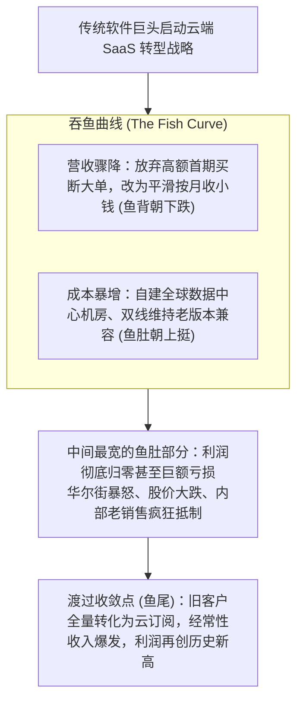

# Lec 10 新兴软件架构与云转型：SaaS 模式与多租户平台演进 (Emerging Technologies: Transition to SaaS & Cloud)

> 授课教师：Prof. Michael A. Cusumano · MIT Sloan School of Management

## TL;DR

- 从 ASP 托管走向现代多租户（Multi-Tenancy）云原生是软件交付的技术革命。
- 软件商业模型从一次性授权彻底转变为可预测的经常性订阅收入（ARR）。
- SaaS 核心经济学模型：客户获取成本（CAC）、生命周期价值（LTV）与净留存率（NRR）。
- 传统软件巨头在云转型过程中面临严峻的“收入吞咽期（Fish Model）”现金流低谷。

## 软件交付的技术大革命：从本地安装到多租户云原生

在个人电脑与企业级局域网时代，软件的交付形态是一件极其沉重的事：企业必须自建恒温机房、采购昂贵的服务器机架、配备专门的系统管理员，并经历数月甚至数年的安装实施周期。每一次软件升级，都需要 IT 人员逐台在每台电脑上插入光盘进行繁琐的更新配置。

在 1990 年代末，第一代应用服务提供商（Application Service Providers, ASP）曾试图挑战这一现状。然而，当时的 ASP 模式仅仅是“把传统软件单机版搬到远程服务器机房托管（Hosting）”，每个客户依然需要独立分配专属虚拟机和数据库，导致运维与硬件成本居高不下，最终在互联网泡沫破灭中遭遇惨败。

迈克尔·库苏马诺教授指出：真正的软件云化革命，直到**多租户架构（Multi-Tenancy Architecture）**与现代**软件即服务（Software as a Service, SaaS）**模式的确立才真正拉开序幕。

::: definition 多租户云架构 (Multi-Tenancy Architecture)
在底层由所有客户共享同一套软件应用实例、同一组服务器集群与同一个物理数据库，但通过高度严密的逻辑分区与数据隔离算法，保证不同企业客户（租户 Tenant）的数据互不可见的云原生软件架构。
:::

## 商业维度的彻底重塑：订阅制现金流的惊人魔力

从传统买断式许可（Perpetual License）向云端 SaaS 订阅转型，不仅是一次技术重构，更是一场彻底改写华尔街财务模型的资本大裂变：

```mermaid
flowchart LR
    Traditional["传统买断软件模型 (Perpetual License)<br/>- 收入结构：首付巨额软件款 + 每年微薄维保<br/>- 营收特征：极度依赖季度末冲刺，业绩剧烈颠簸<br/>- 客户关系：一旦交付收款，软件商几乎不再关心使用实情"]
    
    VS{{"商业范式彻底转移"}}
    
    Modern["现代云端 SaaS 模型 (Subscription ARR)<br/>- 收入结构：按月/按年支付平滑的订阅席位费<br/>- 营收特征：高确定性、可预测的经常性现金流<br/>- 客户关系：必须全生命周期持续提供价值以防客户流失"]]
    
    Traditional --- VS
    VS --- Modern
```

### 1. 传统软件的“走钢丝”困境
在传统买断模式下，软件销售团队每个季度第一天醒来，账上的新增营收都清零。公司必须在每一个季度拼死签下几个数百万美元的超级大单才能达成业绩指标。这种模式导致企业充斥着不可控的业绩颠簸，管理层极易为了短期利润而做出透支长期健康的非理性决策。

### 2. 现代 SaaS 的滚雪球效应
SaaS 模式将软件转变为一种类似水电气一样的公用事业服务。客户只要在平台上持续使用并存储数据，每年都会按时缴纳订阅费。这种**年度经常性收入（Annual Recurring Revenue, ARR）**具备极强的复利滚雪球效应，使软件企业拥有了前所未有的长期财务能见度。

## SaaS 核心微观经济学度量体系

衡量一家云原生软件企业是否健康，不再看其账面上的总资产与净利润，而是严格审视以下四大金科玉律：

| 核心经济学指标 | 术语缩写与标准计算公式 | 健康基准线与战略意义 |
| :--- | :--- | :--- |
| **客户获取成本** | **CAC (Customer Acquisition Cost)**<br/>销售与市场总营销投入 ÷ 同期新增客户数 | 衡量获客效率；通常要求客户在 12 个月内产生的毛利能够完全收回 CAC |
| **客户生命周期价值** | **LTV (Lifetime Value)**<br/>单客平均年贡献毛利 ÷ 年客户流失率 (Churn) | 衡量单个客户终身为公司创造的总现值；健康的 SaaS 企业其 **LTV / CAC 必须 ≥ 3** |
| **净金额留存率** | **NRR (Net Revenue Retention)**<br/>(期末老客 ARR - 老客流失 + 老客增购) ÷ 期初老客 ARR | 衡量老客户池自造血能力；顶级企业级 SaaS 的 **NRR 通常在 120% 至 140% 以上** |
| **规则 40 指标** | **Rule of 40**<br/>企业年度 ARR 同比增长率 (%) + 自由现金流利润率 (%) | 衡量增长与盈利的综合平衡；若该数值总和长期大于 40%，代表企业处于极度健康的高估值区间 |

::: insight
净金额留存率（NRR）是 SaaS 商业模式最强大的秘密武器。如果一家公司的 NRR 达到 130%，意味着即使销售团队在接下来的一整年里**没有开拓任何一个新客户**，仅仅依靠现有老客户因为业务扩张自发增购席位与高级功能，全公司的总收入就能自然增长 30%！这正是资本市场愿意给予优秀 SaaS 平台极其高昂估值倍数的根本动力。
:::

## 传统巨头转型的“吞鱼模型（The Fish Model）”

对于从传统本地部署软件向 SaaS 转型的成熟在位巨头（如当年的微软、Adobe 与甲骨文），转型过程必须经历一段极其惊险的“死亡峡谷”，行业称之为**吞鱼模型（The Fish Model）**：



在转型初期，高昂的买断授权费被叫停，改为按月收取微薄的几十美元，导致短期报表营收急剧下滑；而与此同时，企业必须在云数据中心、服务器带宽与客户成功团队上进行巨额资本开支。只有那些拥有强大战略定力与充沛现金流储备的统帅（如萨提亚·纳德拉领导下的微软），才能顶住华尔街的口诛笔伐，成功穿越鱼腹，完成向云帝国的蜕变。

::: pitfall
不要把“把旧代码打包扔进阿里云或 AWS 虚拟机”当成 SaaS 转型！这种假云原生（伪 SaaS）由于底层依然是单租户架构，无法享受多租户架构在代码统一升级、跨租户数据聚合与自动化运维上的规模经济红利，其维护成本比传统单机软件还要高昂数倍，最终必然沦为昂贵低效的半吊子工程。
:::
