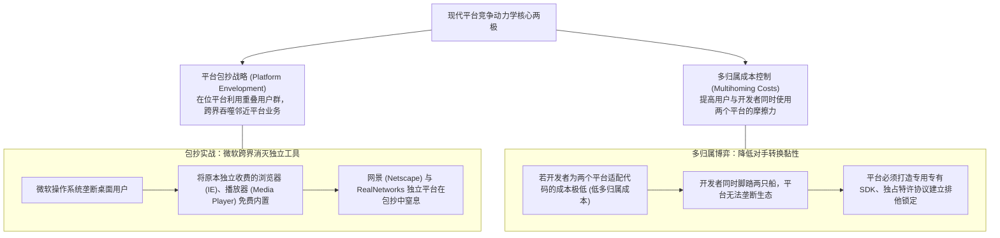

# Lec 11 软件商业未来演进全景复盘：多边平台网络效应与战略总结 (Future of Software Business & Strategic Synthesis)

> 授课教师：Prof. Michael A. Cusumano · MIT Sloan School of Management

## TL;DR

- 双边与多边平台网络效应是数字经济时代最核心的价值生成引擎。
- 平台包抄（Platform Envelopment）与多归属成本（Multihoming Costs）决定了寡头竞争态势。
- 梳理库苏马诺软件战略全景：产品、服务、架构与生态治理的动态统一。
- 技术管理者必须建立跨周期的战略直觉，持续审视软件企业的护城河健康度。

## 平台即帝国：软件商业的终极形态

纵观过去数十年的全球商业演进史，人类历史上从未有一类企业能够像现代数字平台巨头一样，在极短时间内聚合如此庞大的经济体量与全球影响力。从微软 Windows、苹果 App Store，到谷歌安卓、亚马逊电商与腾讯微信，全球市值最高的跨国科技巨头，其底层商业核心无一例外都是**多边平台（Multi-Sided Platforms, MSPs）**。

在学期压轴讲次中，迈克尔·库苏马诺教授带领全班跳出具体的编码规范与单点营销战术，站在全球科技产业生态的最高维度，系统串联全学期讲授的战略构件，解构平台网络效应的深层微观经济学机制，并为软件创业者与管理者确立一套穿越技术周期的战略决策罗盘。

::: definition 双边/多边网络效应 (Two-Sided / Multi-Sided Network Effects)
当一个平台对于某一类参与者群体（如买家或手机用户）的价值，高度取决于该平台所吸引的另一类完全不同参与者群体（如卖家或独立 App 开发者）的规模与活跃度时，所产生的一种跨群体的自我强化正向反馈机制。
:::

## 平台竞争的深层动力学：包抄战略与多归属成本

在平台之间的终极争霸战中，库苏马诺与托马斯·艾斯曼（Thomas Eisenmann）系统总结了两大决定生态生死的微观经济学杠杆：

### 1. 平台包抄（Platform Envelopment）
当一个处于统治地位的超级平台，发现某个邻近细分赛道诞生了一个极具前途的独立应用时，超级平台可以利用其与该应用高度重合的庞大用户基础，通过将类似功能直接打包内置、甚至免费赠送的方式，对独立应用发起致命包抄。微软当年消灭网景浏览器、苹果推出“查找（Find My）”功能直接重创智能防丢器 Tile，都是平台包抄的经典案例。

### 2. 多归属成本（Multihoming Costs）
如果用户或开发者同时在两个竞争平台上活跃的成本非常低（例如：既用打车软件 A、又用打车软件 B），两个平台就会陷入旷日持久的价格战与补贴战；只有当平台能够通过专有数据格式、专属特许协议或独特的硬件绑定，大幅抬高用户的多归属成本时，赢家通吃的垄断格局才会最终锁定。

## 15.358 全课程战略知识体系全景大闭环

在学期终结之际，库苏马诺教授将全学期的十一讲内容系统收敛为一张软件商业战略全景决策矩阵：

| 战略模块 | 核心理论模型与关键概念 | 软件技术领袖的终身心法与行动法则 |
| :--- | :--- | :--- |
| **战略定位与商业形态** (Lec 01 - 03) | - 软件经营杠杆与零边际成本 - 产品型 vs 服务型终极分野 - 1969 软硬件解绑与商业模式演进 | 绝不用服务型外包代码去包装产品型估值；从定制大项目中敏锐抽象 80% 通用标准化资产；深刻理解底层计算范式迁移 |
| **工程交付与研发管理** (Lec 04 - 05) | - 微软 Synch-and-Split 每日构建 - 布鲁克斯“没有银弹”本质困难 - 敏捷冲刺与技术债务量化治理 | 质量是架构设计出来的，不是测试出来的；给延期项目加人只会更延期；制度化预留 20% 工时持续偿还技术债务 |
| **市场化与全球生态** (Lec 06 - 09) | - 企业级 CRM 销售漏斗与采购委员会 - 杰弗里·摩尔跨越鸿沟保龄球战术 - 开源红帽订阅与双重许可模型 - 离岸外包软件工厂与隐性成本冰山 | 企业级大单靠解决商业投资回报率（ROI）而非炫技；集中全部兵力打穿首个垂直细分市场；开源是获客渠道而非免费施舍 |
| **云原生与平台战略** (Lec 10 - 11) | - 多租户云原生多维经济学 (CAC/LTV/NRR) - 传统软件转型吞鱼模型 (The Fish Model) - 多边网络效应、平台领导力与包抄 | 依靠 NRR 构筑老客户滚雪球复利；勇敢承受云转型初期的鱼腹低谷；克制自研边界，让互补开发者在你的平台上赚钱 |

::: insight
“代码会过时，协议会被替代，但对人性和商业规律的洞察永存”。一位平庸的技术主管只能看懂代码逻辑与系统架构，而一位真正卓越的软件战略家能够透过数百万行代码，看清底层的资本流向、客户采购心理博弈、开发者社区的荣誉驱动力以及跨国团队的组织张力。软件商业不是冰冷的算法世界，它是人类智慧、野心与生态协作在数字维度交织出的最壮丽的交响乐。
:::

## 软件创业者的终身战略健康度检查清单

在未来的商业化征途上，请定期审视企业的战略罗盘：
1. **产品与服务纯洁度审计**：在当前公司的总收入中，不可复用的定制外包开发工时占比是否被严格控制在 20% 以下？
2. **裂谷跨越进度评估**：我们是在少数科技尝鲜者的赞美声中自我陶醉，还是已经在某一个主流垂直行业拿下了压倒性的第一品牌心智？
3. **技术债务安全红线**：线上系统的发布周期是否正在变长？核心团队是否有足够的勇气与时间对脆弱的陈旧模块进行大手术？
4. **生态伙伴的赚钱效应**：在围绕我们产品构建的生态网络中，第三方开发者和集成商是否赚到了比我们更多的利润？
5. **云端指标健康度**：我们的净金额留存率（NRR）是否坚挺在 115% 以上？获客成本（CAC）能否在 12 个月内完全收回？

::: pitfall
不要盲目崇拜“技术先进性”！在软件商业史上，死在沙滩上的技术先驱不计其数。技术领先只能为你争取到 6 到 12 个月的先发窗口期，如果没有在窗口期内迅速建立起销售管道、渠道网络、开发者互补生态以及高转换成本壁垒，后发而至的商业巨头可以用资金和渠道优势在瞬间将你的技术优势碾压殆尽。
:::
