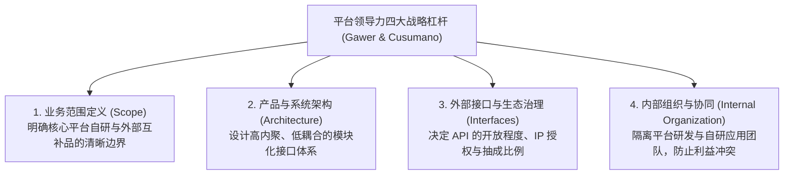

# Lec 02 产品化、服务化权衡与平台领导力构建 (Product vs. Service Trade-offs & Platform Leadership)

> 授课教师：Prof. Michael A. Cusumano · MIT Sloan School of Management

## TL;DR

- 软件企业在产品标准化与客户定制化之间面临深层的战略张力。
- 卡尔·夏皮罗与哈尔·瓦里安揭示了技术标准之战的七大关键资产。
- 平台领导力四要素：范围定义、模块化架构、接口开放性与内部组织协同。
- 成功跨越技术采纳裂谷需要建立完整的“整体产品（Whole Product）”。

## 软件战略的永恒张力：标准化产品 vs 定制化服务

在软件创业的实践中，创始人每天都会面临来自销售一线的巨大诱惑：一家财富 500 强大客户表示，只要你们愿意在产品中增加一套专门符合其财务流程的专有模块，他们立即签下一张 300 万美元的合同。对于资金紧张的初创公司而言，这笔钱足以让团队多活一年。

然而，迈克尔·库苏马诺教授指出：**这往往是软件公司走向平庸与死亡的糖衣毒药**。一旦企业接受了这种定制，核心研发团队就会被锁死在为特定大客户排查私有代码的泥潭中。版本控制被彻底打乱，标准化版本更新停滞，原本有望成为行业通用标准的软件产品，退化为无法复用的大客户私有系统。

::: definition 平台领导力 (Platform Leadership)
由安娜贝尔·高尔（Annabelle Gawer）与迈克尔·库苏马诺提出的战略理论：一家企业通过开放自身底层核心技术的应用编程接口（API）与架构规范，激励并协调庞大的外部第三方开发者（互补者 Complementors）围绕该核心进行持续创新，从而确立行业事实标准并主导整个商业生态的战略能力。
:::

## 平台领导力的四大关键杠杆

库苏马诺与高尔在对英特尔（Intel）、微软（Microsoft）与思科（Cisco）的长期实证追踪中，提炼出构建平台领导力的四大支柱杠杆：

### 1. 业务范围（Scope）：不要吃掉所有蛋糕
平台所有者必须极其克制。如果平台厂商看到第三方开发者做出一个赚钱的插件就亲自下场抄袭并将其内置于操作系统，第三方开发者就会感到唇亡齿寒并撤出生态。平台所有者必须向生态释放长期明确的信号：我们只做底层基础设施，高价值的应用空间永远留给生态伙伴。

### 2. 系统架构（Architecture）与接口（Interfaces）
架构决定了生态的创新门槛。优秀的平台拥有严密的模块化分层与极其稳定、文档详尽的公共接口（Public APIs）。第三方开发者无需了解操作系统底层的数千万行汇编代码，只需调用几个简洁的函数库即可实现复杂功能。

## 标准之战：夏皮罗与瓦里安的七大决胜资产

加州大学伯克利分校信息经济学大师卡尔·夏皮罗（Carl Shapiro）与哈尔·瓦里安（Hal Varian）在《标准之战的艺术》（The Art of Standards Wars）中指出，高科技标准竞争并非纯粹的技术性能较量，而是综合商业资产的立体博弈：

| 决胜关键资产 | 核心战略内涵与操作要点 | 经典商业实战案例 |
| :--- | :--- | :--- |
| **已安装客户群 (Installed Base)** | 已经在使用旧标准的庞大用户基数，带来巨大的转换成本壁垒 | 微软 Windows 凭借数亿存量 PC 用户，轻松将浏览器捆绑推向主流 |
| **知识产权控制力 (IP Rights)** | 拥有核心协议底层的专利与版权，迫使竞争对手无法直接克隆 | 高通（Qualcomm）在 CDMA 无线通信专利上的绝对控制权 |
| **创新与工程能力 (Innovation Ability)** | 持续迭代升级、将标准性能推向极限的顶尖研发团队 | 英特尔每 18 个月将微处理器晶体管翻倍的摩尔定律研发纪律 |
| **首发先发优势 (First-Mover Advantage)** | 抢在所有竞争对手之前确立市场认知共识与互补品网络 | 索尼 PlayStation 抢先于任天堂推出 3D CD-ROM 光盘主机生态 |
| **互补品制造能力 (Manufacturing Capabilities)** | 低成本、高质量、大规模交付关键关联硬件与服务的能力 | 松下与 JVC 在 VHS 录像机制造上的成本压制，击败索尼 Betamax |
| **品牌与行业声誉 (Brand & Reputation)** | 在企业级 CIO 心中建立“采用该标准绝不会被解雇”的信用背书 | IBM 在大型机时代的图腾地位：“没有人因为买 IBM 而被开除” |
| **战略联盟聚合力 (Strategic Alliances)** | 组建跨界联盟阵营、制定统一行业事实标准的号召力 | 谷歌牵头成立“开放手机联盟（OHA）”，联合全球运营商力挺安卓 |

::: insight
在标准之战中，**“期望管理（Expectations Management）”往往超越技术现实本身**。网络效应的核心法则是：人们选择某项标准，往往不是因为该标准今天最好，而是因为人们“预期”该标准未来会成为行业主流。如果一家企业能通过高调的市场公关、重量级战略联盟签署与权威背书，在全行业心中植入“赢局已定”的心理共识，这个预期就会自我实现。
:::

## 跨越裂谷：从尝鲜者到主流实用主义者

杰弗里·摩尔（Geoffrey Moore）在《跨越鸿沟》（Crossing the Chasm）中指出，高科技软件产品在生命周期中会遭遇一道致命的裂谷：早期尝鲜者（Visionaries）热爱探索新技术瑕疵，而主流实用主义者（Pragmatists）只看重成熟稳定、开箱即用的解决方案。

为了跨越裂谷，软件企业必须构建**“完整产品（The Whole Product）”**：不仅包括核心代码，还必须配备完备的第三方硬件驱动、系统集成商服务、合规审计认证以及全天候售后支持网络。

::: pitfall
切忌在标准未成型时搞“闭门造车式的不兼容”。许多技术工程师出于自尊心，总想发明一套与全行业完全隔离的专有数据格式或通信协议。在强网络效应的市场中，自我封闭等于自掘坟墓。降低外部系统与自身平台的互通壁垒，才是做大生态蛋糕的唯一正道。
:::
