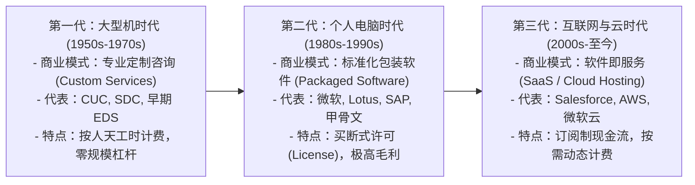
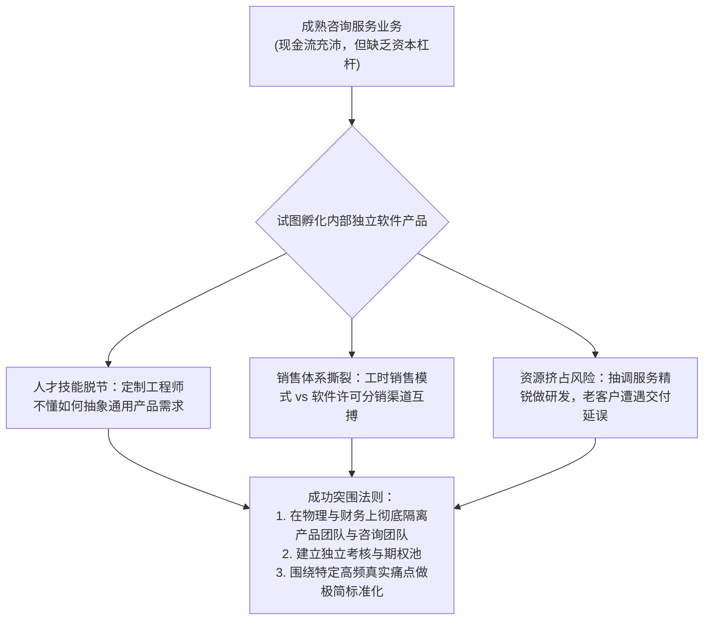

# Lec 03 软件产业商业模式演进史：从定制服务到包装软件 (The Evolution of Software as a Business)

> 授课教师：Prof. Michael A. Cusumano · MIT Sloan School of Management

## TL;DR

- 二战后软件产业经历了从硬件捆绑附赠到独立商业化产品的历史巨变。
- 1969 年 IBM 反垄断调查促成的软硬件解绑（Unbundling）催生了独立软件产业。
- NetNumina 案例揭示了离岸开发与专业咨询向高毛利软件转型的真实阵痛。
- 理解历史演进规律有助于预判当前云原生与 AI 时代的商业模式重构。

## 软件商业的历史创世纪：从免费赠品到价值核心

在 1950 年代至 1960 年代初的计算机发展早期，商业世界并不存在所谓的“软件产业”。计算机是由 IBM、UNIVAC 等硬件巨头制造的重达数吨的庞大机柜，其售价高达数百万美元。在当时的商业模式中，客户购买或租赁的是纯粹的物理硬件；而打孔纸带、汇编指令与基础操作系统代码，仅仅被视作促成硬件正常运转的免费“赠品（Giveaways）”。

这种将软件作为硬件附属品的模式，严重压抑了代码的独立经济价值。直到 1969 年发生了一场改写全球技术产业格局的历史性转折事件——**IBM 软硬件大解绑（The IBM Unbundling Decision）**。

::: definition 1969 年 IBM 软硬件解绑 (The 1969 IBM Unbundling)
面对美国司法部旷日持久的反垄断诉讼压力，IBM 于 1969 年 6 月正式宣布：将其生产的大型机硬件、基础软件与系统工程服务进行独立定价与单独销售。这一历史性决定打破了硬件巨头对代码分发的绝对垄断，正式拉开了全球独立软件开发商（Independent Software Vendors, ISVs）蓬勃崛起的序幕。
:::

## 软件商业模式的三次历史大跃迁

库苏马诺教授与马丁·坎贝尔-凯利（Martin Campbell-Kelly）在《软件产业简史》中，将过去半个多世纪的软件商业模式演进归纳为三大代际跃迁：

### 1. 第一代：定制软件服务（Custom Development）
早期的软件企业（如计算机应用公司 CUC）本质上是高级软件外包公司。每个客户的需求完全异质化，工程师需要进入现场为特定企业的大型机手写每一行代码。此时的软件企业没有任何规模经济，营收与员工人数严格呈 1:1 线性增长。

### 2. 第二代：包装软件（Packaged Software）的黄金时代
随着 1980 年代 IBM PC 的普及与微处理器架构的标准化，个人电脑软件迎来了爆发。以微软件 DOS/Windows、Lotus 1-2-3 电子表格、dBase 数据库与 WordPerfect 文字处理为代表的“盒装软件（Packaged Software）”席卷全球。软件被刻录在软盘或光盘中，摆放在零售店货架上销售。边际成本彻底归零，软件产业诞生了人类商业史上最惊人的财富暴增神话。

### 3. 第三代：云端托管与 SaaS 的到来
进入新千年后，网络宽带的普及终结了盒装软件时代。客户不再愿意每三年耗费巨资购买一次充满 Bug 的全新光盘，软件演化为在远程数据中心 7x24 小时运行的在线服务。

## 经典案例诊断：NetNumina 从外包向产品的惊险转型

麻省理工学院本讲特邀创业家伊姆兰·萨伊德（Imran Sayeed）深度复盘了其联合创立的科技企业 **NetNumina Solutions** 的真实转型阵痛。

### 1. 外包咨询的舒适区
NetNumina 起家于高端分布式金融系统集成服务。凭借麻省理工背景的顶尖架构师团队，他们为华尔街顶级投行提供复杂交易系统的定制开发，年营收迅速突破数千万美元，现金流极其充沛。

### 2. 跨越产品化鸿沟的血泪教训

从定制外包向独立软件产品转型的过程，被软件产业界普遍称为“惊险的一跃”。在咨询外包模式下，客户为每一个工时直接买单，企业几乎不需要承担产品研发失败的沉没成本风险；而一旦转向纯产品研发，企业必须自筹重金在没有任何收入保障的前提下进行长达数年的封闭研发。

更残酷的挑战在于组织心智的冲突。咨询顾问的职业习惯是“客户永远是对的，客户要什么我们就做什么”；而优秀软件产品经理的职业准则是“哪怕客户想要一匹更快的马，我也要给他造一辆汽车”。如果不能在组织内部彻底剥离这两种截然相反的文化与激励体系，混合作战的下场往往是全盘皆输。
管理层渴望享受资本市场对“高科技软件产品公司”的高估值溢价，决定从咨询利润中抽调重金，研发一套通用的企业应用集成（EAI）中间件产品：
- **文化排异反应**：原本习惯于向大客户点头哈腰、言听计从的项目经理，无法胜任严苛梳理通用功能的产品经理角色；
- **销售渠道冲突**：外包业务依赖资深合伙人的人脉关系型直销，而产品销售需要建立覆盖全美渠道分销网络的代理商体系，两套激励机制严重互搏；
- **资金链承压**：产品研发周期一再拖延，而主力咨询顾问由于被抽调去攻关核心软件，导致老客户服务质量滑坡，公司险些陷入双线崩溃。

::: insight
许多外包咨询公司之所以无法转型为软件产品巨头，不是因为工程师技术不行，而是患上了“现金流成瘾症”。当产品研发遭遇瓶颈、账上资金吃紧时，管理层本能的反应就是把最顶尖的核心架构师再次派去给大客户做外包写私有代码，以赚取眼前的快钱救急。这种对短期现金流的路径依赖，使得团队永远无法积累出足够纯粹、高内聚的通用软件内核。
:::

## 软件商业演进的深层经济学启示

回顾半个世纪的软件商业史，可以提炼出贯穿各代际的三大铁律：
1. **硬件永远商品化（Commoditization），软件持续吞噬价值**：历史上每一次硬件计算性能的大幅降价，都带来了软件复杂度的指数级飞跃。谁掌握了顶层代码与用户数据接口，谁就掌握了全产业链的最高利润定价权。
2. **定制服务永远是通用软件的“先锋侦察兵”**：没有横空出世的通用产品。几乎所有伟大的企业级软件（从 SAP 的 ERP 到甲骨文的数据库），最初都脱胎于为特定工业巨头解决具体问题的高端定制服务。关键在于管理层能否从数十个定制项目中敏锐抽象出 80% 的通用痛点。
3. **交付介质的改变必然重构商业契约**：从软盘、光盘、网络下载再到云端 API 订阅，每一次软件交付形态的跃迁，都彻底颠覆了销售佣金、实施周期与客户生命周期价值（LTV）的计算模型。

::: pitfall
不要把“客户在定制项目中提出的每一个需求”都写进通用产品里！产品经理的核心天职是说“不”。如果在产品迭代中对大客户的个性化诉求有求必应，你的产品很快就会退化为一个臃肿不堪、到处都是配置开关的科学怪人，最终被小巧敏捷的竞品轻易击败。
:::
