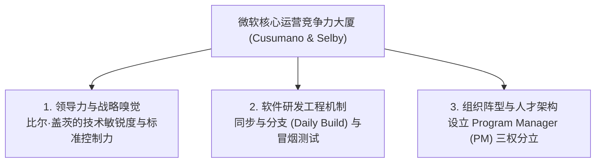

# Lec 04 微软案例研究：比尔·盖茨的战略、管理哲学与标准之战 (Microsoft Strategy, Management & Organization)

> 授课教师：Prof. Michael A. Cusumano · MIT Sloan School of Management

## TL;DR

- 库苏马诺与塞尔比经典著作《微软秘密》深度解构了全球软件霸主的运营内核。
- 比尔·盖茨的技术洞察力与对行业技术标准的严苛掌控构成垄断护城河。
- “同步与分支（Sync-and-Split）”与“每日构建（Daily Build）”重塑了软件工程规范。
- 功能专员（Program Manager）制度成功搭建了纯商业与纯技术之间的转译桥梁。

## 商业帝国的解构：微软为什么能成为世界霸主？

在 1990 年代，微软公司（Microsoft）在全球商业界享有着神话般的统治地位：其旗舰操作系统 Windows 占据了全球 90% 以上的桌面 PC 市场，办公套件 Office 几乎垄断了全人类的文书与电子表格处理，市值常年高居全球第一，其创始人比尔·盖茨更是稳坐世界首富宝座数十年。

外部公众往往将微软的成功简单归结为“垄断运气”或“冷酷的商业并购手腕”。然而，麻省理工学院迈克尔·库苏马诺教授与理查德·塞尔比（Richard W. Selby）在深入微软雷德蒙德总部历时数年、对数百位核心高管与程序员进行深度调研后完成的里程碑著作《微软秘密》（Microsoft Secrets），揭示了这一奇迹背后的工程与组织管理真相：**微软之所以能够所向披靡，核心在于其在战略愿景、软件工程方法论与组织架构设计上建立了一套超越时代的精密机器**。

::: definition 同步与分支流程 (Synch-and-Split Process)
微软首创的软件工程开发范式：在大型复杂项目（如 Windows 或 Office）研发中，允许数十个并行子团队在不同模块上自由编写代码（分支 Split），但强制要求全体工程师每天下午必须将代码提交至中心分支，并在午夜统一进行系统级的代码全编译与自动化测试（同步 Synch），确保庞大系统随时保持可运行状态。
:::

## 微软秘密：三大组织与工程核心法宝

库苏马诺与塞尔比在研究中将微软的运营优势解构为三大支柱系统：

### 1. 比尔·盖茨的领导力：技术智商与商业无情的合璧
盖茨本人是顶尖的底层程序员（曾亲自手写 Altair BASIC 解释器），但他同时拥有极其冷酷的商业战略嗅觉。在每季度的产品技术评审会议（Think Week 与 Review）上，盖茨能够直接看穿复杂架构中潜在的性能瓶颈与商业威胁，痛斥平庸概念。更关键的是，盖茨死死咬住“控制行业事实标准”的咽喉，通过低价乃至免费捆绑策略，先后在 PC 操作系统、网络协议与办公套件中将对手斩尽杀绝。

### 2. 每日构建（Daily Build）与冒烟测试（Smoke Test）
在微软之前，传统软件工程普遍采用僵化的瀑布流模型：需求分析半年、架构设计半年、写代码一年、最后留半年时间集中联调找 Bug。结果往往在最后联调阶段发现数百个底层接口根本互不兼容，导致项目无休止延期甚至胎死腹中。
- 微软确立了雷打不动的“每日构建铁律”：每晚午夜，构建服务器自动拉取当天全部代码进行端到端编译；
- 自动化运行核心冒烟测试用例；如果某位程序员提交的代码导致构建失败（Break the Build），该程序员的大头照会被挂在部门走廊，并被强制要求通宵修复，直至系统恢复绿灯。

### 3. 程序经理（Program Manager, PM）制度的开创
在传统的软件公司中，往往由纯工程师直接与销售人员对话，双方由于专业术语鸿沟经常爆发激烈冲突。微软开创了现代科技产业标志性的**“程序经理（Program Manager, 即今日的产品经理原型）”**制度：
- PM 必须懂底层技术架构，但其核心职责是撰写详细的“功能规格说明书（Functional Specification）”，站在用户体验与商业目标角度定义产品；
- 形成著名的“黄金三权分立”：**PM（定义做什么）、Dev（工程实现怎么做）、QA（严苛把关质量能否上线）**，三者相互牵制、高效咬合。

## 微软多维竞争力对照分析

通过对微软黄金时代运营体系的复盘，可以清晰看到其对抗传统软件作坊的降维优势：

| 组织管理维度 | 传统软件企业的陈旧做法 | 微软雷德蒙德的标准化实践 | 带来的决定性优势 |
| :--- | :--- | :--- | :--- |
| **代码集成节奏** | 项目最后阶段才进行“大爆炸式（Big Bang）”集中集成 | 每日午夜全自动编译与冒烟测试（Daily Build） | 缺陷在 24 小时内被迅速定位并扑灭，系统始终可运行 |
| **产品与技术桥梁** | 销售直接向程序员提口头需求，需求边界随意变动 | 专职 PM 撰写严格的功能规格书，建立需求冻结基线 | 消除功能蔓延，大幅提升跨职能协作确定性 |
| **人才招募标准** | 招募具备特定语言死记硬背经验的熟练工 | 招募智商极高、具备极强算法思维与抗压能力的通才 | 能够随技术风口极速自学并重构底层系统 |
| **对待竞争对手** | 单纯追求技术参数的理论优雅与学院派纯粹 | 战略性牺牲部分纯洁度，换取向后绝对兼容与生态规模 | 锁死庞大商业客户，构筑坚不可摧的转换壁垒 |

::: insight
许多人认为代码质量是由测试工程师（QA）测出来的。微软工程哲学的最大贡献在于确立了：**质量是架构设计出来的，不是测试出来的**。通过把复杂系统拆解为独立的模块单元，并强制推行每日构建与代码审查（Code Review），微软证明了即使是上千人共同开发拥有数千万行代码的巨型操作系统，依然可以保持令人惊叹的工业化流水线节奏。
:::

## 微软标准竞争的治理阴暗面与反思

虽然微软的战略战术取得了商业上的绝对垄断，但也为其带来了巨大的历史代价：
- **反垄断诉讼风暴**：1998 年美国司法部与 20 个州联合起诉微软在 Windows 中恶意捆绑 IE 浏览器、非法滥用垄断地位扼杀网景（Netscape Navigator）。这场诉讼险些导致微软被肢解为两家独立公司，严重牵扯了高层精力长达数年；
- **中年危机与内部政治帝国化**：进入 2000 年代后，随着组织规模膨胀至数万人，各事业部（Windows 部门 vs Office 部门）各自为政、互相拆台，导致微软错失了互联网搜索、智能手机与社交网络的关键风口。

::: pitfall
不要以为拥有强大的垄断地位就可以为所欲为。技术霸主最致命的毒药就是“自负与路径依赖”。当微软将全部战略重心放在保卫 Windows 桌面操作系统的垄断地位时，底层的计算范式已经在悄然向开放的移动互联网与云端协议转移。敬畏技术周期，是每一位商业领袖永恒的必修课。
:::
