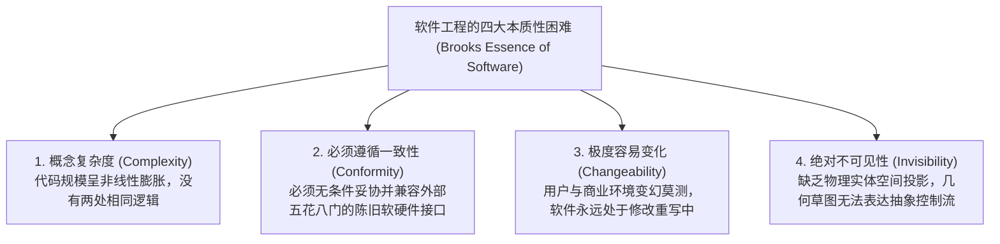
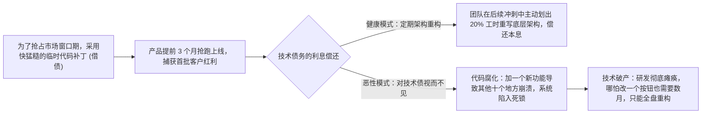

# Lec 05 软件研发管理工程实践：从瀑布流到敏捷迭代与每日构建 (Managing Software Development: Basic Issues and Best Practices)

> 授课教师：Prof. Michael A. Cusumano · MIT Sloan School of Management

## TL;DR

- 弗雷德里克·布鲁克斯经典论断揭示：软件工程不存在解决生产力的“没有银弹”。",
- 软件系统天生具备概念复杂度（Complexity）、一致性、可变性与不可见性四重本质特征。
- 瀑布流模型在应对需求高度不确定性时的结构性崩溃与敏捷冲刺崛起。
- 技术债务（Technical Debt）的量化管理与架构重构策略是保证可持续交付的关键。

## 软件开发的永恒困局：为什么大型软件项目总会延期？

在所有人类工程学门类中，没有哪一个领域像软件工程一样充斥着如此广泛而普遍的项目灾难。根据行业权威统计机构 Standish Group 著名的《混沌报告》（CHAOS Report），在过去数十年间，全球超过 70% 的大型软件项目遭遇了严重的预算超支、严重延误上线甚至最终被彻底取消废弃。

图灵奖得主、IBM 大型机操作系统之父**弗雷德里克·布鲁克斯（Frederick P. Brooks）**在计算机科学里程碑论文《没有银弹：软件工程的本质性与附属性工作》（No Silver Bullet: Essence and Accidents of Software Engineering）中，给出了最深刻的哲学解答：软件开发之所以如此艰难，并不是因为程序员不够聪明，也不是因为编程语言不够先进，而是由软件这项事物的**内在物理与逻辑本质**所决定的。

::: definition 没有银弹论断 (No Silver Bullet Thesis)
在任何一个十年内，没有任何单一的技术发明、编程范式或管理方法（银弹），能够像当年晶体管替代电子管那样，使软件开发的生产力、可靠性与交付速度提升一个数量级（10 倍）。
:::

## 软件内在复杂度的四重本质困境

布鲁克斯将软件开发工作严格区分为“本质性工作（Essence，即构建复杂的概念性思维实体）”与“附属性工作（Accidents，即把思维实体转化为具体的高级语言代码与语法调试）”。附属性困难可以通过更优秀的集成开发环境（IDE）与高阶语言解决，但本质性困难无法消灭：

### 1. 复杂度（Complexity）的几何级暴增
软件不同于汽车或建筑，建筑中成千上万块砖头在结构上是高度重复的。而一个数百万行代码的现代软件系统，没有任何两个函数是完全相同的；随着模块数量的增加，模块之间潜在的状态交互与调用路径呈指数级几何暴增，远远超出了任何单个人类大脑的即时工作记忆容量。

### 2. 容易变化（Changeability）的诅咒
实物大厦在浇筑完混凝土后，没有人会要求建筑师把地下车库瞬间搬到楼顶；但用户和管理层总是轻率地认为：“这不过是改几行代码的事。”这种对代码可塑性的盲目乐观，导致软件在整个生命周期中都在承受着无休止的需求蔓延与架构侵蚀。

## 开发模式大对决：瀑布流 vs 敏捷迭代

为了驯服这头复杂性巨兽，软件工程学在过去四十年间经历了从机械工业式的瀑布流向有机生物式的敏捷迭代的历史大迁移：

| 工程对比维度 | 经典瀑布模型 (Waterfall Model) | 现代敏捷/螺旋迭代 (Agile & Iterative) |
| :--- | :--- | :--- |
| **哲学假设** | 假设用户需求在第一天就能被 100% 穷尽并精准锁定 | 承认需求是不确定的，用户只有看到可运行原型才知道自己要什么 |
| **流程组织形态** | 严格按阶段串行推进：需求 -> 设计 -> 编码 -> 测试 -> 部署 | 2 至 4 周为一个敏捷冲刺（Sprint），每个冲刺交付可工作软件 |
| **变更应对策略** | 严格抵制变更，变更需要经过极其冗长繁琐的审批委员会 | 拥抱变更，通过定期的产品代办列表（Backlog）动态梳理优先级 |
| **风险暴露时间点** | 极度后置；直到项目最后集成阶段才发现致命设计缺陷 | 极度前置；每个冲刺结束时的 Demo 会议即暴露出偏差并迅速纠偏 |

::: insight
布鲁克斯法则（Brooks's Law）指出：“**给已经延期的软件项目增加人手，只会让项目延期更加严重！**”根源在于：新加入的工程师不仅需要老员工耗费大量原本用于写代码的时间进行业务培训与交接，更导致团队内部的人际沟通通道（$N(N-1)/2$）呈平方级激增。当一个软件团队陷入延期泥潭时，盲目往里面塞人无异于往火场里浇汽油。
:::

## 技术债务（Technical Debt）的产生与治理闭环

技术债务就像金融系统中的高利贷：借债本身并不是罪恶，在商业竞争的生死关头，为了抢在竞争对手之前发布 MVP 并锁定核心首发客户，故意采用一些未经重构的硬编码与临时脚本（借入短期技术债）是合理且高效的战术选择。

然而，致命的危险在于管理层缺乏偿还债务的纪律性。当产品成功占领市场后，业务端往往继续催促研发团队“快马加鞭上线更多新特性”，对底层已经千疮百孔的架构视而不见。随着时间的推移，技术债务产生的“利息”会迅速飙升：每一次哪怕修改一个简单的字段，都会导致系统其他不相关模块发生雪崩式的连锁崩溃，最终让整个企业的创新机器彻底停摆。

由敏捷宣言发起人沃德·坎宁安（Ward Cunningham）提出的**技术债务（Technical Debt）**概念，是现代软件研发管理的核心量化抓手：

## 顶尖软件团队工程管理的五大最佳实践

1. **坚持“小步快跑，持续集成（Continuous Integration）”**：坚决消灭长达数周才合并一次的庞大特性分支（Feature Branch）。强制要求开发人员每天向主干集成代码，自动化流水线实时运行单元测试，确保主分支时刻处于随时可发布状态。
2. **设立不可逾越的“Definition of Done（完成定义）”**：代码写完绝不等于交付。一项功能必须同时具备详尽的单元测试覆盖、接口文档更新、安全漏洞扫描通过以及在类生产环境验收跑通，才能被标记为完成。
3. **制度化预留 20% 的“偿债专款”**：在每个开发冲刺周期中，严格封顶业务功能开发工时在 80% 以内，强制留出 20% 的工程带宽专门用于重构陈旧代码、优化数据库查询索引以及升级底层依赖库。

::: pitfall
绝不要试图把软件工程师当成计件流水线工人来考核“代码行数（LOC）”或“关闭的 Bug 数量”。这种愚蠢的指标只会诱导程序员故意把简洁优雅的代码写成冗长繁琐的垃圾代码，或者先自己故意写出几个简单的低级 Bug 再将其关闭以刷高绩效分。对智力劳动的管理，必须回归到对商业交付价值与架构健壮性的整体定性评估。
:::
