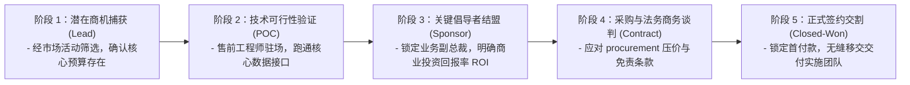

# Lec 06 企业级软件直销与渠道拓展：Siebel 与销售体系演进 (Enterprise Software Sales: Siebel & Go-To-Market)

> 授课教师：Prof. Michael A. Cusumano · MIT Sloan School of Management

## TL;DR

- 企业级软件（B2B）销售周期漫长，涉及复杂的采购委员会与利益博弈。
- 希贝尔系统（Siebel Systems）首创了狼性矩阵式企业级 CRM 大单直销铁军。
- 前 HubSpot 联合创始人布莱恩·哈利根分享软件销售从地推直销向集客营销演化。
- 销售管道（Pipeline）各阶段的转化率漏斗与佣金激励设计是规模化引擎。

## 软件不是造出来的，软件是卖出来的

在技术极客主导的初创公司中，技术人员往往本能地轻视销售与市场营销人员。极客们总有一种浪漫的幻想：“只要我们的代码架构足够优雅、算法性能比竞品快 30%，客户就会自然排着队把支票送上门来。”

然而，迈克尔·库苏马诺教授与特邀演讲嘉宾、前 Groove Networks 销售副总裁（后来创立了著名集客营销 SaaS 巨头 HubSpot）**布莱恩·哈利根（Brian Halligan）**在课堂上向所有未来软件创业者泼了一盆冷水：**在企业级企业级软件（B2B Enterprise Software）市场，平庸的产品加上世界一流的销售铁军，可以轻易打败拥有世界一流技术却缺乏销售能力的企业**。

企业级软件单笔订单金额高达数十万乃至数千万美元，其采购周期长达 6 至 18 个月。企业客户购买的不仅是几张安装光盘，而是一套关乎其核心运营命脉的复杂系统。搞懂企业采购背后的政治学与销售漏斗，是软件商业化成功的生死底牌。

::: definition 企业级采购委员会 (Buying Center / Committee)
在 B2B 软件采购决策中，拍板权从来不是属于某一个人，而是由六种不同的角色构成的复杂利益复合体：**经济决策人（拥有预算权的高管）、实际使用者（一线业务员）、技术评估人（CIO/架构师）、政治把关人（合规与采购部）、倡导者（内线支持者）以及阻碍者（利益受损部门）**。
:::

## 经典案例诊断：托马斯·希贝尔与 Siebel 的百万大单铁军

在 1990 年代末，**希贝尔系统公司（Siebel Systems）**是企业客户关系管理（CRM）软件领域无可争议的绝对霸主。创始人汤姆·希贝尔（Tom Siebel，前甲骨文全明星销售副总裁）打造了一套全美最具攻击性的企业级大单直销机器：

### 1. 穿西装打领带的严苛铁血纪律
在崇尚随性休闲的硅谷，希贝尔反其道而行之：
- 强制要求全员无论天气多热，必须身着深色顶级西装、雪白衬衫打领带；办公室桌面严禁摆放任何杂物；
- 希贝尔向大客户传达一种极端严肃、甚至带有压迫感的高端企业形象：“我们不是在玩极客玩具，我们是在重塑你们全球的销售命脉。”

### 2. 销售管道（Pipeline）的精密数学管理

在科学化的 B2B 软件销售管理体系中，销售预测绝不是销售代表拍脑袋给出的乐观估计。每一个阶段的商机推进，都必须对应客观、可验证的客户行为标志（Customer Actions），而非销售代表的主观愿望。

例如，客户口头说“非常感兴趣”毫无意义；只有当客户正式指派专职 IT 工程师协同对接测试数据接口（POC），商机才能被推进至第二阶段；只有当客户业务副总裁出面主持商业可行性论证会，商机才能被标记为第三阶段。通过严密的漏斗转化率历史统计，高管团队才能在季度初精确预测出季度末的可落袋回款金额。
希贝尔将软件销售彻底转变为一门可被精密预测的统计学科学：
- 销售副总裁绝不接受模糊的“这个单子感觉不错”的汇报；
- 每一个商机必须被严格归类于管道漏斗的明确阶段，并匹配严格的量化推进指标：

### 3. “赢家通吃、输家出局”的极端佣金激励
在希贝尔，顶级销售代表的年收入可以轻松突破百万美元，甚至超过硅谷多数公司的 CEO。但与此同时，公司推行冷酷的末位淘汰制：连续两个季度无法达成配额（Quota）的销售代表，其客户资源会被瞬间瓜分并被无情解雇。

## B2B 软件销售的关键组织机制对照

结合现代软件销售的演进，企业级直销与现代数字化集客销售存在鲜明的战略取舍：

| 销售组织维度 | 传统企业级直销铁军 (如 早期 Siebel/Oracle) | 现代集客与产品驱动增长 (PLG / Inbound) |
| :--- | :--- | :--- |
| **客单价与毛利空间** | 极高（单笔 50 万至 1,000 万美元以上的大型 License） | 中低客单价（每月数百至数千美元的席位订阅费） |
| **获客渠道策略** | 高管关系网络引荐、高规格私人高尔夫宴请、冷门扫楼地推 | 优质内容营销、SEO 流量自然沉淀、免费试用（Freemium）病毒自裂变 |
| **售前技术支持 (SE)** | 派遣资深架构师团队常驻客户现场进行定制化原型概念验证 | 依靠详尽的在线交互文档、沙箱环境与开发者社区自主调试 |
| **部署与上线摩擦** | 极重；需要长达半年的外部专业咨询团队驻场实施 | 极轻；云端即开即用，几分钟内完成信用卡绑定与快速配置 |

::: insight
在企业级软件销售中，许多销售代表最常犯的致命错误就是“盲目把精力耗费在没有最终预算拍板权的基层使用者身上”。一线员工可能非常喜欢你的软件界面，但他们根本没有审批预算的权力；而真正签支票的首席财务官（CFO）根本不关心软件界面有多好看，他唯一关心的是：“花这 200 万买你的系统，在接下来的 18 个月内究竟能帮我削减多少运营成本或提升多少净利润？”
:::

## 打造高转化企业级销售体系的四大行动法则

1. **建立严谨的“理想客户画像（ICP, Ideal Customer Profile）”**：明确界定哪些客户是你的核心甜区（企业规模、行业属性、技术栈、年营收），坚决不让销售代表在不符合标准的劣质潜在客户身上浪费宝贵的时间与差旅预算。
2. **提炼“可被量化的商业价值论证（Value Proposition & ROI）”**：为销售团队准备标准化投资回报率计算模板。用客户能听懂的财务语言（如每单处理成本降低 35%、回款周期缩短 12 天），清晰证明买你的软件是一笔高回报投资。
3. **推行“猎犬（Hunter）与农夫（Farmer）”的分工架构**：不要让同一个销售人员既负责打下新客户，又负责老客户的日常维护续费。设立专门开拓新疆域的业务拓展代表（BDR/AE），与专门负责老客户深化与增购的客户成功经理（CSM），分别考核。

::: pitfall
绝不要为了在季度末冲刺销售业绩，而向大客户做出“当前软件根本无法实现的功能承诺”！平庸的销售为了拿提成，往往在合同附件中随意答应客户的各种定制要求，把灾难甩给后台研发与交付团队。这种合同虽然签得痛快，但在后续交付时必将引发客户愤怒拒付与长期诉讼，彻底摧毁企业的市场声誉。
:::
